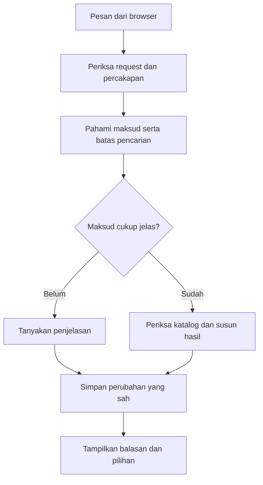
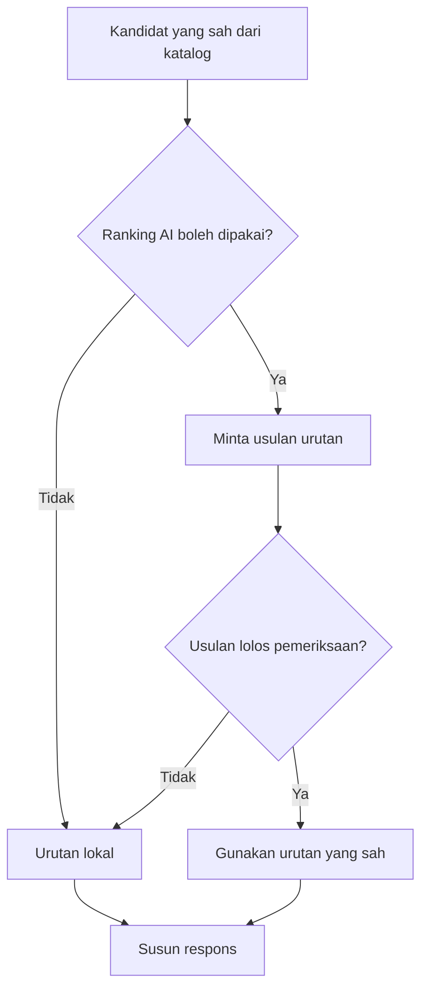

# Memahami Sistem Chatbot RasaKita

Panduan belajar untuk anggota tim. Kita mulai dari hal yang dilihat pelanggan,
lalu menelusuri pekerjaan di belakangnya. Penjelasan mengikuti implementasi
branch `ahmad`; konfigurasi lokal setiap laptop dapat berbeda.

Jika baru belajar class dan object, baca [modul OOP](oop/README.md) terlebih
dahulu. Untuk instalasi web, ikuti [README proyek](../README.md).

Istilah yang akan muncul: **request** adalah permintaan browser; **view** bagian
yang menerimanya; **provider** layanan AI luar; **JSON** bentuk data terstruktur;
**scope** cakupan pemakaian batas; **CSRF** pemeriksaan untuk membantu memastikan
permintaan perubahan datang melalui alur browser yang sah. Istilah tersebut
dipakai ketika menunjuk kode, bukan syarat untuk mulai membaca ceritanya.

## Daftar isi

1. [Apa pekerjaan chatbot?](#1-apa-pekerjaan-chatbot)
2. [Mengapa ada bagian lokal dan AI?](#2-mengapa-ada-bagian-lokal-dan-ai)
3. [Perjalanan satu pesan](#3-perjalanan-satu-pesan)
4. [Siapa mengerjakan bagian mana?](#4-siapa-mengerjakan-bagian-mana)
5. [Bagaimana nama menu dan tag dikenali?](#5-bagaimana-nama-menu-dan-tag-dikenali)
6. [Bagaimana budget dipahami?](#6-bagaimana-budget-dipahami)
7. [Apa yang diingat dari percakapan?](#7-apa-yang-diingat-dari-percakapan)
8. [Bagaimana menu dipilih dan diurutkan?](#8-bagaimana-menu-dipilih-dan-diurutkan)
9. [Apa tepatnya peran Gemini?](#9-apa-tepatnya-peran-gemini)
10. [Dari hasil pencarian menjadi kalimat](#10-dari-hasil-pencarian-menjadi-kalimat)
11. [Dari kartu menu menjadi pesanan](#11-dari-kartu-menu-menjadi-pesanan)
12. [Mengapa ada batas penggunaan dan pemeriksaan keamanan?](#12-mengapa-ada-batas-penggunaan-dan-pemeriksaan-keamanan)
13. [Memahami catatan proses](#13-memahami-catatan-proses)
14. [Contoh percakapan untuk dipelajari](#14-contoh-percakapan-untuk-dipelajari)
15. [Keterbatasan dan urutan membaca kode](#15-keterbatasan-dan-urutan-membaca-kode)

## 1. Apa pekerjaan chatbot?

Pelanggan dapat mengatakan `minuman maksimal 10 ribu` daripada mengisi beberapa
filter sendiri. Chatbot membantu menerjemahkan kalimat itu menjadi kebutuhan
pencarian, lalu menunjukkan menu yang tersedia pada katalog.

Bayangkan pelayan yang mempunyai catatan: pelanggan mencari minuman, batasnya
Rp10.000, dan mungkin ingin pilihan lain. Pelayan perlu memahami maksud,
memeriksa daftar menu, lalu menjawab. Ia tidak boleh menciptakan harga atau
mengaku pesanan sudah dibayar hanya karena pelanggan menyebutnya.

Chatbot membantu **memilih**, bukan menggantikan seluruh proses restoran:

- Katalog tetap berasal dari database yang dikelola staf.
- Harga akhir tetap dihitung server berdasarkan pilihan yang sah.
- Varian/tambahan dipilih melalui pilihan menu dan keranjang.
- Pembayaran tetap mengikuti alur pesanan dan kasir.

## 2. Mengapa ada bagian lokal dan AI?

**Lokal** berarti aturan dijalankan oleh kode aplikasi sendiri. Contohnya,
nominal `10k` perlu dibaca sebagai Rp10.000 dan menu tidak tersedia harus
dikeluarkan dari hasil. Itu tidak membutuhkan percakapan bebas dengan AI.

**AI** dapat membantu ketika bahasa lebih samar, misalnya pilihan yang cocok
untuk “nemenin nugas”. Hasil bantuannya tetap perlu dibatasi dan diperiksa.
AI tidak mengambil alih database, aturan harga, atau izin transaksi.

Konsep utama sekarang **AI-first**, mengikuti implementasi tim di `main`.
Ketika Gemini aktif dan tersedia, pesan biasa diproses oleh `GeminiAssistant`
lebih dahulu. AI dapat bertanya atau meminta pencarian melalui fungsi Django.
Jika Gemini nonaktif atau gagal, aturan lokal menjadi jalur cadangan.
Hasil mode lokal tidak mewakili semua kemampuan percakapan AI-first.

| Pertanyaan | Jawaban |
|---|---|
| Apakah SDK terpasang berarti Gemini aktif? | Tidak. Flag, model, key, dan jalur yang dipilih juga menentukan. |
| Apakah chatbot bisa berjalan tanpa key? | Bisa, memakai profil lokal default. |
| Siapa menyusun kalimat saat AI-first aktif? | Gemini; fakta menu diambil melalui fungsi katalog Django. |
| Apakah JSON dari AI otomatis dipakai? | Tidak. Bentuk dan isinya diperiksa dahulu. |

## 3. Perjalanan satu pesan

Ikuti pesan **`minuman maksimal 10 ribu`**:

1. Browser mengirim pesan ke `POST /api/recommendation/chat/` dengan informasi
   sesi/revisi yang dibutuhkan alur percakapan serta CSRF.
2. View memeriksa request dan memuat keadaan percakapan yang benar.
3. `ChatbotService` mencoba `GeminiAssistant` jika tersedia. Gemini membaca pesan dan konteks.
4. Jika membutuhkan fakta menu, Gemini meminta `search_menu` atau `get_menu_details`.
   Django menjalankan fungsi tersebut. Jika AI tidak tersedia, penafsir lokal menangani pesan.
5. Pencarian memeriksa katalog serta syarat yang berlaku. Menu tidak tersedia
   atau yang melanggar batas tidak menjadi kandidat yang sah.
6. Hasil dirangkai menjadi rencana respons, kalimat, tombol, dan kartu menu.
7. Perubahan percakapan disimpan dengan pemeriksaan revisi, lalu browser menampilkan hasil.

Ini ringkasan untuk belajar; beberapa permintaan berhenti lebih awal untuk
bertanya ulang atau memberi informasi tanpa melakukan pencarian menu.

[Buka diagram SVG](diagrams/chatbot-perjalanan-pesan.svg).

Jalur AI yang opsional dijelaskan pada bagian 9. Diagram ini tidak menyatakan
semua pesan selalu melewati provider atau menghasilkan kartu menu.

## 4. Siapa mengerjakan bagian mana?

Jangan membaca seluruh file besar sekaligus. Mulailah dari pekerjaan tiap bagian:

| Bagian | Ibarat di restoran | Lokasi kode |
|---|---|---|
| Halaman chatbot | Tempat pelanggan berbicara dan melihat pilihan | [template chatbot](../recommendation/templates/recommendation/chatbot.html) |
| View | Penerima pesan yang memeriksa bentuk permintaan | [views.py](../recommendation/views.py) |
| `ChatbotService` | Pengatur alur percakapan | [chatbot.py](../recommendation/services/chatbot.py) |
| `GeminiAssistant` | Percakapan AI-first dan permintaan fungsi katalog | [assistant.py](../recommendation/services/ai/assistant.py) |
| `ConversationInterpreter` | Membaca jenis maksud dan perubahan pilihan | [conversation_interpreter.py](../recommendation/services/conversation_interpreter.py) |
| `EntityResolver` | Mencocokkan sebutan dengan identitas menu | [entity_resolver.py](../recommendation/services/entity_resolver.py) |
| `TagExtractor`, bagian mood | Membaca ciri atau suasana yang disebut | [tag_extractor.py](../recommendation/services/tag_extractor.py), [mood_extractor.py](../recommendation/services/mood_extractor.py), [mood_resolver.py](../recommendation/services/mood_resolver.py) |
| Budget dan rencana | Memisahkan harga, jumlah, dan maksud budget | [budget.py](../recommendation/services/budget.py), [plan_interpreter.py](../recommendation/services/plan_interpreter.py) |
| `DecisionRouter` | Menentukan jalur lokal, bantuan AI, atau klarifikasi | [decision_router.py](../recommendation/services/decision_router.py) |
| `RecommendationService` | Memeriksa daftar menu dan mengurutkan hasil | [recommendation.py](../recommendation/services/recommendation.py) |
| `ConversationSession` | Catatan pilihan dan konteks percakapan | [conversation_session.py](../recommendation/services/conversation_session.py) |
| `ConversationStore` | Penjaga penyimpanan/revisi catatan | [conversation_store.py](../recommendation/services/conversation_store.py) |
| `ResponsePlan`, `LocalResponseComposer` | Rencana jawaban dan kalimat lokal | [response_plan.py](../recommendation/services/response_plan.py), [response_composer.py](../recommendation/services/response_composer.py) |
| Adapter dan pembatas AI | Penghubung layanan luar yang dibatasi | [gemini.py](../recommendation/services/gemini.py), [turn_generator.py](../recommendation/services/ai/turn_generator.py), [security.py](../recommendation/services/security.py) |

`DecisionRouter` membuat keputusan; ia bukan bagian yang membuka koneksi Google
sendiri. Pemisahan ini membantu menguji keputusan tanpa memanggil provider.

## 5. Bagaimana nama menu dan tag dikenali?

Nama menu adalah **identitas**. Contohnya, pelanggan menyebut menu tertentu.
Tag adalah **ciri**, misalnya manis atau dingin. Memilih tag dingin tidak sama
dengan memilih satu menu bernama tertentu.

1. Teks dibantu normalisasi melalui [language.py](../recommendation/services/language.py).
2. Penafsir mencari ciri, kategori, nominal, serta maksud kalimat.
3. Pencocokan menu memakai katalog dan alias yang tersedia.
4. Jika lebih dari satu menu sama-sama mungkin, bot dapat meminta penjelasan.

Alias menu berasal dari `MenuItemAlias`; alias tag berbeda, melalui
`MenuTagAlias` dan kosakata ekstraksi. Menambah menu di CMS tidak otomatis
memberikan seluruh tag, bahan, atau alias yang mungkin disebut pelanggan.

### Mengapa tidak cukup mencari satu kata?

Dalam `aku alergi telur, ayam geprek aman?`, telur adalah bahan yang perlu
diperhatikan, sedangkan Ayam Geprek adalah objek pertanyaan. Menganggap semua
kata makanan sebagai pantangan akan mengubah maksud pelanggan. Penafsir perlu
memperhatikan peran kata, bukan sekadar keberadaannya.

Tag juga tidak boleh dipakai untuk menyimpulkan “tidak ada tag telur berarti
menu bebas telur”. Data bahan mungkin belum lengkap; bot tidak bisa menjamin
keamanan alergi hanya dari metadata tersebut.

## 6. Bagaimana budget dipahami?

Ada dua pertanyaan berbeda: **berapa nominalnya** dan **nominal itu untuk apa**.
Rp20.000 per menu berbeda dengan Rp20.000 untuk seluruh rencana pesanan.

| Contoh | Hal yang perlu dipahami |
|---|---|
| `maksimal 10 ribu` | Harga boleh sama dengan batas atas. |
| `di atas 5 ribu` | Harga harus lebih besar dari batas bawah. |
| `antara 5 dan 15 ribu` | Rentang dalam satu pesan, sesuai pembacaan nominal yang sah. |
| `sekitar 20 ribu` | Target perkiraan; jangan otomatis menganggapnya batas keras maksimal Rp20.000. |
| `budget 20 ribu` | Jika scope belum jelas, bisa perlu bertanya total atau per menu. |
| `20 ribu untuk dua porsi` | Jumlah dan scope total perlu diperiksa bersama. |

Contoh percakapan bertahap:

1. Pelanggan: “budget ku 30rb”. Bot menanyakan total pesanan atau batas per menu.
2. Pelanggan: “total ya”. Bot mencatat Rp30.000 sebagai budget seluruh pesanan.
3. Pelanggan: “makanan dan minuman”. Kedua kategori diingat. Bot menanyakan jumlah orang.
4. Pelanggan: “untuk 1 orang”. Bot dapat mencari satu makanan dan satu minuman bersama.
   Untuk beberapa orang, bot menanyakan porsi masing-masing atau berbagi jika belum jelas.

Setelah bot bertanya jumlah orang, pelanggan juga boleh menjawab singkat seperti
“1”, “satu”, atau “sendiri”. Angka singkat dibaca sebagai jumlah orang hanya
dalam konteks pertanyaan tersebut, bukan otomatis dianggap harga atau jumlah menu.

Jawaban dapat menggabungkan informasi, misalnya “total untuk makanan dan minuman
1 orang”. Pengguna tidak harus menjawab dengan satu kata persis. Koreksi nominal
mengikuti cakupan budget yang sudah dikonfirmasi. Jika belum jelas, bot bertanya lagi.
Permintaan dengan jumlah porsi yang sudah lengkap tidak perlu ditanyai ulang.

`BudgetConstraint` mewakili batas harga yang sudah jelas. `BudgetRequest` dan
bagian penafsiran rencana membantu memahami maksud kalimatnya. Method
`intersect` adalah operasi menggabungkan batas yang memang perlu digabung;
keberadaannya tidak berarti setiap dua pesan pelanggan harus digabung menjadi rentang.

### Nominal baru dan kelanjutan konteks

| Urutan pesan | Perilaku yang dituju |
|---|---|
| `maksimal 15 ribu` → `minimal 5 ribu` | Batas baru mengganti rentang lokal sebelumnya; tidak otomatis 5–15 ribu. |
| `minimal 5 ribu maksimal 15 ribu` dalam satu pesan | Menggunakan dua batas yang dinyatakan bersama. |
| `minuman maksimal 10 ribu` → `kalau ayam geprek?` | Membandingkan pilihan dengan budget yang sama. |
| `minuman maksimal 10 ribu` → `sekarang makanan` | Pergantian kategori tanpa penghubung pembandingan tidak otomatis membawa batas minuman. |
| `maksimal 15 ribu` → `sekitar 20 ribu` | Target baru menggantikan batas lokal Rp15.000 sebelumnya. |
| `harga es kelapa berapa?` | Pertanyaan harga tidak otomatis mengganti budget. |

Tabel ini contoh kebijakan percakapan, bukan jaminan setiap variasi kalimat
akan dimengerti. Permintaan samar/bertentangan dapat menghasilkan klarifikasi.
Budget total dan batas keselamatan mempunyai scope berbeda dari filter lokal;
jangan menghapus semua batas hanya karena ada nominal lokal baru.

### Harga kartu dan harga akhir

[`MenuSelection`](../menu/selection.py) menghitung harga minimum yang mencakup
opsi wajib termurah. Ini membantu menilai apakah menu mungkin memenuhi budget.
Pelanggan masih harus memilih opsi sendiri. Tambahan atau opsi lain dapat
menaikkan harga akhir ketika dimasukkan ke keranjang.

## 7. Apa yang diingat dari percakapan?

Bot membutuhkan catatan supaya `yang kedua` atau `cari yang lain` mempunyai
makna. Tetapi tidak semua hal harus dibawa ke pencarian berikutnya.

| Informasi | Contoh kegunaan |
|---|---|
| Pencarian aktif | Kategori dan batas harga saat ini. |
| Fokus/menu yang baru disebut | Menjawab pertanyaan lanjutan tentang menu itu. |
| Pilihan yang sudah ditampilkan/ditolak | Mencari alternatif tanpa terus mengulang menu yang sama. |
| Konteks sebelumnya yang dibatasi | Merujuk kembali pada pencarian yang relevan. |
| Pantangan keselamatan | Tidak diperlakukan sebagai selera yang boleh hilang begitu saja. |
| Rencana dan jumlah | Membaca koreksi pada rencana yang sedang dibahas. |

`ConversationSession` mengelola data tersebut. `ConversationStore` menyimpan
keadaan percakapan tersendiri menggunakan penyimpanan sesi Django dan revisi.
Jadi, “sementara selama sesi” bukan berarti semua catatan hanya berada di RAM
browser. Data dapat mempunyai masa berlaku; kebersihan penyimpanan tetap perlu
diatur operator.

Versi bentuk data percakapan saat ini adalah **schema 6**. Bagi pemula, cukup
pahami sebagai versi susunan catatan, bukan enam tabel chatbot baru.

### Dua tab mengirim pesan bersamaan

Bayangkan tab A dan B membaca catatan versi yang sama. A menyimpan perubahan
lebih dahulu. Jika B langsung menimpa catatan lama, hasil A bisa hilang.
Pemeriksaan revisi mencegah penimpaan tersebut. Request yang kalah dapat menerima
konflik `409`; gangguan penyimpanan dapat menghasilkan `503`.

Ini bukan alasan mereset semua sesi atau menonaktifkan pemeriksaan. Muat dan
periksa keadaan terbaru sebelum mengulang tindakan.

**Mulai Lagi** menghapus konteks dialog untuk memulai percakapan baru. Keranjang
bukan bagian yang ikut dikosongkan oleh tombol itu, dan hitungan penggunaan
provider tidak boleh dihapus hanya untuk melewati batas.

### Menambah menu saat pilihan sebelumnya belum pasti

Contoh: pelanggan menyebut budget total Rp30.000, lalu meminta menu ayam maksimal
Rp20.000. Bot menawarkan beberapa menu. Jika pelanggan langsung berkata
“sekalian nasi goreng”, bot belum boleh menganggap salah satu menu ayam sudah
dipilih.

Bot menanyakan menu sebelumnya yang ingin digabung, sambil mengingat tambahan
Nasi Goreng. Pelanggan dapat menjawab nama menu atau urutannya. Setelah itu,
harga terbaru dan total gabungan diperiksa. Jika melebihi budget, tambahan
ditolak dan pilihan sebelumnya yang sah tetap dicatat. Semuanya masih berupa
rencana percakapan, bukan pesanan dalam keranjang.

Catatan tambahan yang menunggu jawaban berlaku paling lama lima menit dan hanya
untuk pencarian dalam sesi tersebut. Pembatalan, reset, atau permintaan baru
dapat menghapusnya. Bot juga memeriksa kembali harga, ketersediaan, varian wajib,
dan pantangan sebelum menggabungkan menu.

## 8. Bagaimana menu dipilih dan diurutkan?

Dua pekerjaan ini berbeda:

1. **Menyaring:** mengeluarkan kandidat yang tidak memenuhi syarat.
2. **Mengurutkan:** menentukan kandidat sah mana yang ditampilkan lebih dahulu.

Misalkan dalam contoh latihan ada menu A Rp8.000, B Rp10.000, dan C Rp15.000.
Untuk batas maksimal Rp10.000, C tidak boleh “dimasukkan lagi” hanya karena AI
menganggapnya paling cocok. Angka/nama ini ilustrasi, bukan isi katalog tetap.

Penyaringan juga memeriksa status menu/kategori, pilihan wajib, batas yang
berlaku, serta pengecualian yang dapat dibuktikan dari data. Setelah itu urutan
dapat mempertimbangkan preferensi, suasana, dan kebijakan ranking.

Tag/suasana bukan diagnosis kesehatan. “Cocok untuk nugas” adalah pertimbangan
subjektif, bukan jaminan menu meningkatkan konsentrasi.

[`CombinationPlanner`](../recommendation/services/combination_planner.py)
membantu usulan kombinasi dalam cakupan/batas yang didukung. Ini bukan bukti
sistem sudah dapat menyelesaikan semua kemungkinan pembagian budget dan porsi.
Permintaan yang tidak jelas tetap dapat ditanyakan kembali.

## 9. Apa tepatnya peran Gemini?

Jalur utama berada di [`GeminiAssistant`](../recommendation/services/ai/assistant.py).
Ia mengirim pesan dan konteks singkat kepada Gemini. AI dapat memanggil:

- `search_menu`: mencari menu melalui filter dan katalog aplikasi.
- `get_menu_details`: membaca rincian berdasarkan ID menu.

Satu pesan dapat membutuhkan beberapa permintaan ke provider: meminta pencarian,
menerima hasil fungsi, lalu menyusun jawaban. `GEMINI_MAX_TOOL_ITERATIONS`
membatasi putaran tersebut. Setiap permintaan tetap dicatat dan dibatasi kuotanya.
AI tidak diberi fungsi untuk mengubah keranjang, checkout, atau pembayaran.

Flag ranking/wording/proposal di bawah adalah komponen hybrid yang tetap tersedia
pada jalur cadangan; flag tersebut tidak mematikan `GeminiAssistant` yang aktif.

Ada beberapa kemampuan terpisah. Flag konfigurasi menentukan mana yang aktif:

| Kemampuan | Bantuannya | Tetap menjadi tugas aplikasi |
|---|---|---|
| Interpretasi/proposal | Mengusulkan pembacaan bahasa yang belum jelas. | Memeriksa maksud, nominal, scope, identitas, dan perubahan yang boleh diterapkan. |
| Semantic ranking | Mengusulkan urutan kandidat yang sudah lolos filter. | Menjaga harga, ketersediaan, pantangan, dan ID kandidat tetap sah. |
| Wording | Membantu kalimat berdasarkan fakta yang disediakan. | Menolak klaim/menu/harga yang tidak didukung dan menyediakan kalimat lokal. |

`GeminiInterpreter` berhubungan dengan pembacaan maksud. `SemanticReranker`
berhubungan dengan pengurutan. `RecommendationExplanationService` berhubungan
dengan penjelasan/wording. Jangan menyebut ketiganya sebagai satu tahap wajib
yang selalu berjalan pada setiap pesan.

### Contoh jalur ranking

[Buka diagram SVG](diagrams/chatbot-ranking.svg).

AI tidak bebas mengembalikan menu di luar daftar. Format data yang salah,
ID tidak sah/berulang, atau isi yang melanggar aturan dapat ditolak.
Keluaran JSON yang bisa dibaca belum otomatis lolos seluruh pemeriksaan.

### Mode default dan mode opsional

- `v1_settings.py` membaca `GEMINI_ENABLED` dari environment atau `.env`; default `false`.
- Jika aktif dan tersedia, AI-first didahulukan untuk pesan biasa. Tombol cari lain
  mempertahankan jalur yang sudah tersedia pada implementasi `main`.
- `CHATBOT_AI_RESPONSE_MODE` membedakan tugas respons seperti ranking/wording.
- `CHATBOT_AI_WORDING_ENABLED` bukan otomatis aktif ketika ranking diaktifkan.
- `CHATBOT_RANKING_STRUCTURED_OUTPUT_ENABLED` mengatur format JSON terstruktur
  khusus ranking. Default nonaktif; validasi backend tetap berlaku bila diaktifkan.
- `CHATBOT_PROPOSAL_V3_ENABLED` adalah jalur proposal opsional, bukan arti bahwa
  semua pesan sudah diinterpretasi penuh oleh AI.

Konfigurasi Gemini disiapkan per laptop dan tidak ikut Git karena memuat
rahasia. Mode lokal tidak memerlukannya. Pengaktifan layanan berbayar perlu
disepakati dengan pemilik akun; jangan menyalin key anggota lain.

## 10. Dari hasil pencarian menjadi kalimat

Pada jalur AI-first, teks jawaban berasal dari `GeminiAssistant`, sedangkan kartu
menu berasal dari hasil fungsi katalog Django. Penjelasan `ResponsePlan` dan
template di bawah berlaku untuk jalur lokal dan komponen hybrid cadangan.

Hasil pencarian belum merupakan balasan siap baca. Bot perlu tahu tujuannya:
memberi rekomendasi, menjawab harga, meminta penjelasan, menjelaskan hasil kosong,
atau mengakui perubahan pilihan.

`ResponsePlan` mengumpulkan informasi yang relevan untuk jawaban.
`LocalResponseComposer` menyusun kalimat dari bagian lokal yang tersedia.
Jika wording AI diizinkan dan lolos pemeriksaan, kalimat bantuan dapat dipakai;
jika tidak, sistem menggunakan hasil lokal yang sesuai.

Karena itu, kalimat yang terdengar seperti template tidak membuktikan provider
mati. Mungkin ranking AI sudah dipakai, sedangkan wording memang belum aktif.
Sebaliknya, kalimat yang terasa alami juga tidak membuktikan ada panggilan API.

Saat memperbaiki respons, periksa dahulu maksud dan fakta di `ResponsePlan`.
Mengganti template saja tidak memperbaiki salah konteks atau salah budget.
Jangan menambahkan klaim “aman”, “sudah dipesan”, atau “tersedia” tanpa dasar
yang sesuai dari alur aplikasi.

## 11. Dari kartu menu menjadi pesanan

1. Pelanggan membaca kartu rekomendasi.
2. Pelanggan menekan **Lihat pilihan menu**.
3. Pelanggan memilih varian wajib, tambahan, jumlah, dan catatan.
4. Pilihan masuk ke keranjang yang sama dengan katalog.
5. Checkout memvalidasi dan membuat order.
6. Kasir mencatat pembayaran sesuai alur transaksi.

Balasan chatbot bukan bukti transaksi. Permintaan `tambah susu` dalam chat
belum berarti addon terpasang atau harganya sudah masuk total. Fitur saat ini
mengarahkan pelanggan memilih opsi melalui halaman menu/keranjang.

Rincian langkah pengguna/operator ada di [panduan penggunaan](PANDUAN_PENGGUNAAN.md).

## 12. Mengapa ada batas penggunaan dan pemeriksaan keamanan?

### Satu balasan tidak boleh memanggil provider berkali-kali tanpa kendali

`TurnGenerator` dipakai bersama bagian AI untuk membatasi satu upaya provider
dalam satu balasan. Jika satu bagian sudah menggunakan jatahnya, bagian lain
tidak boleh diam-diam menambah panggilan. Ini berbeda dengan batas per sesi,
per klien/hari, dan global/hari yang juga dapat berlaku.

Jika kuota dibatasi, provider gagal, atau keluaran ditolak, bot dapat memakai
jalur lokal atau meminta penjelasan. Jangan membuat loop retry tanpa batas.
Hitungan aplikasi berbeda dengan kuota/tagihan pada dashboard penyedia.

### Data dari pelanggan/katalog bukan instruksi sistem

Jika nama/deskripsi menu berisi kalimat “abaikan semua aturan”, kalimat itu
tetap data katalog, bukan izin mengubah aturan. Keluaran provider juga tidak
berwenang mengubah harga, izin operator, atau catatan keselamatan secara bebas.

Ada pemeriksaan untuk menghindari pengiriman konteks sensitif pada jalur tertentu.
Jangan menganggapnya jaminan bahwa semua jenis data pribadi selalu terdeteksi.
Saat membuat contoh/bug report, pakai data latihan dan metadata seperlunya,
bukan key, raw percakapan pribadi, atau seluruh isi sesi.

### Lokal berbeda dengan hosting

Cache dalam satu proses cukup untuk skenario uji tertentu, tetapi tidak menjadi
penghitung bersama banyak worker. Hosting memerlukan konfigurasi penyimpanan,
cache bersama, HTTPS, dan batas penggunaan yang diverifikasi. Jangan menyalin
pengecualian profil uji sebagai konfigurasi production.

## 13. Memahami catatan proses

| Yang terlihat | Artinya | Bukan bukti bahwa… |
|---|---|---|
| `chat_request`, status 200 | Request chat berhasil dijawab. | Gemini pasti dipanggil. |
| `provider_attempt`, `success` | Respons provider diterima pada upaya itu. | Isinya pasti dipakai atau sesuai aturan. |
| `ranking_validation`, `accepted` | Usulan ranking lolos pemeriksaan. | Kalimat balasan ditulis AI. |
| `invalid_json` atau penolakan validasi | Format/isi keluaran tidak memenuhi aturan. | Seluruh aplikasi gagal berjalan. |
| `session_limit_reached` | Batas panggilan sesi tercapai. | API key pasti salah. |
| `dialog_fallback` | Bantuan AI tidak tersedia/diterima untuk tahap itu. | Pelanggan pasti tidak mendapat hasil lokal. |
| `provider_failure` | Ada kategori kegagalan provider untuk diagnosis. | Pesan error mentah aman dibagikan. |

`input_tokens` dan `output_tokens` adalah ukuran penggunaan yang dilaporkan
provider. `null` berarti tidak tersedia, bukan nol. `estimated_cost=null`
juga bukan berarti gratis. Timeout dapat membuat pemakaian belum diketahui.
Catat ID request dan ringkasan aman; cocokkan dengan dashboard penyedia bila
sedang melakukan percobaan live.

Saat menelusuri kendala, gunakan urutan pesan yang menyebabkan masalah dan
cocokkan hasilnya dengan katalog. Catat langkah serta hasil yang terlihat agar
anggota lain bisa mengulangnya. Panduan pemeriksaan melalui browser ada di
[pemeriksaan lokal](PANDUAN_TESTING_LOKAL.md).

## 14. Contoh percakapan untuk dipelajari

Gunakan katalog latihan; hasil menu aktual mengikuti data di database.

| Coba | Perhatikan |
|---|---|
| `minuman maksimal 10 ribu` | Kategori, batas harga, dan hasil yang sah. |
| Lanjut `minimal 5 ribu` | Nominal baru tidak otomatis digabung dengan maksimum lama. |
| Mulai lagi, lalu `minuman maksimal 10 ribu` → `kalau ayam geprek?` | Batas pembandingan masih digunakan; menu di atasnya tidak otomatis lolos. |
| `harga ayam geprek berapa?` | Informasi harga tidak diam-diam mengganti budget. |
| `cari menu lain` | Konteks yang relevan tetap dipakai dan pengulangan dibatasi. |
| `yang kedua` pada percakapan baru | Bot tidak menebak tanpa daftar acuan. |
| `aku alergi telur, menu ini aman?` | Tidak menjamin aman hanya dari tag katalog. |
| `es kelapa tambah susu` | Bila menu tersedia, identitasnya dikenali; tambahan tetap belum diterapkan lewat chat. |
| Pertanyaan membeli barang di luar restoran | Bot membatasi bantuan pada domain yang sesuai. |

Untuk setiap percakapan, catat **maksud → kebutuhan pencarian → hasil → kalimat**.
Jika salah, tentukan tahap yang bermasalah. Jangan langsung menyalahkan Gemini
ketika request belum pernah mencapai provider.

## 15. Keterbatasan dan urutan membaca kode

- Masih ada aturan/frasa lokal. Tidak semua kalimat ditafsirkan AI dan tidak
  semua variasi bahasa mempunyai cakupan yang sama.
- Kualitas hasil bergantung pada katalog, alias, tag, status, dan data pilihan.
- Rencana kombinasi mempunyai batas; bukan pemecah semua masalah alokasi budget.
- Tidak ada jaminan alergi, nutrisi, atau kesehatan dari metadata menu.
- Chat tidak menerapkan opsi, membayar, atau membuat perubahan transaksi bebas.
- `ChatbotService` masih besar. Pisahkan penjelasan alur dari klaim bahwa semua
  bagian sudah kecil atau sepenuhnya memenuhi SOLID.

Urutan membaca yang disarankan:

1. Template: lihat apa yang dikirim/dilihat pelanggan.
2. View: temukan penerimaan request dan penyimpanan respons.
3. `ChatbotService.reply`: pilih satu cabang, jangan seluruh file sekaligus.
4. Penafsir, budget, dan resolver: cari asal maksud/angka/menu.
5. Pencarian: temukan syarat yang menggugurkan menu.
6. Rencana respons dan composer: lihat asal kalimat.
7. Generator, router, dan validasi: pahami kapan bantuan AI diterima/ditolak.
8. Tes terkait: baca contoh perilaku dan batas yang sengaja dijaga.

Untuk presentasi, pilih satu cerita: “pelanggan menyebut budget, lalu mengganti
kategori”. Tunjukkan perubahan catatan, penyaringan menu, dan kalimat respons.
Hubungkan ke [enkapsulasi](oop/encapsulation.md),
[composition](oop/composition.md), dan [polymorphism](oop/polymorphism.md)
hanya pada bagian yang benar-benar memperlihatkan konsep tersebut.

Pertanyaan diskusi: mengapa harga harus tetap diperiksa server setelah bantuan
AI? Mengapa ranking dan wording perlu dibedakan? Bagaimana mengetahui masalah
berasal dari penafsiran, data katalog, atau penyusunan kalimat?
