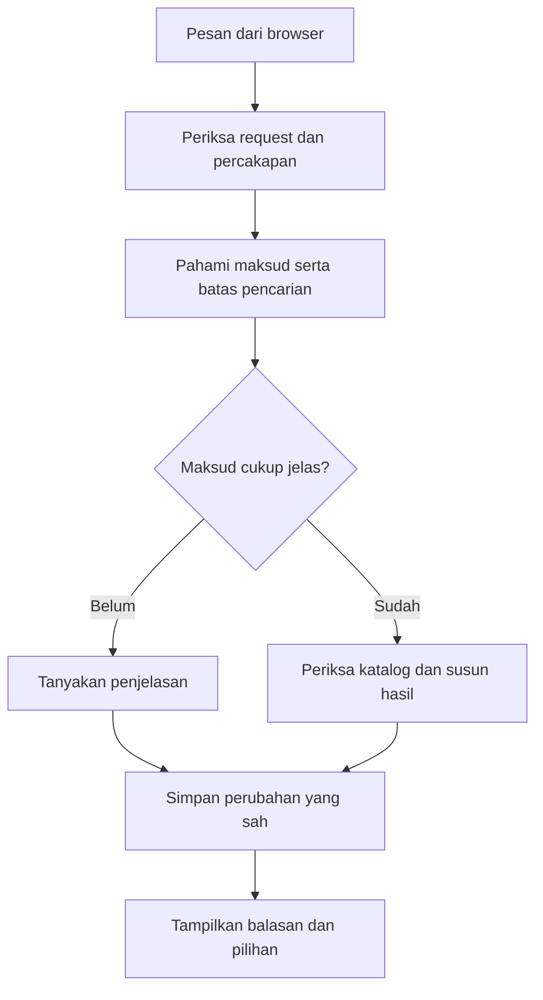

# Memahami Sistem Chatbot RasaKita

Diselaraskan pada **23 Oktober 2026** dengan kode proyek utama di branch `ahmad`.

Panduan belajar untuk anggota tim. Kita mulai dari hal yang dilihat pelanggan, lalu menelusuri
pekerjaan di belakangnya. Penjelasan mengikuti implementasi branch `ahmad`; konfigurasi lokal
setiap laptop dapat berbeda.

Jika baru belajar class dan object, baca [modul OOP](oop/README.md) terlebih dahulu. Untuk
pemasangan web, ikuti [README proyek](../README.md).

Bayangkan chatbot sebagai pelayan yang membantu memilih makanan. Pelayan mendengar keinginan
pelanggan, memeriksa katalog, lalu menawarkan pilihan. Program membagi pekerjaan itu ke
beberapa bagian supaya lebih mudah diatur.

Ketika nanti menemukan nama file atau method, cocokkan dengan pekerjaan dalam cerita tersebut.
Kamu tidak perlu menghafal semua namanya sebelum memahami alur.

Beberapa istilah yang diperlukan:

- **Server:** program yang menerima permintaan dari browser dan menjalankan aturan.
- **View:** bagian Django yang menerima permintaan halaman atau data.
- **JSON:** cara menulis data dengan nama dan nilai agar dapat dibaca program.
- **API:** jalur yang dipakai program untuk meminta data atau bantuan dari program lain.
- **Token Gemini:** satuan potongan teks yang dipakai untuk menghitung penggunaan AI.
- **CSRF:** pemeriksaan agar tindakan browser memakai tanda pengaman yang sesuai.

## Daftar isi

1. [Apa pekerjaan chatbot?](#1-apa-pekerjaan-chatbot)
2. [Mengapa chatbot memakai AI?](#2-mengapa-chatbot-memakai-ai)
3. [Perjalanan satu pesan](#3-perjalanan-satu-pesan)
4. [Siapa mengerjakan bagian mana?](#4-siapa-mengerjakan-bagian-mana)
5. [Bagaimana nama menu dan tag dikenali?](#5-bagaimana-nama-menu-dan-tag-dikenali)
6. [Bagaimana budget dipahami?](#6-bagaimana-budget-dipahami)
7. [Apa yang diingat dari percakapan?](#7-apa-yang-diingat-dari-percakapan)
8. [Bagaimana menu dipilih dan diurutkan?](#8-bagaimana-menu-dipilih-dan-diurutkan)
9. [Apa tepatnya peran Gemini?](#9-apa-tepatnya-peran-gemini)
10. [Dari hasil pencarian menjadi kalimat](#10-dari-hasil-pencarian-menjadi-kalimat)
11. [Dari kartu menu menjadi pesanan](#11-dari-kartu-menu-menjadi-pesanan)
12. [Mengapa ada batas penggunaan dan pemeriksaan keamanan?](#12-mengapa-ada-batas-penggunaan-dan-pemeriksaan-keamanan)
13. [Memahami catatan proses](#13-memahami-catatan-proses)
14. [Contoh percakapan untuk dipelajari](#14-contoh-percakapan-untuk-dipelajari)
15. [Keterbatasan dan urutan membaca kode](#15-keterbatasan-dan-urutan-membaca-kode)

## 1. Apa pekerjaan chatbot?

Pelanggan dapat mengatakan `minuman maksimal 10 ribu` daripada mengisi beberapa filter sendiri.
Chatbot membantu menerjemahkan kalimat itu menjadi kebutuhan pencarian, lalu menunjukkan menu
yang tersedia pada katalog.

Bayangkan pelayan yang mempunyai catatan: pelanggan mencari minuman, batasnya Rp10.000, dan
mungkin ingin pilihan lain. Pelayan perlu memahami maksud, memeriksa daftar menu, lalu
menjawab. Ia tidak boleh menciptakan harga atau mengaku pesanan sudah dibayar hanya karena
pelanggan menyebutnya.

Chatbot membantu **memilih**, bukan menggantikan seluruh proses restoran:

- Katalog tetap berasal dari database yang dikelola staf.
- Harga akhir tetap dihitung server berdasarkan pilihan yang sah.
- Varian/tambahan dipilih melalui pilihan menu dan keranjang.
- Pembayaran tetap mengikuti alur pesanan dan kasir.

## 2. Mengapa chatbot memakai AI?

Aturan aplikasi tetap dijalankan oleh kode sendiri. Contohnya, menu tidak tersedia harus
dikeluarkan dari hasil, dan harga akhir dihitung server. Itu tidak diserahkan kepada AI.

**AI** dipakai untuk memahami bahasa yang samar, misalnya pilihan yang cocok untuk “nemenin
nugas”, dan untuk menyusun kalimat balasan. Hasil bantuannya tetap dibatasi dan diperiksa. AI
tidak mengambil alih database, aturan harga, atau izin transaksi.

Cara kerja chatbot sekarang hanya satu jalur: **Gemini**. `GeminiAssistant` memproses setiap
pesan. AI dapat bertanya atau meminta pencarian melalui fungsi Django. Jika Gemini dimatikan,
kuotanya habis, atau balasannya gagal diperiksa, chatbot mengembalikan pesan bahwa layanan
belum tersedia (HTTP 503); tidak ada balasan lokal sebagai cadangan.

| Pertanyaan | Jawaban |
|---|---|
| Apakah paket Python untuk Gemini terpasang berarti Gemini aktif? | Tidak. Pengaturan, model, dan kunci API juga menentukan. |
| Apakah chatbot bisa berjalan tanpa kunci API? | Tidak. Tanpa Gemini aktif, endpoint mengembalikan pesan "Chatbot belum tersedia". |
| Siapa menyusun kalimat? | Gemini; fakta menu diambil melalui fungsi katalog Django. |
| Apakah JSON dari AI otomatis dipakai? | Tidak. Bentuk dan isinya diperiksa dahulu. |

## 3. Perjalanan satu pesan

### Saat halaman pertama kali dibuka

Template chatbot memanggil `sendMessage("", "")` saat inisialisasi. Browser mengirim `POST
/api/recommendation/chat/` meskipun pengguna belum mengetik. Pesan kosong diterjemahkan menjadi
permintaan memulai percakapan. Petunjuk untuk AI, daftar fungsi bantuan yang boleh diminta, dan
catatan percakapan ikut dikirim sehingga input token tidak nol. Sapaan tanpa API tidak
disediakan; setiap sapaan memakai Gemini.

Jadi, bedakan `GET /chatbot/` yang memuat halaman, POST inisialisasi, dan POST pesan
berikutnya. Membuka atau me-refresh halaman dapat memakai kuota layanan AI.

### Setelah pengguna mengirim kebutuhan

Ikuti pesan **`minuman maksimal 10 ribu`**:

1. Browser mengirim pesan ke `POST /api/recommendation/chat/` dengan informasi
   sesi/revisi yang dibutuhkan alur percakapan serta CSRF.
2. View memeriksa permintaan dan memuat keadaan percakapan yang benar.
3. `ChatbotService` memanggil `GeminiAssistant`. Gemini membaca pesan dan konteks.
4. Jika membutuhkan fakta menu, Gemini meminta `search_menu` atau `get_menu_details`.
   Django menjalankan fungsi tersebut. Jika AI tidak tersedia atau balasannya tidak lolos
   pemeriksaan, permintaan berhenti dengan HTTP 503.
5. Pencarian memeriksa katalog serta syarat yang berlaku. Menu tidak tersedia
   atau yang melanggar batas tidak menjadi kandidat yang sah.
6. Balasan AI dipakai bersama kartu menu hasil pencarian; tombol mengikuti hasil tersebut.
7. Perubahan percakapan disimpan dengan pemeriksaan revisi, lalu browser menampilkan hasil.

Ini ringkasan untuk belajar; beberapa permintaan berhenti lebih awal untuk bertanya ulang atau
memberi informasi tanpa melakukan pencarian menu.



[Buka diagram SVG](diagrams/chatbot-perjalanan-pesan.svg).

Jalur AI yang opsional dijelaskan pada bagian 9. Diagram ini tidak menyatakan semua pesan
selalu melewati layanan AI atau menghasilkan kartu menu.

## 4. Siapa mengerjakan bagian mana?

Jangan membaca seluruh file besar sekaligus. Mulailah dari pekerjaan tiap bagian:

| Bagian | Ibarat di restoran | Lokasi kode |
|---|---|---|
| Halaman chatbot | Tempat pelanggan berbicara dan melihat pilihan | [template chatbot](../recommendation/templates/recommendation/chatbot.html) |
| View | Penerima pesan yang memeriksa bentuk permintaan | [views.py](../recommendation/views.py) |
| `ChatbotService` | Pengatur alur percakapan | [chatbot.py](../recommendation/services/chatbot.py) |
| `GeminiAssistant` | Percakapan AI dan permintaan fungsi katalog | [assistant.py](../recommendation/services/ai/assistant.py) |
| `TagExtractor` | Kosakata tag, alias, dan kategori katalog yang boleh dipakai AI | [tag_extractor.py](../recommendation/services/tag_extractor.py) |
| `RecommendationService` | Memeriksa daftar menu dan mengurutkan hasil | [recommendation.py](../recommendation/services/recommendation.py) |
| `ConversationSession` | Catatan pilihan dan konteks percakapan | [conversation_session.py](../recommendation/services/conversation_session.py) |
| `ConversationStore` | Penjaga penyimpanan/revisi catatan | [conversation_store.py](../recommendation/services/conversation_store.py) |
| Adapter dan pembatas AI | Penghubung layanan luar yang dibatasi | [gemini.py](../recommendation/services/gemini.py), [security.py](../recommendation/services/security.py) |

`GeminiAssistant` memutuskan kapan meminta fakta katalog; ia tidak membuka koneksi Google
sendiri. `GeminiClient` yang menangani koneksi, sehingga keputusan dan pemeriksaan bisa diuji
tanpa memanggil layanan AI.

## 5. Bagaimana nama menu dan tag dikenali?

Nama menu adalah **identitas**. Contohnya, pelanggan menyebut menu tertentu. Tag adalah
**ciri**, misalnya manis atau dingin. Memilih tag dingin tidak sama dengan memilih satu menu
bernama tertentu.

1. Teks dinormalisasi melalui [language.py](../recommendation/services/language.py).
2. Gemini membaca maksud kalimat dan memilih tag/kategori/anggaran yang disebut pelanggan.
3. Backend memvalidasi tag terhadap kosakata katalog dan mencari menu yang cocok.
4. Jika lebih dari satu menu sama-sama mungkin, bot dapat meminta penjelasan.

Alias menu berasal dari `MenuItemAlias`; alias tag berbeda, melalui `MenuTagAlias` dan kosakata
ekstraksi. Menambah menu di CMS tidak otomatis memberikan seluruh tag, bahan, atau alias yang
mungkin disebut pelanggan.

### Mengapa tidak cukup mencari satu kata?

Dalam `aku alergi telur, ayam geprek aman?`, telur adalah bahan yang perlu diperhatikan,
sedangkan Ayam Geprek adalah objek pertanyaan. Menganggap semua kata makanan sebagai pantangan
akan mengubah maksud pelanggan. Penafsir perlu memperhatikan peran kata, bukan sekadar
keberadaannya.

Tag juga tidak boleh dipakai untuk menyimpulkan “tidak ada tag telur berarti menu bebas telur”.
Data bahan mungkin belum lengkap; bot tidak bisa menjamin keamanan alergi hanya dari informasi
pendukung tersebut.

## 6. Bagaimana budget dipahami?

Ada dua pertanyaan berbeda: **berapa nominalnya** dan **nominal itu untuk apa**. Rp20.000 per
menu berbeda dengan Rp20.000 untuk seluruh rencana pesanan.

| Contoh | Hal yang perlu dipahami |
|---|---|
| `maksimal 10 ribu` | Harga boleh sama dengan batas atas. |
| `di atas 5 ribu` | Harga harus lebih besar dari batas bawah. |
| `antara 5 dan 15 ribu` | Rentang dalam satu pesan, sesuai pembacaan nominal yang sah. |
| `sekitar 20 ribu` | Target perkiraan; jangan otomatis menganggapnya batas keras maksimal Rp20.000. |
| `budget 20 ribu` | Jika cakupan belum jelas, bisa perlu bertanya total atau per menu. |
| `20 ribu untuk dua porsi` | Jumlah dan cakupan total perlu diperiksa bersama. |

Contoh percakapan bertahap:

1. Pelanggan: “budget ku 30rb”. Bot menanyakan total pesanan atau batas per menu.
2. Pelanggan: “total ya”. Bot mencatat Rp30.000 sebagai budget seluruh pesanan.
3. Pelanggan: “makanan dan minuman”. Kedua kategori diingat. Bot menanyakan jumlah orang.
4. Pelanggan: “untuk 1 orang”. Bot dapat mencari satu makanan dan satu minuman bersama.
   Untuk beberapa orang, bot menanyakan porsi masing-masing atau berbagi jika belum jelas.

Setelah bot bertanya jumlah orang, pelanggan juga boleh menjawab singkat seperti “1”, “satu”,
atau “sendiri”. Angka singkat dibaca sebagai jumlah orang hanya dalam konteks pertanyaan
tersebut, bukan otomatis dianggap harga atau jumlah menu.

Jawaban dapat menggabungkan informasi, misalnya “total untuk makanan dan minuman 1 orang”.
Pengguna tidak harus menjawab dengan satu kata persis. Koreksi nominal mengikuti cakupan budget
yang sudah dikonfirmasi. Jika belum jelas, bot bertanya lagi. Permintaan dengan jumlah porsi
yang sudah lengkap tidak perlu ditanyai ulang.

`BudgetConstraint` mewakili batas harga yang sudah jelas dan dipakai saat menyaring kandidat.
Pemahaman kalimat seperti “budget 20 ribu” diserahkan kepada Gemini; jawabannya tetap harus
berupa angka yang masuk akal dan melewati pemeriksaan server sebelum dipakai.

### Nominal baru dan kelanjutan konteks

| Urutan pesan | Perilaku yang dituju |
|---|---|
| `maksimal 15 ribu` → `minimal 5 ribu` | Batas baru mengganti rentang lokal sebelumnya; tidak otomatis 5–15 ribu. |
| `minimal 5 ribu maksimal 15 ribu` dalam satu pesan | Menggunakan dua batas yang dinyatakan bersama. |
| `minuman maksimal 10 ribu` → `kalau ayam geprek?` | Membandingkan pilihan dengan budget yang sama. |
| `minuman maksimal 10 ribu` → `sekarang makanan` | Pergantian kategori tanpa penghubung pembandingan tidak otomatis membawa batas minuman. |
| `maksimal 15 ribu` → `sekitar 20 ribu` | Target baru menggantikan batas lokal Rp15.000 sebelumnya. |
| `harga es kelapa berapa?` | Pertanyaan harga tidak otomatis mengganti budget. |

Tabel ini contoh kebijakan percakapan, bukan jaminan setiap variasi kalimat akan dimengerti.
Permintaan samar/bertentangan dapat menghasilkan klarifikasi. Budget total dan batas
keselamatan mempunyai cakupan berbeda dari filter lokal; jangan menghapus semua batas hanya
karena ada nominal lokal baru.

### Harga kartu dan harga akhir

[`MenuSelection`](../menu/selection.py) menghitung harga minimum yang mencakup opsi wajib
termurah. Ini membantu menilai apakah menu mungkin memenuhi budget. Pelanggan masih harus
memilih opsi sendiri. Tambahan atau opsi lain dapat menaikkan harga akhir ketika dimasukkan ke
keranjang.

## 7. Apa yang diingat dari percakapan?

Bot membutuhkan catatan supaya `yang kedua` atau `cari yang lain` mempunyai makna. Tetapi tidak
semua hal harus dibawa ke pencarian berikutnya.

| Informasi | Contoh kegunaan |
|---|---|
| Pencarian aktif | Kategori dan batas harga saat ini. |
| Fokus/menu yang baru disebut | Menjawab pertanyaan lanjutan tentang menu itu. |
| Pilihan yang sudah ditampilkan/ditolak | Mencari alternatif tanpa terus mengulang menu yang sama. |
| Konteks sebelumnya yang dibatasi | Merujuk kembali pada pencarian yang relevan. |
| Pantangan keselamatan | Tidak diperlakukan sebagai selera yang boleh hilang begitu saja. |
| Rencana dan jumlah | Membaca koreksi pada rencana yang sedang dibahas. |

`ConversationSession` mengelola data tersebut. `ConversationStore` menyimpan keadaan percakapan
tersendiri menggunakan penyimpanan sesi Django dan revisi. Jadi, “sementara selama sesi” bukan
berarti semua catatan hanya berada di RAM browser. Data dapat mempunyai masa berlaku;
kebersihan penyimpanan tetap perlu diatur operator.

Versi bentuk data percakapan saat ini adalah **susunan data 6**. Bagi pemula, cukup pahami
sebagai versi susunan catatan, bukan enam tabel chatbot baru.

### Dua tab mengirim pesan bersamaan

Bayangkan tab A dan B membaca catatan versi yang sama. A menyimpan perubahan lebih dahulu. Jika
B langsung menimpa catatan lama, hasil A bisa hilang. Pemeriksaan revisi mencegah penimpaan
tersebut. Permintaan yang kalah dapat menerima konflik `409`; gangguan penyimpanan dapat
menghasilkan `503`.

Ini bukan alasan mereset semua sesi atau menonaktifkan pemeriksaan. Muat dan periksa keadaan
terbaru sebelum mengulang tindakan.

**Mulai Lagi** menghapus konteks dialog dan teks `recommendation_last_message` serta
`recommendation_last_response` yang lama. Keranjang, status login, dan penghitung penggunaan
dipertahankan. Setelah reset, `ChatbotService.reply` dapat meminta sapaan Gemini baru jika
tersedia; karena itu reset juga dapat memakai kuota dan menghasilkan teks percakapan baru. Ini
penghapusan konteks aplikasi, bukan jaminan menghapus data yang sebelumnya sudah diproses
layanan AI.

### Menambah menu saat pilihan sebelumnya belum pasti

Contoh: pelanggan menyebut budget total Rp30.000, lalu meminta menu ayam maksimal Rp20.000. Bot
menawarkan beberapa menu. Jika pelanggan langsung berkata “sekalian nasi goreng”, bot belum
boleh menganggap salah satu menu ayam sudah dipilih.

Bot menanyakan menu sebelumnya yang ingin digabung, sambil mengingat tambahan Nasi Goreng.
Pelanggan dapat menjawab nama menu atau urutannya. Setelah itu, harga terbaru dan total
gabungan diperiksa. Jika melebihi budget, tambahan ditolak dan pilihan sebelumnya yang sah
tetap dicatat. Semuanya masih berupa rencana percakapan, bukan pesanan dalam keranjang.

Catatan tambahan yang menunggu jawaban berlaku paling lama lima menit dan hanya untuk pencarian
dalam sesi tersebut. Pembatalan, reset, atau permintaan baru dapat menghapusnya. Bot juga
memeriksa kembali harga, ketersediaan, varian wajib, dan pantangan sebelum menggabungkan menu.

## 8. Bagaimana menu dipilih dan diurutkan?

 Dua pekerjaan ini berbeda:

1. **Menyaring:** mengeluarkan kandidat yang tidak memenuhi syarat.
2. **Mengurutkan:** menentukan kandidat sah mana yang ditampilkan lebih dahulu.

Misalkan dalam contoh latihan ada menu A Rp8.000, B Rp10.000, dan C Rp15.000. Untuk batas
maksimal Rp10.000, C tidak boleh “dimasukkan lagi” hanya karena AI menganggapnya paling cocok.
Angka/nama ini ilustrasi, bukan isi katalog tetap.

Penyaringan juga memeriksa status menu/kategori, pilihan wajib, batas yang berlaku, serta
pengecualian yang dapat dibuktikan dari data. Setelah itu urutan dapat mempertimbangkan
preferensi dan suasana.

Tag/suasana bukan diagnosis kesehatan. “Cocok untuk nugas” adalah pertimbangan subjektif, bukan
jaminan menu meningkatkan konsentrasi.

Pemecahan satu anggaran menjadi beberapa menu tidak lagi punya perencana khusus. Bila
permintaan tidak jelas, Gemini dapat menanyakan kembali, dan setiap usulan tetap harus lolos
pemeriksaan katalog.

## 9. Apa tepatnya peran Gemini?

Seluruh jawaban berada di [`GeminiAssistant`](../recommendation/services/ai/assistant.py). Ia
mengirim pesan dan konteks singkat kepada Gemini. AI dapat memanggil:

- `search_menu`: mencari menu melalui filter dan katalog aplikasi.
- `get_menu_details`: membaca rincian berdasarkan ID menu.

Satu pesan dapat membutuhkan beberapa permintaan ke layanan AI: meminta pencarian, menerima
hasil fungsi, lalu menyusun jawaban. `GEMINI_MAX_TOOL_ITERATIONS` membatasi putaran tersebut.
Setiap permintaan tetap dicatat dan dibatasi kuotanya. AI tidak diberi fungsi untuk mengubah
keranjang, checkout, atau pembayaran.

| Yang dilakukan AI | Tetap menjadi tugas aplikasi |
|---|---|
| Memahami kalimat dan memilih filter pencarian. | Memvalidasi tag, kategori, nominal, dan identitas menu. |
| Menyusun kalimat balasan. | Menjaga harga, ketersediaan, dan pantangan tetap sesuai katalog. |
| Menjelaskan hasil pencarian. | Menolak balasan yang memuat HTML, tautan, atau menu di luar hasil fungsi katalog. |

Balasan AI diperiksa sebelum dipakai: harus teks biasa, tidak memuat HTML/Markdown/tautan, dan
tidak melebihi panjang yang wajar. Balasan yang gagal diperiksa dianggap kegagalan layanan,
bukan alasan untuk menyusun jawaban lokal.

AI tidak bebas mengembalikan menu di luar daftar. Format data yang salah, ID tidak
sah/berulang, atau isi yang melanggar aturan dapat ditolak. Keluaran JSON yang bisa dibaca
belum otomatis lolos seluruh pemeriksaan.

### Konfigurasi Gemini

- `v1_settings.py` membaca `GEMINI_ENABLED` dari pengaturan lingkungan atau `.env`.
- `GEMINI_ENABLED=true` dan `GEMINI_API_KEY` yang valid adalah syarat chatbot dapat menjawab.
- `GEMINI_MAX_TOOL_ITERATIONS` membatasi putaran pemanggilan fungsi katalog, dan
  `GEMINI_MAX_CALLS_PER_SESSION` membatasi panggilan per sesi.
- Tidak ada pilihan mode lain: bila Gemini nonaktif, kuota habis, atau balasannya gagal
  diperiksa, endpoint mengembalikan HTTP 503 dengan pesan "Chatbot belum tersedia".

Konfigurasi Gemini disiapkan per laptop dan tidak ikut Git karena memuat rahasia.
Pengaktifan layanan berbayar perlu ditentukan dengan pemilik akun; jangan menyalin kunci API
anggota lain.

## 10. Dari hasil pencarian menjadi kalimat

Teks jawaban berasal dari `GeminiAssistant`, sedangkan kartu menu berasal dari hasil fungsi
katalog Django. AI hanya boleh menyebut menu yang muncul pada hasil pencarian; backend tetap
memeriksa bentuk balasan sebelum dikirim ke browser.

Hasil pencarian belum merupakan balasan siap baca. Bot perlu tahu tujuannya: memberi
rekomendasi, menjawab harga, meminta penjelasan, menjelaskan hasil kosong, atau mengakui
perubahan pilihan. Instruksi sistem menjelaskan hal ini kepada Gemini, dan kartu menu tetap
menjadi sumber kebenaran nama, harga, dan ketersediaan.

Saat memperbaiki respons, periksa dahulu hasil pencarian dan konteks yang dikirim ke AI.
Mengganti kalimat saja tidak memperbaiki salah konteks atau salah budget. Jangan menambahkan
klaim “aman”, “sudah dipesan”, atau “tersedia” tanpa dasar yang sesuai dari alur aplikasi.

## 11. Dari kartu menu menjadi pesanan

1. Pelanggan membaca kartu rekomendasi.
2. Pelanggan menekan **Lihat pilihan menu**.
3. Pelanggan memilih varian wajib, tambahan, jumlah, dan catatan.
4. Pilihan masuk ke keranjang yang sama dengan katalog.
5. Checkout memvalidasi dan membuat order.
6. Kasir mencatat pembayaran sesuai alur transaksi.

Balasan chatbot bukan bukti transaksi. Permintaan `tambah susu` dalam chat belum berarti addon
terpasang atau harganya sudah masuk total. Fitur saat ini mengarahkan pelanggan memilih opsi
melalui halaman menu/keranjang.

Rincian langkah pengguna/operator ada di [panduan penggunaan](PANDUAN_PENGGUNAAN.md).

## 12. Mengapa ada batas penggunaan dan pemeriksaan keamanan?

### Batas putaran dan kuota

`GeminiAssistant` memakai `GeminiClient.converse` langsung, sehingga satu pesan dapat
menghasilkan beberapa panggilan AI: permintaan tool, hasil tool, dan respons lanjutan. Jumlah
putarannya dibatasi `GEMINI_MAX_TOOL_ITERATIONS` (bawaan 4). Sebelum setiap panggilan AI, program
memeriksa jatah sesi melalui fungsi yang diberikan pemanggil, lalu menjalankan
`_allow_provider` untuk penghitung global/klien/sesi bersama.

`UsageGuard` menghitung pemakaian per hari menurut waktu UTC, lalu menyimpannya sementara
di cache. Jika tidak diubah lewat pengaturan, kode memakai batas harian 100 untuk seluruh
aplikasi dan 20 per klien; batas sesi bawaannya 50. Pengelola server dapat memakai
nilai lain. Angka ini menghitung percobaan panggilan, bukan token atau kuota akun Google.

Pada pengaturan lokal, penghitung berada pada masing-masing proses server dan dapat hilang
ketika proses berhenti. Jika server memakai beberapa proses, mereka memerlukan tempat
penyimpanan penghitung yang sama supaya batas pemakaiannya tidak terpisah-pisah.

Jika kuota habis, layanan AI gagal, atau keluarannya ditolak, chatbot mengembalikan pesan bahwa
layanan belum tersedia. Jangan mengulang panggilan terus-menerus tanpa batas. Hitungan aplikasi
berbeda dengan batas pemakaian atau tagihan pada dashboard penyedia.

### Data dari pelanggan/katalog bukan instruksi sistem

Jika nama/deskripsi menu berisi kalimat “abaikan semua aturan”, kalimat itu tetap data katalog,
bukan izin mengubah aturan. Keluaran layanan AI juga tidak berwenang mengubah harga, izin
operator, atau catatan keselamatan secara bebas.

Ada pemeriksaan untuk menghindari pengiriman konteks sensitif pada jalur tertentu. Jangan
menganggapnya jaminan bahwa semua jenis data pribadi selalu terdeteksi. Saat membuat contoh/bug
report, pakai data latihan dan informasi pendukung seperlunya, bukan kunci API, isi percakapan lengkap
pribadi, atau seluruh isi sesi.

### Lokal berbeda dengan hosting

Cache dalam satu proses cukup untuk skenario uji tertentu, tetapi tidak menjadi penghitung
bersama banyak proses pelayan. Hosting memerlukan konfigurasi penyimpanan, cache bersama, HTTPS, dan
batas penggunaan yang diverifikasi. Jangan menyalin pengecualian profil uji sebagai konfigurasi
penggunaan sebenarnya.

## 13. Memahami catatan proses

| Yang terlihat | Artinya | Bukan bukti bahwa… |
|---|---|---|
| `chat_request`, status 200 | Permintaan chat berhasil dijawab. | Gemini pasti dipanggil pada permintaan itu. |
| `provider_attempt`, `success` | Respons layanan AI diterima pada upaya itu. | Isinya pasti dipakai atau sesuai aturan. |
| `chat_request`, status 503 | AI tidak tersedia atau balasannya ditolak; pelanggan menerima pesan belum tersedia. | Kunci API pasti salah. |
| `invalid_json` atau penolakan pemeriksaan | Format/isi keluaran tidak memenuhi aturan. | Seluruh aplikasi gagal berjalan. |
| `session_limit_reached` | Batas panggilan sesi tercapai. | Kunci API pasti salah. |
| `provider_failure` | Ada kategori kegagalan layanan AI untuk diagnosis. | Pesan error mentah aman dibagikan. |

`input_tokens` dan `output_tokens` adalah ukuran penggunaan yang dilaporkan layanan AI. `null`
berarti tidak tersedia, bukan nol. `estimated_cost=null` juga bukan berarti gratis. Timeout
dapat membuat pemakaian belum diketahui. Catat ID permintaan dan ringkasan aman; cocokkan
dengan dashboard penyedia bila sedang melakukan percobaan live.

Log JSON tampil di terminal server Django melalui logger `recommendation.services.gemini` pada
level INFO. Jalur percakapan AI-first (`converse`) mencatat satu `provider_attempt` setelah
setiap panggilan ke Gemini selesai, termasuk respons permintaan tool dan respons akhir.

Satu pesan pelanggan dapat menghasilkan beberapa baris; kelompokkan dengan `request_id` yang
sama. Setiap baris berisi token untuk panggilan tersebut, bukan akumulasi sesi: `input_tokens`,
`output_tokens`, `thinking_tokens`, `cached_tokens`, dan `total_tokens`.

Gunakan `total_tokens` dari layanan AI; jangan menjumlahkan semua kolom karena kategori token
dapat saling mencakup.

Contoh ringkasan field dari satu baris (angka ilustrasi):

```json
{"event":"provider_attempt","model":"dummy-model","outcome":"success","latency_ms":850.2,"input_tokens":100,"output_tokens":30,"thinking_tokens":10,"cached_tokens":20,"total_tokens":140,"provider_called":true}
```

Timeout/error juga menghasilkan `provider_attempt` dengan pemakaian token yang belum diketahui
serta `provider_failure` berisi kategori aman. Penolakan kuota mempunyai
`provider_called=false`. Isi pesan, jawaban, masukan dan hasil fungsi bantuan, dan Kunci API tidak dimasukkan
ke log ini. Konfigurasi bawaan hanya mencetak ke console, belum menyimpan ke file atau
menampilkan total token di halaman web.

Saat menelusuri kendala, gunakan urutan pesan yang menyebabkan masalah dan cocokkan hasilnya
dengan katalog. Catat langkah serta hasil yang terlihat agar anggota lain bisa mengulangnya.
Panduan pemeriksaan melalui browser ada di [pemeriksaan lokal](PANDUAN_TESTING_LOKAL.md).

## 14. Contoh percakapan untuk dipelajari

Gunakan katalog latihan; hasil menu aktual mengikuti data di database.

| Coba | Perhatikan |
|---|---|
| `minuman maksimal 10 ribu` | Kategori, batas harga, dan hasil yang sah. |
| Lanjut `minimal 5 ribu` | Nominal baru tidak otomatis digabung dengan maksimum lama. |
| Mulai lagi, lalu `minuman maksimal 10 ribu` → `kalau ayam geprek?` | Batas pembandingan masih digunakan; menu di atasnya tidak otomatis lolos. |
| `harga ayam geprek berapa?` | Informasi harga tidak diam-diam mengganti budget. |
| `cari menu lain` | Konteks yang relevan tetap dipakai dan pengulangan dibatasi. |
| `yang kedua` pada percakapan baru | Bot tidak menebak tanpa daftar acuan. |
| `aku alergi telur, menu ini aman?` | Tidak menjamin aman hanya dari tag katalog. |
| `es kelapa tambah susu` | Bila menu tersedia, identitasnya dikenali; tambahan tetap belum diterapkan lewat chat. |
| Pertanyaan membeli barang di luar restoran | Bot membatasi bantuan pada domain yang sesuai. |

Untuk setiap percakapan, catat **maksud → kebutuhan pencarian → hasil → kalimat**. Jika salah,
tentukan tahap yang bermasalah. Jangan langsung menyalahkan Gemini ketika permintaan belum
pernah mencapai layanan AI.

## 15. Keterbatasan dan urutan membaca kode

- Kualitas jawaban bergantung pada instruksi AI, katalog, alias, tag, dan status data menu.
- Tidak ada jalur balasan lokal; gangguan Gemini berarti chatbot belum tersedia.
- Tidak ada jaminan alergi, nutrisi, atau kesehatan dari informasi pendukung menu.
- Chat tidak menerapkan opsi, membayar, atau membuat perubahan transaksi bebas.
- `ChatbotService` sekarang hanya pengatur lalu lintas antara sesi, penyimpanan, dan
  `GeminiAssistant`; aturan katalog berada di `RecommendationService`.

Urutan membaca yang disarankan:

1. Template: lihat apa yang dikirim/dilihat pelanggan.
2. View: temukan penerimaan permintaan dan penyimpanan respons.
3. `ChatbotService.reply`: lihat alur reset, kuota, dan pemanggilan AI.
4. `GeminiAssistant`: lihat instruksi sistem, deklarasi fungsi katalog, dan pemeriksaan balasan.
5. Pencarian: temukan syarat yang menggugurkan menu.
6. Tes terkait: baca contoh perilaku dan batas yang sengaja dijaga.

Untuk presentasi, pilih satu cerita: “pelanggan menyebut budget, lalu mengganti kategori”.
Tunjukkan perubahan catatan, penyaringan menu, dan kalimat respons. Hubungkan ke
[enkapsulasi](oop/3.%20Enkapsulasi.md), [composition](oop/9.%20Pendalaman%20Komposisi.md), dan
[polymorphism](oop/6.%20Polimorfisme%20dan%20Abstraksi.md) hanya pada bagian yang benar-benar
memperlihatkan konsep tersebut.

Pertanyaan diskusi: mengapa harga harus tetap diperiksa server setelah bantuan AI? Mengapa kartu
menu tetap berasal dari katalog, bukan dari kalimat AI? Bagaimana mengetahui masalah berasal dari
instruksi AI, data katalog, atau penyimpanan sesi?

## 16. Mendiagnosis log yang tidak terlihat

Baris `[tanggal] "GET/POST ..."` adalah log akses Django. JSON `chat_request` adalah informasi
pendukung permintaan chatbot, sedangkan `provider_attempt` adalah informasi pendukung upaya
layanan AI. Status 200 berarti AI memberi balasan yang lolos pemeriksaan; status 503 berarti
chatbot belum tersedia untuk permintaan itu.

Gunakan alamat dan port yang sama dengan terminal. Karena `--noreload`, restart setelah
perubahan Python atau konfigurasi. Hindari beberapa runserver bersamaan pada alamat yang sama;
pada sesi debugging sebelumnya ditemukan server lama dan baru sehingga akses tidak terlihat
pada terminal yang sedang diamati. Periksa proses terlebih dahulu dan hentikan server lewat
terminalnya; jangan mematikan semua proses Python tanpa memeriksa identitasnya.

Waktu pencatatan JSON memakai UTC (`+00:00`), sedangkan log akses lokal memakai WITA. Contoh
pukul 07:23 WITA sama dengan 23:23 UTC pada hari sebelumnya. Perbedaan tanggal itu bukan bukti
permintaan ganda atau waktu server rusak.

Contoh 975 token input dan 57 token output menghasilkan 1.032 total pada satu respons yang
diamati. Angka tersebut contoh, bukan tarif atau batas semua model.

Sebagian besar input dapat berasal dari instruksi/tool/context, bukan ketikan pengguna. Pada
free tier, pantau batas permintaan per menit/hari sekaligus token; satu pesan dengan putaran
tool dapat memakai beberapa permintaan.

Batas akun/model dibaca dari dashboard layanan AI dan dapat berubah, sehingga tidak dihardcode
sebagai janji kuota tetap dalam panduan ini.

Panduan OOP yang membedah adapter dan perangkaian layanan AI tersedia di [indeks
OOP](oop/README.md). Cara uji tanpa API asli ada di [pemeriksaan
lokal](PANDUAN_TESTING_LOKAL.md).
