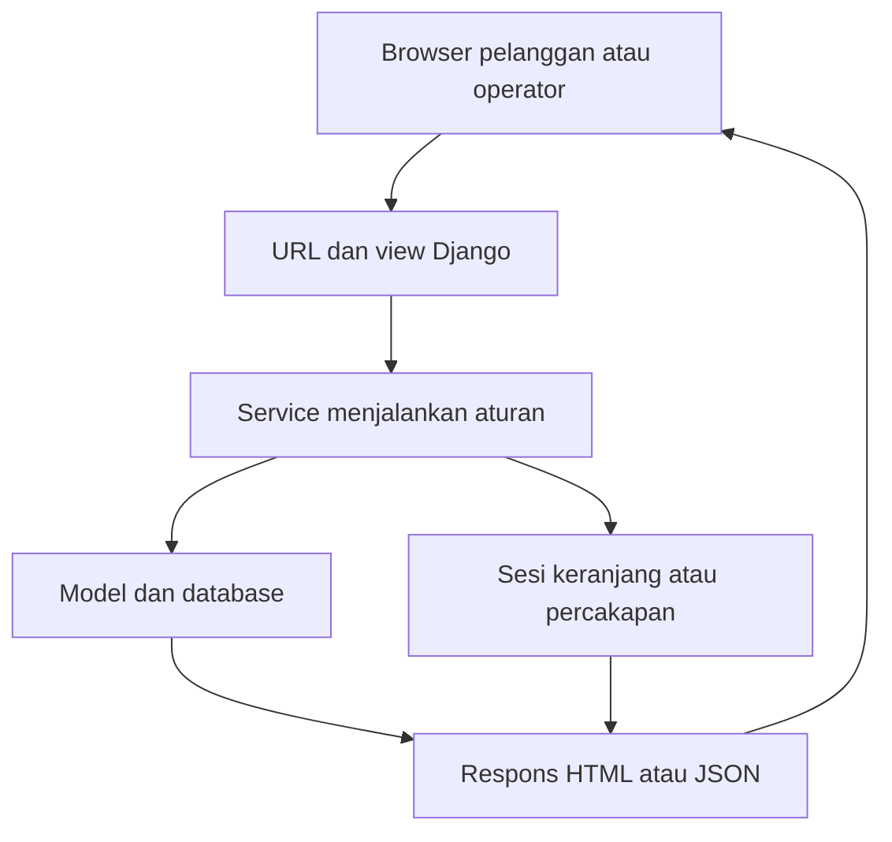
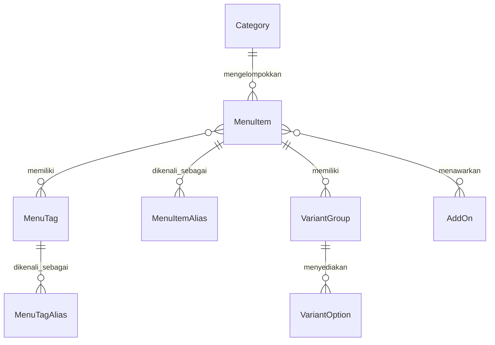
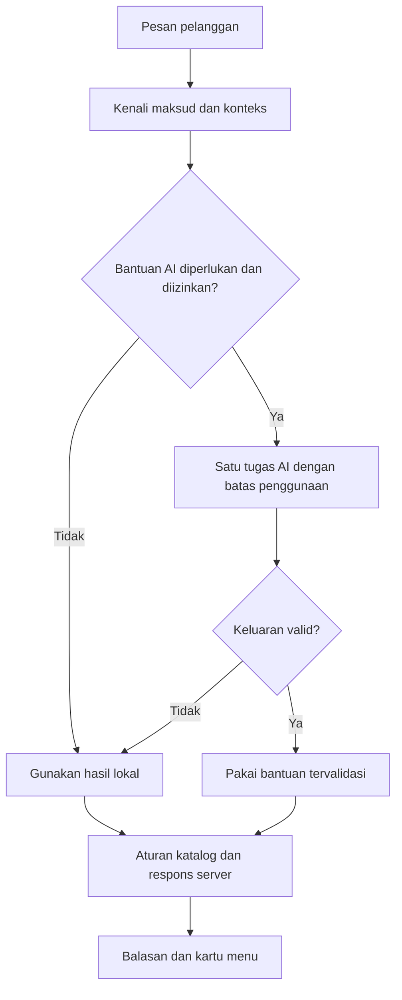
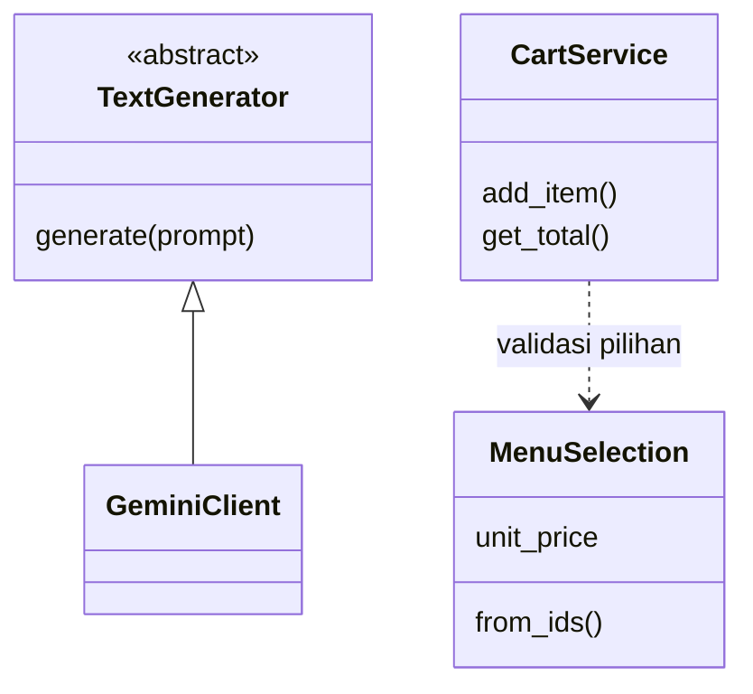

# Panduan Pengembangan RasaKita

Panduan frontend dan backend untuk **branch `ahmad`**, diperbarui 20 Oktober
2026. Susunannya mengikuti panduan di `main`, tetapi menjelaskan implementasi
v1 yang telah diintegrasikan ke branch ini.

Mulai dari [README](../README.md) untuk instalasi. Untuk mencoba sebagai
pelanggan, staf, atau kasir, baca [panduan penggunaan](PANDUAN_PENGGUNAAN.md).

## Daftar isi

1. [Gambaran sistem](#1-gambaran-sistem)
2. [Konfigurasi dan data lokal](#2-konfigurasi-dan-data-lokal)
3. [Peta folder dan tempat mengubah fitur](#3-peta-folder-dan-tempat-mengubah-fitur)
4. [Aliran request](#4-aliran-request)
5. [Model dan relasi](#5-model-dan-relasi)
6. [Keranjang, harga, dan checkout](#6-keranjang-harga-dan-checkout)
7. [Endpoint dan akses](#7-endpoint-dan-akses)
8. [Chatbot lokal dan hybrid](#8-chatbot-lokal-dan-hybrid)
9. [Kelas dan OOP](#9-kelas-dan-oop)
10. [Migrasi, foto, dan data awal](#10-migrasi-foto-dan-data-awal)
11. [Pengujian dan urutan perubahan](#11-pengujian-dan-urutan-perubahan)
12. [Batas sistem](#12-batas-sistem)

## 1. Gambaran sistem

RasaKita adalah satu aplikasi Django dengan beberapa modul. Browser pelanggan,
CMS, kasir, dan chatbot memakai server serta katalog yang sama. SQLite dipakai
untuk pengembangan lokal.



[Buka diagram SVG](diagrams/arsitektur-request.svg).

| Modul | Tanggung jawab |
|---|---|
| `menu` | Kategori, menu, tag/alias, varian, tambahan, dan pemrosesan foto. |
| `cart` | Pilihan dalam keranjang berbasis sesi browser. |
| `orders` | Pesanan, snapshot harga, meja/QR, pembayaran, dan audit transaksi. |
| `users` | Login operator, CMS, keputusan akses, serta halaman kasir. |
| `recommendation` | Pemahaman percakapan, budget, filter/ranking, konteks, dan AI opsional. |
| `config` | URL proyek serta profil ASGI/WSGI dan deployment. |

## 2. Konfigurasi dan data lokal

`manage.py` default memakai `v1_settings.py`; `start.ps1` juga memilih profil
itu. Nama file ini tidak bergantung pada nama folder repository. Jangan
menghapusnya atau mengganti default ke `config.settings` tanpa meninjau perbedaannya.

- `v1_settings.py`: SQLite `db.sqlite3`, media lokal, zona waktu Makassar,
  host loopback, dan Gemini nonaktif.
- `config/settings.py`: profil terpisah yang membaca environment sesuai kode
  di file itu. Jangan menganggap nama variabelnya sama dengan profil lain.
- `local_gemini_settings.py`: profil lokal opsional yang dibuat per laptop;
  tidak disediakan melalui Git. Dapat membaca `.env` jika pemiliknya menambahkan
  `load_dotenv` sesuai panduan pengujian.
- File `.env` saja tidak otomatis mengaktifkan Gemini pada `v1_settings`.
- Rahasia development `.local-secret-key` dibuat otomatis secara lokal.

Instalasi baru mengikuti README, termasuk foto katalog. Tidak memerlukan
`seed_demo`, akun bawaan, MySQL, atau API Gemini. Katalog dan pesanan setiap
anggota berada di database lokal masing-masing.

## 3. Peta folder dan tempat mengubah fitur

```text
config/                         URL proyek dan profil deployment
menu/
  models.py                     katalog, tag/alias, varian, tambahan
  selection.py                  validasi pilihan dan perhitungan harga
  image_processing.py           pemrosesan foto
  fixtures/v1_catalog.json      katalog awal untuk database baru
  assets/recovered-menu/        sumber foto katalog awal
  static/menu/css/              tampilan storefront dan kartu menu
  static/menu/js/               katalog, keranjang, checkout, QR, editor foto
  templates/menu/               halaman dan modal pelanggan
  tests/                        pengujian katalog dan foto
cart/                           keranjang, payload, endpoint, tests
orders/                         pesanan, meja, pembayaran, audit, tests
users/                          CMS, login, akses, kasir, tests
recommendation/
  services/                     konteks, budget, router, ranking, provider
  templates/recommendation/     UI chatbot dan JavaScript percakapan
  tests/                        pengujian chatbot dan batas AI
docs/                           panduan penggunaan dan pengembangan
manage.py                       perintah Django
v1_settings.py                  profil lokal default
start.ps1                       menjalankan server lokal
```

| Ingin mengubah | Mulai dari |
|---|---|
| Katalog dan modal pilihan | `menu/templates/menu/storefront.html`, `menu/templates/menu/partials/` |
| Tampilan katalog/kartu | `menu/static/menu/css/page4.css`, `retro.css`, `storefront.css`, `menu-card.css` |
| Pencarian dan pemilihan menu | `menu/static/menu/js/menu.mjs`, `storefront.mjs` |
| Keranjang dan catatan item | `menu/static/menu/js/cart.mjs`, `cart/services.py` |
| Checkout dua tahap | `menu/static/menu/js/checkout.mjs`, `orders/views.py`, `orders/services.py` |
| QR meja | `menu/static/menu/js/table-scanner.mjs`, model `orders.models.Table`, `orders/views.py` |
| Pilihan wajib, tambahan, harga | `menu/selection.py` |
| Foto dan editor foto | `menu/image_processing.py`, `menu/widgets.py`, `menu/static/menu/js/photo-editor.js` |
| Tata letak CMS | `users/templates/users/base.html`, `users/static/users/css/cms-shell.css` |
| Form CMS | `users/forms.py`, template di `users/templates/users/` |
| Peran staf/kasir | `users/access.py`, `orders/permissions.py` |
| Halaman kasir | `users/cashier_views.py`, `users/templates/users/kasir/` |
| Percakapan/budget | `recommendation/services/chatbot.py`, `conversation_interpreter.py`, `budget.py` |
| Identitas menu/alias | `recommendation/services/entity_resolver.py`, model `MenuItemAlias` |
| Filter/ranking | `recommendation/services/recommendation.py`, `services/ai/semantic_reranker.py` |
| Provider dan batas penggunaan | `recommendation/services/gemini.py`, `security.py`, `telemetry.py` |
| Respons | `response_plan.py`, `response_composer.py`, `services/ai/explanations.py` |
| Konteks dan penyimpanan chat | `conversation_session.py`, `conversation_store.py` |

Path layanan chatbot yang disingkat berada di `recommendation/services/`.
Pengujian sekarang berada di paket `tests/` per aplikasi; jangan menambahkan
kembali file `tests.py` lama yang sudah dipindahkan.

## 4. Aliran request

Contoh pelanggan menambah Ayam Geprek ke keranjang:

1. Browser mengambil katalog dari `GET /api/menu/`.
2. Pelanggan memilih varian, tambahan, jumlah, dan catatan.
3. Browser mengirim ID pilihan ke `POST /api/cart/add/` dengan CSRF.
4. View membaca payload; `CartService` memvalidasi melalui `MenuSelection`.
5. Server menghitung harga dari katalog dan menyimpan pilihan dalam sesi.
6. Browser menerima isi keranjang terbaru, lalu memperbarui tampilannya.

Harga/total dari browser bukan sumber kebenaran. Jangan memindahkan aturan
harga ke JavaScript saja, menonaktifkan CSRF, atau menerima sembarang ID varian.

## 5. Model dan relasi

Diagram hanya memuat hubungan inti agar mudah dibaca, bukan seluruh field/constraint.



[Buka diagram SVG](diagrams/relasi-katalog.svg).

- `MenuItem`: harga dasar, status aktif/tersedia, foto kartu, foto detail opsional.
  Kategori juga harus aktif agar menu dapat ditawarkan.
- `MenuItemAlias` mengenali sebutan menu; `MenuTagAlias` mengenali karakteristik.
  Alias menu berbeda dengan tag rasa/bahan.
- Grup varian wajib harus mempunyai pilihan sah saat item masuk keranjang.
- Tambahan harus aktif, tersedia, dan ditawarkan untuk menu yang dipilih.
- Tag membantu pencarian; bukan daftar bahan lengkap atau bukti aman alergi.

`Order` memiliki banyak `OrderItem`. Varian, tambahan, dan harga disimpan
sebagai snapshot saat pemesanan. `Payment` berhubungan satu-ke-satu dengan order,
sedangkan `AuditLog` mencatat aksi. Meja opsional untuk bawa pulang dan diperlukan
untuk makan di tempat.

## 6. Keranjang, harga, dan checkout

`CartService` menyimpan pilihan pada sesi browser. `MenuSelection` memeriksa
menu/varian/tambahan terhadap katalog saat ini. Pada implementasi terbaru aturan
order berupa **fungsi dalam `orders/services.py`**, seperti `create_order`,
`pay`, `cancel`, dan `refund`; bukan class bernama `OrderService`.

```text
Harga satuan = harga menu + penyesuaian varian + harga tambahan
Total baris = harga satuan × jumlah
Total pesanan = jumlah seluruh total baris
```

Contoh: menu Rp18.000, varian +Rp2.000, tambahan Rp3.000, dua porsi menghasilkan
`(18.000 + 2.000 + 3.000) × 2 = Rp46.000`. Ini contoh hitungan, bukan harga katalog tetap.

Harga minimum chatbot adalah batas bawah termasuk opsi wajib termurah. Harga
akhir mengikuti pilihan pelanggan dan dihitung ulang server. Quote minimum
tidak berarti varian/tambahan sudah dipilih.

Checkout membuat order/snapshot melalui transaksi database. Pembayaran menolak
order kosong, pembayaran ulang, dan uang tunai kurang. Perubahan order hanya
pada status yang diizinkan; refund memerlukan staf. Lihat
[alur kasir](PANDUAN_PENGGUNAAN.md#6-alur-kasir) untuk transisi status.

## 7. Endpoint dan akses

Untuk payload/error terbaru, periksa `urls.py`, view, payload class, dan tes.
Tabel ini peta endpoint, bukan salinan seluruh kontrak JSON.

| Metode dan path | Fungsi | Akses |
|---|---|---|
| `GET /api/menu/` | Katalog dan opsi | Publik |
| `GET /api/cart/` | Keranjang browser | Sesi pelanggan |
| `POST /api/cart/add/` | Tambah item | Sesi pelanggan + CSRF |
| `PATCH`, `DELETE /api/cart/<line_id>/` | Ubah/hapus baris | Sesi pelanggan + CSRF |
| `DELETE /api/cart/clear/` | Kosongkan keranjang | Sesi pelanggan + CSRF |
| `GET /api/orders/tables/<token>/` | Validasi meja | Publik; bukan membuat order |
| `POST /api/orders/checkout/` | Membuat order | Sesi pelanggan + CSRF |
| `GET /api/orders/<public_id>/` | Membaca status berdasarkan ID | Publik; jangan membagikan ID sembarangan |
| `POST /api/orders/<public_id>/items/` | Tambah item order | Staf/kasir |
| `POST /api/orders/<public_id>/items/<line_id>/` | Ubah jumlah; nol menghapus item | Staf/kasir |
| `POST /api/orders/<public_id>/customer/` | Ubah data pelanggan | Staf/kasir |
| `POST /api/orders/<public_id>/table/` | Pindah meja | Staf/kasir |
| `POST /api/orders/<public_id>/pay/` | Catat pembayaran | Staf/kasir |
| `POST /api/orders/<public_id>/cancel/` | Batalkan pending | Staf/kasir |
| `POST /api/orders/<public_id>/refund/` | Refund order dibayar | Staf (`is_staff`) |
| `POST /api/recommendation/chat/` | Percakapan/rekomendasi | Sesi percakapan + CSRF |
| `POST /api/recommendation/add/` | Pilihan rekomendasi masuk keranjang bersama | Sesi pelanggan + CSRF |

Halaman: `/`, `/chatbot/`, `/orders/<public_id>/`, `/staff/`, `/kasir/`, dan
`/admin/`. Tidak semua kemampuan API mempunyai tombol pada halaman kasir.
Cart pelanggan tetap sama ketika berpindah dari chatbot ke katalog.

## 8. Chatbot lokal dan hybrid

Chatbot bersifat **deterministic-first**: bahasa/aturan jelas diproses lokal,
katalog menyaring hasil, dan Gemini membantu tugas tertentu jika konfigurasi
mengizinkan. Tidak semua pesan membutuhkan panggilan AI.



[Buka diagram SVG](diagrams/chatbot-hybrid.svg).

Diagram menunjukkan batas kepercayaan. Pada tugas ranking, kandidat sudah
disaring sebelum dikirim ke AI; aturan server tetap berlaku setelahnya. Gemini
tidak boleh membuat harga, stok, ID menu, atau mengubah keranjang secara bebas.

| Bagian | Tugas |
|---|---|
| `ConversationInterpreter`, `EntityResolver` | Memahami pesan dan mengenali menu/alias. |
| `budget.py`, `plan_interpreter.py` | Nominal, jumlah, scope rencana/budget. |
| `DecisionRouter` | Keputusan dialog dan validasi proposal AI. |
| `RecommendationService` | Katalog, syarat keras, dan urutan kandidat. |
| `ConversationSession` | Konteks, fokus, budget, preferensi melalui method yang dibatasi. |
| `conversation_store.py` | Penyimpanan chat bertanda revisi agar request tidak saling menimpa. |
| `ResponsePlan`, `ResponseComposer` | Hasil dan kalimat lokal dari fakta tervalidasi. |
| `GeminiClient`, `UsageGuard`, telemetry | Adapter provider, batas panggilan, metadata penggunaan. |

### Contoh budget dan konteks

| Percakapan | Perilaku yang dimaksud |
|---|---|
| `maksimal 15 ribu` → `minimal 5 ribu` | Nominal baru mengganti rentang lama; tidak otomatis menjadi 5–15 ribu. |
| `antara 5 ribu dan 15 ribu` | Satu pesan menyatakan dua batas bersama. |
| `minuman maksimal 10 ribu` → `kalau ayam geprek?` | Membandingkan menu dengan budget yang sama. |
| `minuman maksimal 10 ribu` → `sekarang makanan` | Pergantian konteks tanpa pembandingan tidak otomatis membawa batas minuman. |
| `harga es kelapa berapa?` | Pertanyaan harga tidak otomatis mengganti budget pencarian. |
| `budget 20 ribu` tanpa penjelasan | Dapat memerlukan klarifikasi total atau per menu. |

Ini contoh aturan yang diuji, bukan jaminan semua parafrasa sudah dipahami.
Batas bahan untuk keselamatan berbeda dengan selera dan tidak boleh hilang
hanya karena kategori berubah. Tag/rekomendasi tidak menjamin aman alergi;
konfirmasi bahan dan risiko kontak silang kepada staf tetap diperlukan.

### Mode AI

- **Lokal:** `GEMINI_ENABLED=False`; respons dan keputusan lokal tanpa API.
- **Ranking:** Gemini dapat membantu urutan kandidat yang lolos filter.
  `ranking_validation=accepted` menunjukkan keluaran dipakai; sukses HTTP provider belum cukup.
- **Wording:** fitur kalimat AI opsional, default nonaktif pada v1. Kalimat
  tetap dapat berupa template lokal walaupun ranking Gemini aktif.
- **Proposal v3:** jalur interpretasi opsional dengan validasi; pemasangan SDK
  atau keberadaan key saja tidak mengaktifkan jalur ini.

Key/model/flag ada pada profil lokal terpisah, bukan frontend. Pilih model yang
tersedia untuk proyek Gemini sendiri; jangan menyalin key anggota lain.
`provider_attempt` mencatat upaya. Timeout/fallback tetap dapat memakai kuota;
token tidak tersedia bukan berarti nol. Reset chat bukan cara menghapus batas
panggilan. Detail konfigurasi/verifikasi ada di [panduan pengujian](PANDUAN_TESTING_LOKAL.md).

## 9. Kelas dan OOP

Contoh: satu pilihan menu perlu opsi yang sah dan harga. `MenuSelection`
membungkus pilihan itu agar cart/order tidak menghitung dengan aturan berbeda.



[Buka diagram SVG](diagrams/kelas-inti.svg).

- **Enkapsulasi:** opsi/tambahan `MenuSelection` disimpan privat, dibaca melalui
  property; konteks chat diubah melalui method session.
- **Abstraksi/inheritance:** `TextGenerator` adalah ABC; `GeminiClient`
  mengimplementasikannya. Tes dapat memakai generator palsu.
- **Pemisahan tanggung jawab:** view menangani HTTP, service menjalankan aturan,
  model menyimpan data. `StaffAccess` memusatkan keputusan peran.
- Domain/payload memakai class biasa dan type hints. Tidak semua aturan harus
  berupa class; fungsi transaksi di `orders/services.py` tetap disengaja.

## 10. Migrasi, foto, dan data awal

1. Ubah model bila kebutuhan data berubah.
2. Buat migrasi baru melalui `makemigrations`, periksa, lalu uji pada database
   percobaan. Jangan menulis ulang migrasi yang sudah dipakai tim.
3. Cadangkan data sebelum menerapkan migrasi pada database kerja.
4. Fixture `v1_catalog` hanya untuk database baru; tidak berisi akun atau meja.
5. Foto awal disalin sesuai README. Upload disimpan terpisah dari Git.

`backfill_menu_images` adalah perintah pemulihan opsional, bukan langkah setup
utama. Ia melewati item yang field fotonya sudah terisi. Fixture sudah menyimpan
path foto, sehingga command ini tidak otomatis memperbaiki file media yang
hilang; salin aset awal sesuai README atau pulihkan backup yang cocok.

Jangan menghapus `menu/assets/recovered-menu/` sebagai aset tidak terpakai:
foto awal, pemulihan foto, dan pengujian membutuhkan isinya.

## 11. Pengujian dan urutan perubahan

Pemeriksaan awal dari folder repository dengan Python proyek:

```powershell
python -B manage.py check
python -B manage.py test menu.tests.test_selection --noinput
python -B manage.py test users.tests.test_access_contracts --noinput
```

Database tes Django berbeda dari database aplikasi. Jangan menggunakan transaksi
di katalog kerja sebagai pengganti pengujian. Tes foto dapat menulis file, jadi
gunakan media sementara ketika memperluas suite. Tes AI memakai provider palsu
dan cache terisolasi secara default.

Di workspace UTS penulis juga tersedia runner terisolasi:

```powershell
python -B output/pengembangan/integrasi-repo-20261020/run_full.py menu cart orders users recommendation
```

Perintah ini dijalankan dari UTS, bukan folder repository. `output/` tidak ikut
clone GitHub; anggota baru tidak perlu memilikinya untuk menjalankan web.
Runner memblokir SDK/koneksi eksternal dan memakai SQLite dalam memori, media
sementara, serta cache uji. Jangan melemahkan konfigurasi production untuk meloloskan tes.

Urutan ketika menambah fitur:

1. Periksa branch dan perubahan lokal melalui `git status`.
2. Pilih modul pemilik fitur; baca alur dan tes existing.
3. Ubah aturan service/model bila perlu, kemudian view dan frontend pemanggil.
4. Uji input normal/salah, akses, serta perubahan katalog/harga.
5. Periksa diff dan migrasi; perbarui panduan terkait.
6. Commit ke branch pekerjaan setelah diperiksa. Integrasi ke `main` melalui
   review tim; push ke `ahmad` tidak mengubah `main`.

Uji metadata katalog lengkap dan tidak lengkap. Jangan memberi semua tag pada
semua menu agar hasil terlihat cocok. Perubahan budget/alergi/harga juga perlu
diuji dalam percakapan lanjutan.

## 12. Batas sistem

- SQLite untuk pengembangan/demo. Transaksi banyak kasir serentak perlu
  diverifikasi pada database deployment yang dipilih.
- CARD/QRIS/OTHER adalah pencatatan metode oleh operator, belum integrasi gateway.
- Gemini opsional; mode lokal dan fallback tetap diperlukan.
- Addon/varian dari kalimat chat belum otomatis diterapkan. Pelanggan memilih
  melalui **Lihat pilihan menu** dan keranjang.
- Tag bukan bukti komposisi/keamanan alergi. Tidak semua parafrasa atau rencana
  kombinasi yang mungkin sudah didukung.
- Profil lokal bukan konfigurasi hosting siap pakai. Lihat
  [verifikasi hosting](PANDUAN_VERIFIKASI_HOSTING.md).

## 13. Menjaga tampilan di berbagai ukuran layar

Halaman pelanggan mengikuti desain mobile Figma dengan lebar maksimal **412 px**.
Pada HP yang lebih kecil, halaman mengikuti lebar layar. Pada desktop, halaman
tetap berada di tengah dengan lebar mobile; kartu tidak diperbesar memenuhi monitor.

Aturan penyesuaian ada di
[responsive.css](../menu/static/menu/css/responsive.css), yang dimuat setelah CSS
tampilan utama. Jika mengubah jarak atau ukuran, periksa dahulu berkas ini agar
aturan baru tidak saling menimpa. Jangan memperkecil seluruh halaman dengan
`transform: scale(...)`, karena teks dan tombol ikut menjadi terlalu kecil.

[responsive.mjs](../menu/static/menu/js/responsive.mjs) mengukur tinggi bilah
keranjang dan ruang layar yang terlihat. Karena itu, posisi maskot AI tidak
bergantung pada satu perkiraan tinggi footer. Foto, judul, dan pilihan pada detail
menu berada dalam satu area gulir, sedangkan tombol tambah tetap di bawah.

Saat mencoba perubahan tampilan:

1. Jalankan server; setelah perubahan template, restart bila memakai `--noreload`.
2. Buka alat pengembang browser dan pilih simulasi perangkat mobile.
3. Coba lebar 320, 360, 390, 412, dan 430 px, lalu putar ke posisi mendatar.
4. Periksa menu kosong/berisi keranjang, detail menu, keranjang, jenis pesanan,
   konfirmasi, chatbot, serta struk. Coba nama menu dan catatan yang panjang.
5. Pastikan halaman tidak bergulir ke samping. Gulir sampai bagian terakhir dan
   pastikan tombol penting tetap bisa dijangkau.
6. Coba keyboard asli di HP, terutama saat mengisi catatan dan chatbot. Simulasi
   browser belum membuktikan perilaku keyboard dan area aman pada semua HP.
7. Di desktop, pastikan halaman dan dialog memakai bingkai mobile yang sama.

Perubahan ini mengatur tampilan. Harga, validasi pesanan, serta aturan chatbot
tetap dihitung oleh layanan backend seperti sebelumnya.
