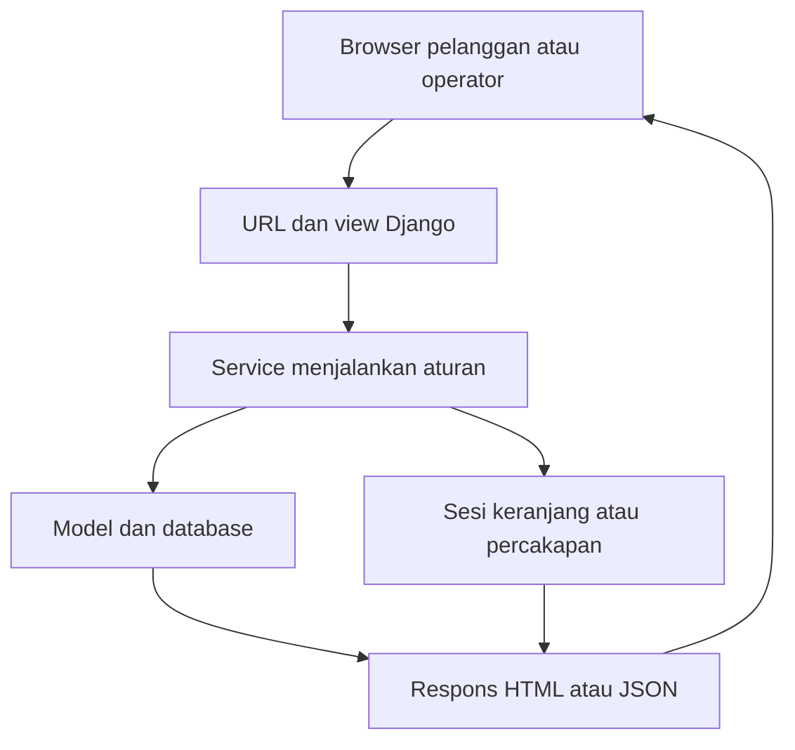
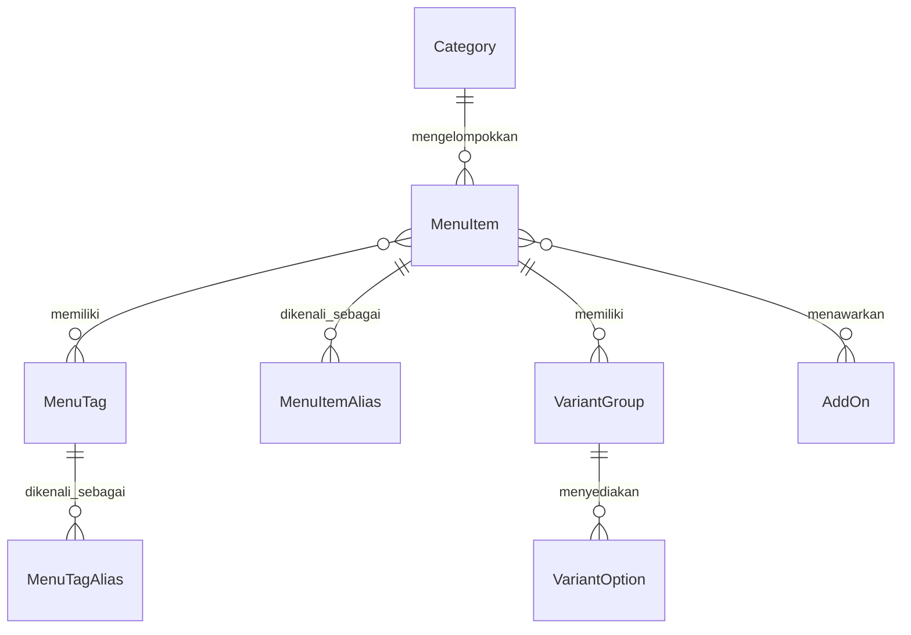
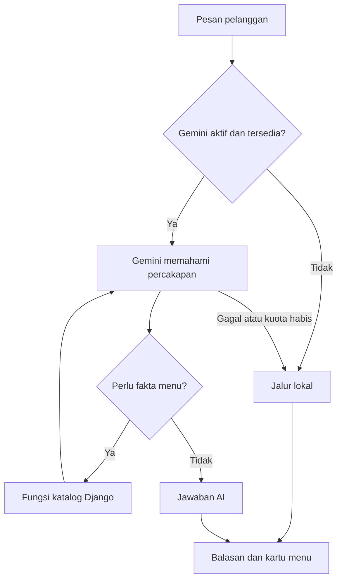
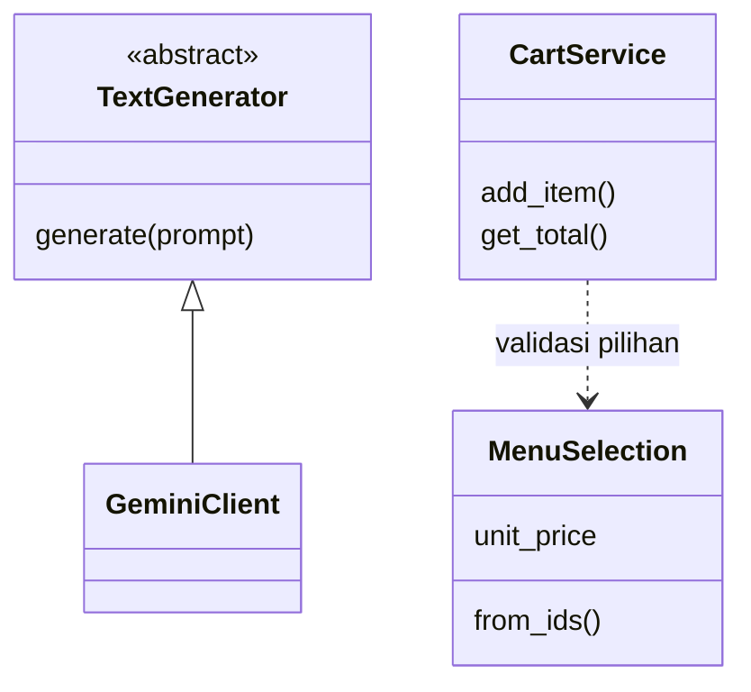

# Panduan Pengembangan RasaKita

Diselaraskan pada **23 Oktober 2026** dengan kode proyek utama di branch `ahmad`.

Panduan untuk anggota tim RasaKita, **Universitas Mulawarman, Samarinda, Kalimantan Timur**,
pada branch `ahmad`. Isinya membantu anggota memahami pembagian modul dan mengembangkan fitur
bersama. Semua perintah dijalankan dari folder proyek yang berisi `manage.py`.

Mulai dari [README](../README.md) untuk pemasangan. Untuk mencoba sebagai pelanggan, staf, atau
kasir, baca [panduan penggunaan](PANDUAN_PENGGUNAAN.md).

## Pegangan sebelum membaca kode

Anggap alurnya seperti ini: browser mengirim permintaan, Django menerimanya, aturan aplikasi
memeriksa data, lalu hasilnya dikirim kembali ke browser. Setiap bagian mempunyai pekerjaan
sendiri.

| Istilah pada panduan | Maksudnya |
|---|---|
| Model | Class yang menjelaskan data yang disimpan, misalnya menu dan pesanan. |
| View | Bagian yang menerima permintaan browser dan menyiapkan balasannya. |
| Service | Bagian yang mengerjakan aturan, misalnya menghitung atau memeriksa pilihan. |
| Sesi | Data sementara yang berkaitan dengan browser, misalnya isi keranjang. |
| API | Alamat atau cara yang dipakai program untuk meminta data dan menjalankan tindakan. |
| Parameter | Nilai yang diberikan ketika fungsi atau method dipanggil. |

Nama pada kode tetap memakai penulisan aslinya. Misalnya `CartService` adalah nama class,
sedangkan pekerjaannya dapat kita sebut “layanan keranjang”.

## Daftar isi

1. [Gambaran sistem](#1-gambaran-sistem)
2. [Konfigurasi dan data lokal](#2-konfigurasi-dan-data-lokal)
3. [Peta folder dan tempat mengubah fitur](#3-peta-folder-dan-tempat-mengubah-fitur)
4. [Aliran permintaan](#4-aliran-permintaan)
5. [Model dan relasi](#5-model-dan-relasi)
6. [Keranjang, harga, dan checkout](#6-keranjang-harga-dan-checkout)
7. [Alamat layanan dan akses](#7-alamat-layanan-dan-akses)
8. [Chatbot lokal dan hybrid](#8-chatbot-lokal-dan-hybrid)
9. [Kelas dan OOP](#9-kelas-dan-oop)
10. [Migrasi, foto, dan data awal](#10-migrasi-foto-dan-data-awal)
11. [Alur kerja tim](#11-alur-kerja-tim)
12. [Batas sistem](#12-batas-sistem)

## 1. Gambaran sistem

RasaKita adalah satu aplikasi Django dengan beberapa modul. Browser pelanggan, CMS, kasir, dan
chatbot memakai server serta katalog yang sama. SQLite dipakai untuk pengembangan lokal.



[Buka diagram SVG](diagrams/arsitektur-request.svg).

| Modul | Tanggung jawab |
|---|---|
| `menu` | Kategori, menu, tag/alias, varian, tambahan, dan pemrosesan foto. |
| `cart` | Pilihan dalam keranjang berbasis sesi browser. |
| `orders` | Pesanan, salinan data harga, meja/QR, pembayaran, dan audit transaksi. |
| `users` | Login operator, CMS, keputusan akses, serta halaman kasir. |
| `recommendation` | Pemahaman percakapan, budget, filter/ranking, konteks, dan AI opsional. |
| `config` | URL proyek serta profil ASGI/WSGI dan pemasangan di server. |

## 2. Konfigurasi dan data lokal

`manage.py` bawaan memakai `v1_settings.py`; `start.ps1` juga memilih profil itu. Nama file ini
tidak bergantung pada nama folder proyek. Jangan menghapusnya atau mengganti bawaan ke
`config.settings` tanpa meninjau perbedaannya.

- `v1_settings.py`: SQLite `db.sqlite3`, media lokal, waktu WITA (UTC+8) untuk Samarinda,
  alamat yang hanya menunjuk komputer sendiri, dan Gemini dimatikan secara bawaan. Nilainya dapat diubah lewat pengaturan lingkungan.
- `config/settings.py`: profil terpisah yang membaca pengaturan lingkungan sesuai kode
  di file itu. Jangan menganggap nama variabelnya sama dengan profil lain.
- `local_gemini_settings.py`: profil lokal opsional yang dibuat per laptop;
  tidak disediakan melalui Git. Dapat membaca `.env` jika pemiliknya menambahkan
  `load_dotenv`. Konfigurasi dan kunci API disiapkan sendiri oleh pemilik laptop.
- `v1_settings` dan `config.settings` memuat `.env` jika `python-dotenv` terpasang.
  `GEMINI_ENABLED=true`, kunci API, dan model yang sesuai diperlukan untuk menggunakan Gemini.
- Nama teknis zona waktu pada Django adalah `Asia/Makassar`. Pengenal ini
  mewakili WITA yang juga digunakan di Samarinda; bukan lokasi tim pengembang.
- Rahasia pengembangan lokal `.local-secret-key` dibuat otomatis secara lokal.

Pemasangan baru mengikuti README, termasuk foto katalog. Tidak memerlukan `seed_demo`, akun
bawaan, MySQL, atau API Gemini. Katalog dan pesanan setiap anggota berada di database lokal
masing-masing.

## 3. Peta folder dan tempat mengubah fitur

```text
config/                         URL proyek dan profil deployment
menu/
  models.py                     katalog, tag/alias, varian, tambahan
  selection.py                  validasi pilihan dan perhitungan harga
  image_processing.py           pemrosesan foto
  fixtures/v1_catalog.json      katalog awal untuk database baru
  assets/recovered-menu/        sumber foto katalog awal
  static/menu/css/              tampilan storefront dan kartu menu
  static/menu/js/               katalog, keranjang, checkout, QR, editor foto
  templates/menu/               halaman dan modal pelanggan
  tests/                        pengujian katalog dan foto
cart/                           keranjang, payload, endpoint, tests
orders/                         pesanan, meja, pembayaran, audit, tests
users/                          CMS, login, akses, kasir, tests
recommendation/
  services/                     konteks, budget, router, ranking, provider
  templates/recommendation/     UI chatbot dan JavaScript percakapan
  tests/                        pengujian chatbot dan batas AI
docs/                           panduan penggunaan dan pengembangan
manage.py                       perintah Django
v1_settings.py                  profil lokal default
start.ps1                       menjalankan server lokal
```

| Ingin mengubah | Mulai dari |
|---|---|
| Katalog dan modal pilihan | `menu/templates/menu/storefront.html`, `menu/templates/menu/partials/` |
| Tampilan katalog/kartu | `menu/static/menu/css/page4.css`, `retro.css`, `storefront.css`, `menu-card.css` |
| Pencarian dan pemilihan menu | `menu/static/menu/js/menu.mjs`, `storefront.mjs` |
| Keranjang dan catatan item | `menu/static/menu/js/cart.mjs`, `cart/services.py` |
| Checkout dua tahap | `menu/static/menu/js/checkout.mjs`, `orders/views.py`, `orders/services.py` |
| QR meja | `menu/static/menu/js/table-scanner.mjs`, model `orders.models.Table`, `orders/views.py` |
| Pilihan wajib, tambahan, harga | `menu/selection.py` |
| Foto dan editor foto | `menu/image_processing.py`, `menu/widgets.py`, `menu/static/menu/js/photo-editor.js` |
| Tata letak CMS | `users/templates/users/base.html`, `users/static/users/css/cms-shell.css` |
| Form CMS | `users/forms.py`, template di `users/templates/users/` |
| Peran staf/kasir | `users/access.py`, `orders/permissions.py` |
| Halaman kasir | `users/cashier_views.py`, `users/templates/users/kasir/` |
| Percakapan/budget | `recommendation/services/chatbot.py`, `conversation_interpreter.py`, `budget.py` |
| Identitas menu/alias | `recommendation/services/entity_resolver.py`, model `MenuItemAlias` |
| Filter/ranking | `recommendation/services/recommendation.py`, `services/ai/semantic_reranker.py` |
| Layanan AI dan batas penggunaan | `recommendation/services/gemini.py`, `security.py`, `telemetry.py` |
| Respons | `response_plan.py`, `response_composer.py`, `services/ai/explanations.py` |
| Konteks dan penyimpanan chat | `conversation_session.py`, `conversation_store.py` |

Path layanan chatbot yang disingkat berada di `recommendation/services/`. Folder `tests/` pada
setiap aplikasi menyimpan contoh pemeriksaan otomatis untuk aturan modul tersebut.

## 4. Aliran permintaan

Contoh pelanggan menambah Ayam Geprek ke keranjang:

1. Browser mengambil katalog dari `GET /api/menu/`.
2. Pelanggan memilih varian, tambahan, jumlah, dan catatan.
3. Browser mengirim ID pilihan ke `POST /api/cart/add/` dengan CSRF.
4. View membaca data yang dikirim; `CartService` memvalidasi melalui `MenuSelection`.
5. Server menghitung harga dari katalog dan menyimpan pilihan dalam sesi.
6. Browser menerima isi keranjang terbaru, lalu memperbarui tampilannya.

Harga/total dari browser bukan sumber kebenaran. Jangan memindahkan aturan harga ke JavaScript
saja, menonaktifkan CSRF, atau menerima sembarang ID varian.

## 5. Model dan relasi

Diagram hanya memuat hubungan inti agar mudah dibaca, bukan seluruh field/constraint.



[Buka diagram SVG](diagrams/relasi-katalog.svg).

- `MenuItem`: harga dasar, status aktif/tersedia, foto kartu, foto detail opsional.
  Kategori juga harus aktif agar menu dapat ditawarkan.
- `MenuItemAlias` mengenali sebutan menu; `MenuTagAlias` mengenali karakteristik.
  Alias menu berbeda dengan tag rasa/bahan.
- Grup varian wajib harus mempunyai pilihan sah saat item masuk keranjang.
- Tambahan harus aktif, tersedia, dan ditawarkan untuk menu yang dipilih.
- Tag membantu pencarian; bukan daftar bahan lengkap atau bukti aman alergi.

`Order` memiliki banyak `OrderItem`. Varian, tambahan, dan harga disimpan sebagai salinan data
saat pemesanan. `Payment` berhubungan satu-ke-satu dengan order, sedangkan `AuditLog` mencatat
aksi. Meja opsional untuk bawa pulang dan diperlukan untuk makan di tempat.

## 6. Keranjang, harga, dan checkout

### Perubahan pemeriksaan dan efisiensi terbaru

- Jumlah porsi pada tambah, gabung, dan edit keranjang diperiksa oleh
  `_validate_quantity`. Nilainya harus angka bulat 1–99. True, False, dan teks
  angka tidak diterima. Jumlah gabungan diperiksa sebelum baris diubah.
  Pada `update_quantity`, angka bulat nol atau kurang tetap berarti hapus.
- Balasan keranjang membaca `get_items` sekali. Daftar hasilnya dipakai juga
  oleh `total_for` untuk menghitung total. Baris yang ditandai tidak sesuai aturan
  tidak ikut dijumlahkan. `get_total()` masih dapat dipakai bagian kode lain.
- Saat membuat pesanan baru, setiap baris ditambahkan sambil mencatat total
  sementara untuk audit. Setelah semua baris selesai, `recalculate` menghitung
  total akhir satu kali. Penambahan langsung melalui `add_item` tetap menghitung
  ulang total dari database.
- Checkout disimpan sebagai satu kesatuan. Jika ada baris yang gagal, perubahan
  order, baris, dan audit pada transaksi itu dibatalkan. Jangan memakai
  `defer_total` pada alur lain tanpa memeriksa akibatnya.
- Belum ada batas baru untuk banyaknya baris keranjang. Penanda pada tampilan
  juga tidak menggantikan pemeriksaan pilihan ketika checkout.

### Aturan harga dan penyimpanan

`CartService` menyimpan pilihan pada sesi browser. `MenuSelection` memeriksa
menu/varian/tambahan terhadap katalog saat ini. Pada implementasi terbaru aturan order berupa
**fungsi dalam `orders/services.py`**, seperti `create_order`, `pay`, `cancel`, dan `refund`;
bukan class bernama `OrderService`.

```text
Harga satuan = harga menu + penyesuaian varian + harga tambahan
Total baris = harga satuan × jumlah
Total pesanan = jumlah seluruh total baris
```

Contoh: menu Rp18.000, varian +Rp2.000, tambahan Rp3.000, dua porsi menghasilkan `(18.000 +
2.000 + 3.000) × 2 = Rp46.000`. Ini contoh hitungan, bukan harga katalog tetap.

Harga minimum chatbot adalah batas bawah termasuk opsi wajib termurah. Harga akhir mengikuti
pilihan pelanggan dan dihitung ulang server. Perkiraan harga minimum tidak berarti
varian/tambahan sudah dipilih.

Checkout menyimpan pesanan beserta salinan nama, pilihan, dan harga saat itu. Pembayaran
menolak order kosong, pembayaran ulang, dan uang tunai kurang. Perubahan order hanya pada
status yang diizinkan; refund memerlukan staf. Lihat [alur
kasir](PANDUAN_PENGGUNAAN.md#6-alur-kasir) untuk transisi status.

## 7. Alamat layanan dan akses

Untuk bentuk data dan pesan kesalahan terbaru, baca `urls.py`, view, berkas penentu bentuk
data, serta tes yang terkait. Tabel ini peta alamat layanan, bukan salinan seluruh aturan penggunaan
JSON.

| Metode dan path | Fungsi | Akses |
|---|---|---|
| `GET /api/menu/` | Katalog dan opsi | Publik |
| `GET /api/cart/` | Keranjang browser | Sesi pelanggan |
| `POST /api/cart/add/` | Tambah item | Sesi pelanggan + CSRF |
| `PATCH`, `DELETE /api/cart/<line_id>/` | Ubah/hapus baris | Sesi pelanggan + CSRF |
| `DELETE /api/cart/clear/` | Kosongkan keranjang | Sesi pelanggan + CSRF |
| `GET /api/orders/tables/<token>/` | Pemeriksaan meja | Publik; bukan membuat order |
| `POST /api/orders/checkout/` | Membuat order | Sesi pelanggan + CSRF |
| `GET /api/orders/<public_id>/` | Membaca status berdasarkan ID | Publik; jangan membagikan ID sembarangan |
| `POST /api/orders/<public_id>/items/` | Tambah item order | Staf/kasir |
| `POST /api/orders/<public_id>/items/<line_id>/` | Ubah jumlah; nol menghapus item | Staf/kasir |
| `POST /api/orders/<public_id>/customer/` | Ubah data pelanggan | Staf/kasir |
| `POST /api/orders/<public_id>/table/` | Pindah meja | Staf/kasir |
| `POST /api/orders/<public_id>/pay/` | Catat pembayaran | Staf/kasir |
| `POST /api/orders/<public_id>/cancel/` | Batalkan pending | Staf/kasir |
| `POST /api/orders/<public_id>/refund/` | Refund order dibayar | Staf (`is_staff`) |
| `POST /staff/logout/` | Keluar dari sesi operator | Login + CSRF; GET ditolak untuk pengguna yang sudah login |
| `POST /api/recommendation/chat/` | Percakapan/rekomendasi | Sesi percakapan + CSRF |
| `POST /api/recommendation/add/` | Pilihan rekomendasi masuk keranjang bersama | Sesi pelanggan + CSRF |

Halaman: `/`, `/chatbot/`, `/orders/<public_id>/`, `/staff/`, `/kasir/`, dan `/admin/`. Tidak
semua kemampuan API mempunyai tombol pada halaman kasir. Cart pelanggan tetap sama ketika
berpindah dari chatbot ke katalog.

## 8. Chatbot lokal dan hybrid

Chatbot bersifat **AI-first**, mengikuti sistem pada `main`. Jika Gemini aktif dan tersedia,
`GeminiAssistant` menangani pesan biasa lebih dahulu. AI mengambil fakta menu melalui fungsi
Django. Jalur lokal tetap tersedia sebagai jalur cadangan.



[Diagram SVG komponen hybrid cadangan](diagrams/chatbot-hybrid.svg).

Diagram menunjukkan batas kepercayaan. Pada tugas ranking, kandidat sudah disaring sebelum
dikirim ke AI; aturan server tetap berlaku setelahnya. Gemini tidak boleh membuat harga, stok,
ID menu, atau mengubah keranjang secara bebas.

| Bagian | Tugas |
|---|---|
| `ConversationInterpreter`, `EntityResolver` | Memahami pesan dan mengenali menu/alias. |
| `budget.py`, `plan_interpreter.py` | Nominal, jumlah, cakupan rencana/budget. |
| `DecisionRouter` | Keputusan dialog dan pemeriksaan proposal AI. |
| `RecommendationService` | Katalog, syarat keras, dan urutan kandidat. |
| `ConversationSession` | Konteks, fokus, budget, preferensi melalui method yang dibatasi. |
| `conversation_store.py` | Penyimpanan chat bertanda revisi agar permintaan tidak saling menimpa. |
| `ResponsePlan`, `ResponseComposer` | Hasil dan kalimat lokal dari fakta yang sudah diperiksa. |
| `GeminiClient`, `UsageGuard`, catatan penggunaan | Adapter layanan AI, batas panggilan, informasi pendukung penggunaan. |

### Contoh budget dan konteks

| Percakapan | Perilaku yang dimaksud |
|---|---|
| `maksimal 15 ribu` → `minimal 5 ribu` | Nominal baru mengganti rentang lama; tidak otomatis menjadi 5–15 ribu. |
| `antara 5 ribu dan 15 ribu` | Satu pesan menyatakan dua batas bersama. |
| `minuman maksimal 10 ribu` → `kalau ayam geprek?` | Membandingkan menu dengan budget yang sama. |
| `minuman maksimal 10 ribu` → `sekarang makanan` | Pergantian konteks tanpa pembandingan tidak otomatis membawa batas minuman. |
| `harga es kelapa berapa?` | Pertanyaan harga tidak otomatis mengganti budget pencarian. |
| `budget 20 ribu` tanpa penjelasan | Dapat memerlukan klarifikasi total atau per menu. |

Ini contoh aturan yang diuji, bukan jaminan semua parafrasa sudah dipahami. Batas bahan untuk
keselamatan berbeda dengan selera dan tidak boleh hilang hanya karena kategori berubah.
Tag/rekomendasi tidak menjamin aman alergi; konfirmasi bahan dan risiko kontak silang kepada
staf tetap diperlukan.

### Mode AI

- **Lokal:** `GEMINI_ENABLED=False`; respons dan keputusan lokal tanpa API.
- **AI-first:** jalur utama saat Gemini tersedia. Memakai `GeminiAssistant`
  dan fungsi katalog, dengan batas putaran `GEMINI_MAX_TOOL_ITERATIONS`.
- **Ranking pada jalur cadangan:** Gemini dapat membantu urutan kandidat yang lolos filter.
  `ranking_validation=accepted` menunjukkan keluaran dipakai; sukses HTTP layanan AI belum cukup.
- **Wording:** fitur kalimat AI opsional, bawaan dimatikan pada profil lokal. Kalimat
  tetap dapat berupa template lokal walaupun ranking Gemini aktif.
- **Proposal v3:** jalur interpretasi opsional dengan pemeriksaan; pemasangan paket Python untuk Gemini
  atau keberadaan kunci API saja tidak mengaktifkan jalur ini.

Profil lokal bawaan memuat `.env` jika pemuat tersedia; nilai pengaturan yang diberikan pada proses yang sudah ada
didahulukan. Kunci API, model, dan pengaturan berada pada konfigurasi bagian program pada server, bukan bagian tampilan pada browser.
Membuka halaman chatbot mengirim pesan kosong untuk sapaan, dan reset dapat meminta sapaan
baru. Ketika Gemini tersedia, keduanya dapat memakai API walaupun pengguna belum mengetik pesan
baru.

Setiap putaran `converse` kini memeriksa kuota bersama dan mencatat informasi pendukung token
seperti jalur generate. `TurnGenerator` membatasi komponen hybrid, bukan seluruh AI-first.
Lihat bagian 12–13 pada [Chatbot.md](Chatbot.md).

Kunci API, model, dan pengaturan dapat memakai profil lokal tambahan yang disiapkan pemilik
laptop, bukan bagian tampilan pada browser. Pilih model yang tersedia untuk proyek Gemini sendiri; jangan menyalin
kunci API anggota lain. `provider_attempt` mencatat upaya.

Timeout/jalur cadangan tetap dapat memakai kuota; token tidak tersedia bukan berarti nol. Reset
chat bukan cara menghapus batas panggilan.

Cara memeriksa alur lewat browser ada di [panduan pemeriksaan lokal](PANDUAN_TESTING_LOKAL.md).

## 9. Kelas dan OOP

Contoh: satu pilihan menu perlu opsi yang sah dan harga. `MenuSelection` membungkus pilihan itu
agar cart/order tidak menghitung dengan aturan berbeda.



[Buka diagram SVG](diagrams/kelas-inti.svg).

- **Enkapsulasi:** opsi/tambahan `MenuSelection` disimpan privat, dibaca melalui
  property; konteks chat diubah melalui method session.
- **Abstraksi dan inheritance:** `TextGenerator` menentukan kemampuan pembuat
  teks yang wajib diisi class turunan. `GeminiClient` mengisinya dengan cara
  memanggil Google. Tes dapat memakai pembuat teks tiruan.
- **Pemisahan tanggung jawab:** view menangani HTTP, service menjalankan aturan,
  model menyimpan data. `StaffAccess` memusatkan keputusan peran.
- Domain/data yang dikirim memakai class biasa dan type hints. Tidak semua aturan harus
  berupa class; fungsi transaksi di `orders/services.py` tetap disengaja.

## 10. Migrasi, foto, dan data awal

1. Ubah model bila kebutuhan data berubah.
2. Buat migrasi baru melalui `makemigrations`, periksa, lalu uji pada database
   percobaan. Jangan menulis ulang migrasi yang sudah dipakai tim.
3. Cadangkan data sebelum menerapkan migrasi pada database kerja.
4. Fixture `v1_catalog` hanya untuk database baru; tidak berisi akun atau meja.
5. Foto awal disalin sesuai README. Upload disimpan terpisah dari Git.

`backfill_menu_images` adalah perintah pemulihan opsional, bukan langkah setup utama. Ia
melewati item yang field fotonya sudah terisi. Fixture sudah menyimpan path foto, sehingga
command ini tidak otomatis memperbaiki file media yang hilang; salin aset awal sesuai README
atau pulihkan backup yang cocok.

Jangan menghapus `menu/assets/recovered-menu/` sebagai aset tidak terpakai: foto awal,
pemulihan foto, dan pengujian membutuhkan isinya.

## 11. Alur kerja tim

1. Buka terminal di folder proyek, lalu aktifkan lingkungan Python proyek.
2. Jalankan `git status` dan pastikan perubahan milik sendiri sudah dikenali.
   Sepakati branch pekerjaan dengan tim sebelum mulai mengubah fitur.
3. Baca alur modul yang akan diubah. Gunakan tabel pada bagian 3 untuk menemukan
   file yang bertanggung jawab; koordinasikan perubahan pada modul anggota lain.
4. Ubah satu kebutuhan yang jelas. Jika model berubah, sertakan migrasi baru
   dan jelaskan dampaknya terhadap data anggota lain.
5. Jalankan pemeriksaan dasar dari folder proyek:

   ```powershell
   python -B manage.py check
   ```

6. Jalankan web sesuai README, lalu coba alur yang berubah dengan data latihan.
   Panduan langkahnya ada di [pemeriksaan lokal](PANDUAN_TESTING_LOKAL.md).
   Jika memakai `--noreload`, restart server setelah mengubah kode Python.
7. Periksa `git diff`. Sertakan hanya perubahan yang berkaitan dengan tugas,
   dan perbarui panduan jika cara penggunaan atau penyiapannya berubah.
8. Buat commit setelah diperiksa. Integrasi antarbranch mengikuti review tim;
   perubahan pada `ahmad` tidak otomatis mengubah `main`.

Database dan foto upload tidak ikut diperbarui oleh Git. Anggota lain perlu menjalankan migrasi
baru bila ada, tetapi tidak perlu memuat ulang katalog awal atau membuat ulang akun setiap
menerima perubahan kode program.

## 12. Batas sistem

- SQLite untuk pengembangan/demo. Transaksi banyak kasir serentak perlu
  diverifikasi pada database pemasangan di server yang dipilih.
- CARD/QRIS/OTHER adalah pencatatan metode oleh operator, belum integrasi gateway.
- Gemini opsional; mode lokal dan jalur cadangan tetap diperlukan.
- Addon/varian dari kalimat chat belum otomatis diterapkan. Pelanggan memilih
  melalui **Lihat pilihan menu** dan keranjang.
- Tag bukan bukti komposisi/keamanan alergi. Tidak semua parafrasa atau rencana
  kombinasi yang mungkin sudah didukung.
- Profil lokal bukan konfigurasi hosting siap pakai. Lihat
  [verifikasi hosting](PANDUAN_VERIFIKASI_HOSTING.md).

## 13. Membaca OOP dan memeriksa perilaku

[Indeks OOP](oop/README.md) mengurutkan sepuluh dokumen bernomor. Tujuh materi utama berisi 35
kasus dari lima berkas utama berbeda per modul. Cuplikan dan simbol mengikuti kode, termasuk
`_validate_quantity`, `total_for`, fungsi pembantu `_add_item`, `_allow_provider`, dan
penghapusan teks pada reset.

Untuk memeriksa perilaku, baca pemeriksaan hasil pada tes pada tes modul terkait dan jalankan
tes dengan data latihan. Profil `config.audit_test_settings` menyediakan database di memori
serta layanan AI palsu pada tes yang sesuai; langkahnya ada di [panduan pemeriksaan
lokal](PANDUAN_TESTING_LOKAL.md). Catat hasil eksekusi pada revisi yang diuji, bukan menganggap
keberadaan berkas tes membuktikan tes lulus.
