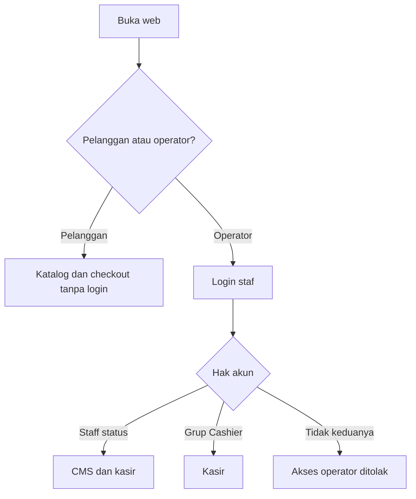
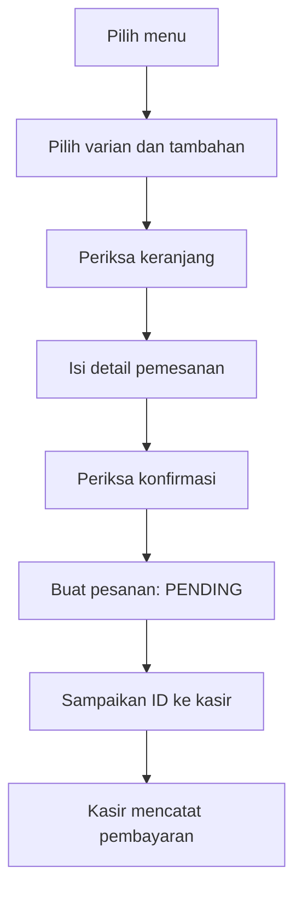
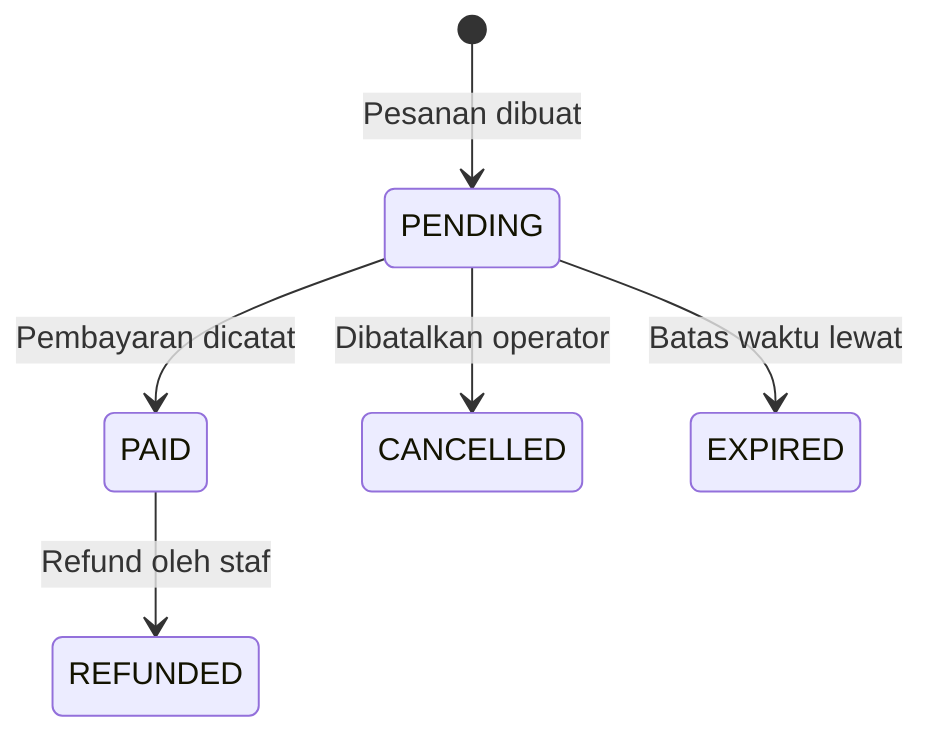

# Panduan Penggunaan RasaKita

Diselaraskan pada **23 Oktober 2026** dengan source project utama di branch `ahmad`.

Alur pelanggan, staf, dan kasir untuk branch `ahmad`. Contoh memakai
`http://127.0.0.1:8890`; sesuaikan port dengan server. Instalasi pertama mengikuti
[lima langkah README](../README.md#instalasi-pertama--lima-langkah).

## Daftar isi

1. [Menjalankan web](#1-menjalankan-web)
2. [Akun dan pembagian akses](#2-akun-dan-pembagian-akses)
3. [Alur pelanggan](#3-alur-pelanggan)
4. [Makan di tempat dan QR meja](#4-makan-di-tempat-dan-qr-meja)
5. [Alur staf](#5-alur-staf)
6. [Alur kasir](#6-alur-kasir)
7. [Simulasi satu pesanan](#7-simulasi-satu-pesanan)
8. [Kendala yang sering ditemui](#8-kendala-yang-sering-ditemui)

## 1. Menjalankan web

Setelah instalasi, buka PowerShell pada folder proyek:

```powershell
.\.venv\Scripts\Activate.ps1
.\start.ps1
```

Biarkan terminal terbuka. Pelanggan membuka `/`, staf `/staff/`, dan kasir
`/kasir/`. Gunakan server yang sama untuk latihan bersama. Pakai dua browser
atau jendela privat saat mencoba sebagai pelanggan dan operator agar sesinya terpisah.

Setiap laptop yang menjalankan server sendiri mempunyai data sendiri. Alamat
`127.0.0.1` menunjuk ke perangkat masing-masing. Demo lintas perangkat perlu
alamat jaringan/host dan konfigurasi tersendiri; bukan cukup membuka loopback
yang sama pada dua laptop.

## 2. Akun dan pembagian akses

Pelanggan tanpa akun. Operator login di `/staff/login/`.

| Jenis akun | Penyiapan | Akses utama |
|---|---|---|
| Pelanggan | Tanpa akun | Katalog, chatbot, keranjang, checkout, konfirmasi. |
| Kasir | Akun aktif di grup bernama tepat `Cashier` | Halaman kasir dan transaksi yang diizinkan. |
| Staf | Akun aktif dengan **Staff status** (`is_staff`) | CMS dan kasir; refund membutuhkan status staf. |
| Superuser | `createsuperuser` | Penyiapan awal, seluruh izin Django Admin, panel staf/kasir. |



[Buka diagram SVG](diagrams/akses-peran.svg).

### Membuat akun operator

Dilakukan oleh admin, bukan pelanggan:

1. Buat superuser sesuai README, lalu login ke `/admin/`.
2. Buka **Groups** dan buat grup `Cashier` jika belum ada. Namanya harus sama persis.
3. Buka **Users**, tambah akun, dan tentukan password sendiri.
4. Untuk kasir biasa, masukkan akun ke grup `Cashier`; tidak perlu mencentang
   **Staff status** atau **Superuser status**.
5. Untuk pengelola katalog, centang **Staff status**. Izin model Django Admin
   diberikan sesuai kebutuhan; CMS custom memeriksa `is_staff`.
6. Pastikan akun aktif, simpan, lalu coba login pada browser lain.

Kasir biasa tidak mendapat hak refund atau pengelolaan katalog. Fixture tidak
membuat username/password demo. Rincian form ada di [panduan CMS/Admin](PANDUAN_CMS_ADMIN.md).

## 3. Alur pelanggan

### Memesan melalui katalog

1. Buka halaman utama, lalu daftar menu.
2. Cari menu atau pilih kategori.
3. Buka pilihan menu; tentukan varian wajib, tambahan opsional, jumlah, dan catatan.
4. Masukkan ke keranjang, lalu periksa pilihan dan total.
5. Buka checkout, isi nama, pilih **Bawa Pulang** atau **Makan di Tempat**.
6. Untuk makan di tempat, gunakan QR meja sesuai bagian 4.
7. Tekan **Lanjut konfirmasi**, periksa ringkasan, lalu **Buat pesanan**.
8. Simpan ID/halaman konfirmasi dan sampaikan ID kepada kasir.



[Buka diagram SVG](diagrams/alur-pelanggan.svg).

Membuat pesanan belum berarti membayar. Harga akhir mengikuti pilihan yang
divalidasi server, bukan nominal yang diketik sendiri oleh pelanggan.

### Memilih melalui chatbot

1. Buka `/chatbot/`.
2. Tulis kebutuhan, misalnya `minuman maksimal 10 ribu`, atau tekan pilihan cepat.
3. Jawab klarifikasi bila bot menanyakan kategori, menu, atau maksud budget.
4. Tekan **Lihat pilihan menu** pada kartu rekomendasi, lalu tentukan opsi.
5. Lanjutkan ke keranjang dan checkout seperti pada katalog.

**Cari Menu Lain** mencari alternatif dalam konteks yang masih berlaku.
**Mulai Lagi** menghapus konteks dan teks dialog lama tanpa mengosongkan keranjang
atau menghapus login/counter penggunaan. Jika Gemini aktif, pembukaan halaman
dan reset dapat meminta sapaan AI baru; keduanya bisa memakai kuota meskipun
belum ada pesan yang diketik.
Kalimat `es kelapa tambah susu` belum otomatis memasang tambahan; pilih tambahan
yang tersedia pada halaman menu/keranjang.

Mode lokal dapat menjawab tanpa Gemini. Jika Gemini aktif dan tersedia, jalur
AI-first mencoba memproses pesan biasa lebih dahulu; instruksi, konteks, dan
hasil fungsi katalog dapat diproses provider. Jalur lokal/hybrid tetap menjadi
cadangan dan tidak semua tindakan melalui jalur yang sama. Untuk alergi, konfirmasi
bahan serta kontak silang kepada staf; kartu rekomendasi bukan jaminan aman.

## 4. Makan di tempat dan QR meja

Fixture awal tidak membuat meja. Siapkan melalui akun staf:

1. Buka `/staff/tables/`, buat meja dengan nomor dan status aktif.
2. Buka tampilan QR meja dan unduh/tampilkan QR dari aplikasi.
3. Pelanggan memilih **Makan di Tempat** pada checkout dan memindai QR meja.
4. Pastikan nomor meja benar sebelum membuat pesanan.

QR berisi konteks meja; pemindaian tidak membuat pesanan atau pembayaran.
Meja tidak aktif/tidak dikenal tidak boleh dipakai checkout.

Untuk latihan, tampilkan QR pada perangkat/layar lain agar terlihat kamera.
Kamera memerlukan izin browser dan konteks yang didukung. Loopback/localhost
dapat dipakai untuk demo lokal; HTTP lewat LAN belum tentu mengizinkan kamera.
Demo banyak perangkat memerlukan alamat server yang dapat dijangkau dan HTTPS
yang sesuai, bukan QR beralamat loopback. Jangan menonaktifkan keamanan browser.
Jika QR belum siap, coba **Bawa Pulang** untuk latihan transaksi pertama.

## 5. Alur staf

1. Login dengan akun staf di `/staff/login/`, lalu buka `/staff/`.
2. Buat/aktifkan kategori sebelum menambahkan menu.
3. Tambahkan menu, harga dasar, foto, status aktif, dan ketersediaan.
4. Tetapkan tag yang benar; jangan menambahkan tag bahan yang belum dikonfirmasi.
5. Tambahkan grup/opsi varian; grup wajib perlu opsi aktif.
6. Tambahkan addon dan hubungkan ke menu yang menawarkannya.
7. Siapkan meja/QR bila melayani makan di tempat.
8. Periksa hasilnya dari browser pelanggan.

| Halaman | Kegunaan |
|---|---|
| `/staff/categories/` | Kategori menu. |
| `/staff/menu-items/` | Menu, foto, harga, ketersediaan. |
| `/staff/tags/` | Tag dan penamaan publiknya. |
| `/staff/variants/` | Grup/opsi varian. |
| `/staff/addons/` | Tambahan. |
| `/staff/tables/` | Meja dan QR. |
| `/staff/orders/` | Pesanan dan aksi yang ditampilkan. |
| `/staff/audit-log/` | Catatan aksi transaksi. |

Untuk menu habis sementara, ubah ketersediaan. Perubahan katalog tidak menulis
ulang snapshot pesanan lama. Menu aktif dalam kategori nonaktif tetap dapat
tidak muncul. Detail editor foto dan form ada di [panduan CMS/Admin](PANDUAN_CMS_ADMIN.md).

## 6. Alur kasir

1. Login di `/staff/login/`. Akun `Cashier` diarahkan ke kasir; staf dapat membuka `/kasir/`.
2. Cari ID dari pelanggan atau buka tab **Menunggu**.
3. Tekan **Buka**, lalu cocokkan nama, jenis pesanan, meja, isi, dan total.
4. Selama `PENDING`, gunakan kontrol jumlah/hapus item/pindah meja yang tersedia.
   Periksa kembali total setelah perubahan.
5. Pilih metode bayar. Untuk tunai, isi **Uang diterima**, minimal sebesar total.
   Untuk metode lain, isi referensi jika diperlukan.
6. Tekan **Konfirmasi pembayaran** dan pastikan status **Dibayar**.
7. Periksa nominal/kembalian. Order yang dibayar tidak bisa dibayar ulang.

Contoh: total Rp18.000, tunai Rp20.000, kembalian Rp2.000. Gunakan total yang
tampil pada order karena opsi/tambahan dapat mengubahnya.



[Buka diagram SVG](diagrams/status-pesanan.svg).

| Status | Artinya |
|---|---|
| `PENDING` | Menunggu pembayaran; dapat diubah sesuai aturan. |
| `PAID` | Pembayaran sudah dicatat. |
| `CANCELLED` | Order pending dibatalkan operator. |
| `EXPIRED` | Order pending melewati masa berlaku. |
| `REFUNDED` | Order yang dibayar telah direfund staf. |

Order baru berlaku satu jam. Kedaluwarsa dapat diperbarui ketika order dibaca
atau melalui `python -B manage.py expire_orders`. Jadwal berkala perlu disiapkan
operator; server tidak otomatis membuat jadwal tersebut.

Pembatalan untuk `PENDING`, refund untuk `PAID` oleh staf. Refund tersedia
melalui endpoint staf `POST /api/orders/<public_id>/refund/`, tetapi belum
mempunyai tombol operasional pada CMS atau dashboard kasir. Pelaksanaan melalui
API perlu operator teknis dengan sesi staf dan CSRF yang sah. Jangan mengubah
status langsung di database untuk meniru transaksi.

CARD/QRIS/OTHER mencatat metode pilihan operator. Aplikasi belum otomatis
memverifikasi pembayaran dengan bank atau penyedia pembayaran.

## 7. Simulasi satu pesanan

Gunakan instalasi latihan, bukan database transaksi nyata:

1. Jalankan satu server; browser A sebagai pelanggan, browser B sebagai admin/kasir.
2. Pelanggan memilih Ayam Geprek, melengkapi opsi wajib, lalu **Bawa Pulang**.
3. Pelanggan membuat pesanan dan mencatat ID.
4. Kasir mencari ID itu pada server yang sama dan mencocokkan total.
5. Kasir mengisi tunai yang cukup, lalu mengonfirmasi pembayaran.
6. Kasir melihat status Dibayar; pelanggan memuat ulang konfirmasi untuk memeriksa status.
7. Staf memeriksa audit. Untuk mengulang latihan, buat pesanan baru; jangan membayar lagi order yang sama.

Latihan menambah order, pembayaran, dan audit di database latihan. Selanjutnya
coba varian/tambahan, uang kurang, pembatalan, serta makan di tempat dengan QR.

## 8. Kendala yang sering ditemui

| Kendala | Yang diperiksa |
|---|---|
| Kasir tidak bisa login atau 403 | Akun aktif dan grup tepat `Cashier`, atau akun staf. |
| Kasir diarahkan ke CMS | Akun juga staf; buka `/kasir/` atau pakai akun kasir khusus. |
| ID tidak ditemukan | Ejaan ID, server/database yang sama, dan tab status lain. |
| Total berubah | Varian, tambahan, jumlah; server menghitung pilihan aktual. |
| Order tidak bisa diubah/dibayar | Masih pending atau sudah kedaluwarsa? |
| Foto/menu berbeda antar-laptop | Data katalog dan upload tidak disinkronkan Git. |
| Chatbot layanan belum tersedia | Periksa terminal, migrasi, profil, dan penyimpanan sesi; belum tentu karena Gemini. |
| Modal/pemindai gagal dimuat | Periksa koneksi CDN dan error browser selain server Django. |

## 9. Catatan penggunaan setelah pembaruan

Jumlah tambah/edit keranjang dibatasi bilangan bulat 1–99 per baris. Jika pilihan
dan catatan sama, penambahan dapat digabung; hasil gabungan juga tidak boleh
melebihi 99. Menghapus baris tetap dilakukan melalui aksi hapus/jalur yang
disediakan. Batas ini bukan jumlah maksimal seluruh baris pesanan kasir.

Keluar dari CMS/kasir memakai tombol **Keluar**. Tombol mengirim form POST dengan
token CSRF; membuka URL logout secara langsung lewat address bar bukan cara
logout. Jika menerima 403, muat ulang halaman operator dan gunakan tombol pada
sesi yang sama; jangan menonaktifkan CSRF.

Untuk memantau AI, lihat terminal server yang benar. Log JSON provider berisi
token per panggilan, bukan isi chat atau total tagihan. Jika hanya membuka
halaman sudah muncul log, itu dapat berasal dari sapaan awal. Panduan teknis
log ada di [Chatbot.md](Chatbot.md#13-memahami-catatan-proses).
