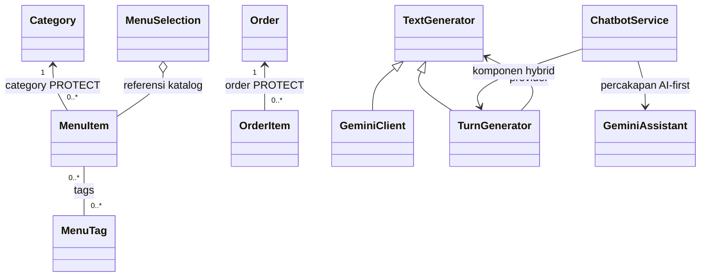

# Modul 4. Hubungan Kelas dan UML

[Kembali ke indeks OOP](README.md). Mengikuti kode proyek utama pada 23 Oktober 2026.

Menu mempunyai kategori. Pesanan mempunyai beberapa baris makanan. GeminiClient merupakan
turunan TextGenerator. Ketiga hubungan ini berbeda. Diagram UML membantu menggambarkannya,
tetapi kita perlu membaca kode terlebih dahulu agar panah dan jumlah hubungannya tidak dipilih
hanya berdasarkan perkiraan.

## Yang akan dipelajari

- Memahami masalah lewat contoh sebelum membaca kode.
- Menunjuk data dan method yang benar-benar dipakai pada lima berkas.
- Menjelaskan cara kerjanya dengan kata sendiri dan menyebutkan batasnya.

## Arti istilah yang diperlukan

| Istilah | Penjelasan sederhana |
|---|---|
| UML | Cara menggambar susunan class dan hubungannya. |
| Asosiasi | Hubungan antara dua object, misalnya menu terhubung dengan kategori. |
| Penghitungan | Pengelompokan beberapa object yang masih dapat digunakan sendiri. |
| Komposisi | Hubungan bagian dan pemilik yang sangat erat. Masa penggunaan bagian perlu ikut diperhatikan. |
| Inheritance | Hubungan induk dan turunan; class turunan merupakan jenis dari class induk. |
| Angka pada garis | Menunjukkan jumlah hubungan. Contohnya satu kategori dapat mempunyai banyak menu. |

## Lima contoh dari lima berkas berbeda

| Kasus | Berkas utama | Class atau method |
|---|---|---|
| 1. Hubungan menu dengan kategori berbeda dari hubungan menu dengan tag | [menu/models.py](../../menu/models.py#L48) | `MenuItem` |
| 2. Pesanan menyimpan harga pada saat pembelian | [orders/models.py](../../orders/models.py#L135) | `OrderItem` |
| 3. Pilihan pelanggan mengumpulkan menu dan tambahannya | [menu/selection.py](../../menu/selection.py#L34) | `MenuSelection.__init__` |
| 4. Chatbot membagi pekerjaan kepada beberapa object | [recommendation/services/chatbot.py](../../recommendation/services/chatbot.py#L114) | `ChatbotService.__init__` |
| 5. Turunan class berbeda dengan object bantuan yang dipakai | [recommendation/services/text_generator.py](../../recommendation/services/text_generator.py#L6) | `TextGenerator` |

## Kasus 1. Hubungan menu dengan kategori berbeda dari hubungan menu dengan tag

**Buka berkas:** [menu/models.py](../../menu/models.py#L68). **Class atau method yang
dibahas:** `MenuItem`.

### Masalah yang dihadapi

Satu menu masuk ke satu kategori. Menu yang sama dapat mempunyai beberapa tag, misalnya pedas
dan ayam. Menggambar kedua hubungan dengan cara yang sama akan membuat pembaca salah memahami
susunan datanya.

### Cuplikan kode nyata

Potongan berikut berasal dari `MenuItem.__str__`. Bagian lain dapat dibaca pada berkas aslinya.

```python
def __str__(self) -> str:
    return self.name
```

### Ikuti kode langkah demi langkah

1. Temukan hubungan category pada MenuItem.
2. Baca `related_name="items"` dan `on_delete=PROTECT`.
3. Temukan tags yang memakai ManyToManyField.
4. Bandingkan satu kategori per menu dengan banyak tag per menu.

### Contoh masukan dan hasilnya

Satu menu wajib terhubung dengan satu kategori. Satu kategori bisa mempunyai banyak menu atau
belum mempunyai menu. Sebuah menu juga bisa mempunyai beberapa tag, dan tag yang sama bisa
dipakai oleh menu lain. Jadi hubungan kategori dan tag tidak digambar dengan jumlah yang sama.

### Mengapa ini contoh OOP?

Field pada model menunjukkan hubungan yang benar-benar dipakai. `ForeignKey` menghubungkan menu
ke satu kategori. `ManyToManyField` memungkinkan satu menu mempunyai banyak tag dan satu tag
dipakai banyak menu. Garis diagram membantu kita membacanya tanpa harus menampilkan seluruh
kode.

### Hal yang perlu diingat

`PROTECT` berarti data induk yang masih dipakai tidak boleh dihapus melalui alur Cara Django
membaca dan menyimpan data terkait. Itu tidak berarti menghapus kategori akan menghapus menu
otomatis. Tag juga tidak menjadi class induk menu.

### Coba jelaskan kembali

Gambar hubungan kategori–menu dan menu–tag. Mengapa jumlah hubungan keduanya berbeda?

## Kasus 2. Pesanan menyimpan harga pada saat pembelian

**Buka berkas:** [orders/models.py](../../orders/models.py#L135). **Class atau method yang
dibahas:** `OrderItem`.

### Masalah yang dihadapi

Harga menu bisa berubah minggu depan. Namun struk pesanan hari ini tetap harus menunjukkan
harga ketika pelanggan memesan. Karena itu baris pesanan menyimpan nama dan harga saat
transaksi dibuat.

### Cuplikan kode nyata

Ini bagian awal `OrderItem`. Lanjutkan ke berkas aslinya untuk membaca seluruh method. Bagian
import tidak ditampilkan.

```python
class OrderItem(models.Model):
    order = models.ForeignKey(Order, on_delete=models.PROTECT, related_name="items")
    menu_item = models.ForeignKey(
        MenuItem, null=True, blank=True, on_delete=models.PROTECT, related_name="order_items"
    )
    item_name = models.CharField(max_length=150)
    base_price = models.DecimalField(
        max_digits=12, decimal_places=2, validators=[MinValueValidator(0)]
    )
    unit_price = models.DecimalField(
        max_digits=12, decimal_places=2, validators=[MinValueValidator(0)]
    )
    quantity = models.PositiveIntegerField(validators=[MinValueValidator(1)])
    line_total = models.DecimalField(
        max_digits=12, decimal_places=2, validators=[MinValueValidator(0)]
    )
    created_at = models.DateTimeField(auto_now_add=True)

```

### Ikuti kode langkah demi langkah

1. Temukan hubungan order pada OrderItem.
2. Baca item_name, base_price, dan unit_price yang disimpan pada baris pesanan.
3. Lihat quantity dan line_total.
4. Buka create_order untuk melihat larangan pesanan kosong yang diperiksa saat pembuatan pesanan.

### Contoh masukan dan hasilnya

Hari ini pelanggan memesan dengan harga Rp18.000. Besok harga katalog naik menjadi Rp20.000.
Baris pesanan hari ini tetap mempunyai harga yang disimpan saat pemesanan, sehingga struk lama
tidak perlu mengikuti harga katalog besok.

### Mengapa ini contoh OOP?

`OrderItem` terhubung dengan satu `Order`, tetapi juga menyimpan data sendiri seperti nama dan
harga satuan. Kita bisa melihat perbedaan antara hubungan ke katalog yang masih berubah dan
catatan transaksi yang perlu menyimpan keadaan saat pemesanan.

### Hal yang perlu diingat

Model dapat menggambarkan hubungan nol atau banyak baris. Aturan bahwa pesanan baru tidak boleh
kosong diperiksa oleh fungsi `create_order`. Jangan menganggap semua aturan layanan sudah
tergambar hanya dari garis pada diagram.

### Coba jelaskan kembali

Mengapa membaca harga katalog terbaru tidak cukup untuk menampilkan struk pesanan lama?

## Kasus 3. Pilihan pelanggan mengumpulkan menu dan tambahannya

**Buka berkas:** [menu/selection.py](../../menu/selection.py#L34). **Class atau method yang
dibahas:** `MenuSelection.__init__`.

### Masalah yang dihadapi

Satu pilihan terdiri dari menu, varian, dan addon. Semua itu sudah tersedia di katalog sebelum
pelanggan memilih. Program hanya mengumpulkannya untuk menghitung pilihan pelanggan.

### Cuplikan kode nyata

Potongan berikut berasal dari `MenuSelection.__init__`. Bagian lain dapat dibaca pada berkas
aslinya.

```python
def __init__(
    self,
    item: MenuItem,
    options: Iterable[VariantOption] = (),
    addons: Iterable[AddOn] = (),
) -> None:
    self.item: MenuItem = item
    self.__options: tuple[VariantOption, ...] = tuple(options)
    self.__addons: tuple[AddOn, ...] = tuple(addons)
```

### Ikuti kode langkah demi langkah

1. Lihat object menu, opsi, dan addon yang diterima bagian penyiapan object.
2. Perhatikan object tersebut berasal dari luar MenuSelection.
3. Lihat pilihan disimpan dalam tuple.
4. Baca from_ids untuk mengikuti pengambilan menu dan pilihan dari katalog.

### Contoh masukan dan hasilnya

Dua pilihan pelanggan dapat memakai satu MenuItem yang sama. Jika satu pilihan tidak dipakai
lagi, menu tersebut tetap tersimpan di database. Membuat MenuSelection tidak membuat tabel
hubungan baru hanya karena ia mengumpulkan beberapa object.

### Mengapa ini contoh OOP?

Hubungan ini bisa dijelaskan sebagai pengelompokan object. Menu dan addon tidak menjadi milik
satu pilihan saja; pilihan pelanggan lain dapat memakai menu yang sama. Pada diagram
pembelajaran, tanda penghitungan dapat dipakai dengan penjelasan bahwa yang dikelompokkan
adalah acuan ke data katalog.

### Hal yang perlu diingat

Menghapus variabel pilihan tidak menghapus menu dari database. Simbol wajik pada gambar juga
bukan perintah Python. Pilih simbol berdasarkan arti hubungan yang ingin dijelaskan, lalu
cocokkan dengan kode.

### Coba jelaskan kembali

Apakah menu katalog hilang ketika pilihan pelanggan tidak lagi dipakai? Mengapa?

## Kasus 4. Chatbot membagi pekerjaan kepada beberapa object

**Buka berkas:**
[recommendation/services/chatbot.py](../../recommendation/services/chatbot.py#L114). **Class
atau method yang dibahas:** `ChatbotService.__init__`.

### Masalah yang dihadapi

Untuk menjawab pesan, chatbot perlu membaca percakapan, mengenali menu, mencari katalog, dan
mungkin memakai Gemini. Satu object tidak harus menulis ulang semua pekerjaan itu sendiri.

### Cuplikan kode nyata

Ini bagian awal `ChatbotService.__init__`. Lanjutkan ke berkas aslinya untuk membaca seluruh
method. Bagian import tidak ditampilkan.

```python
def __init__(
    self,
    session: SessionBase,
    *,
    gemini_client: TextGenerator | None = None,
) -> None:
    self.session: SessionBase = session
    self._session_state: ConversationSession = ConversationSession(session)
    self._responses: LocalResponseComposer = LocalResponseComposer(session)
    self.tag_extractor: TagExtractor = TagExtractor()
    catalog_tags = (
        MenuTag.objects.filter(
            menu_items__is_active=True,
            menu_items__category__is_active=True,
        )
        .values_list("name", "display_name")
        .distinct()
    )
```

### Ikuti kode langkah demi langkah

1. Temukan pembuatan ConversationSession, TagExtractor, dan RecommendationService.
2. Lihat layanan AI yang diterima dari luar atau dibuat memakai GeminiClient.
3. Periksa GeminiAssistant yang menerima layanan AI langsung.
4. Bandingkan dengan TurnGenerator yang membatasinya untuk bagian hybrid.

### Contoh masukan dan hasilnya

Chatbot dapat memakai layanan Gemini yang sama pada assistant dan pembatas hybrid. Sesi juga
diberikan oleh request Django. Jadi tidak semua object bantuan hanya dimiliki dan dipakai oleh
satu object pengatur percakapan.

### Mengapa ini contoh OOP?

`ChatbotService` menyiapkan beberapa object bantuan dan menghubungkannya. Ini menunjukkan kerja
sama object tanpa harus membuat semuanya menjadi class turunan. Setiap bagian diberi pekerjaan
tertentu, misalnya menyimpan percakapan atau meminta teks dari layanan AI.

### Hal yang perlu diingat

Sesi berasal dari Django, sedangkan layanan AI dapat diberikan dari luar. Karena itu keberadaan
atribut tidak selalu berarti satu object memiliki seluruh bagian lain secara mutlak. Assistant
memakai Gemini langsung; bagian hybrid tertentu memakai TurnGenerator.

### Coba jelaskan kembali

Tunjukkan object yang mengatur percakapan dan object yang benar-benar meminta jawaban ke
Gemini.

## Kasus 5. Turunan class berbeda dengan object bantuan yang dipakai

**Buka berkas:**
[recommendation/services/text_generator.py](../../recommendation/services/text_generator.py#L6).
**Class atau method yang dibahas:** `TextGenerator`.

### Masalah yang dihadapi

TurnGenerator merupakan TextGenerator, tetapi di dalamnya juga ada object pembuat teks lain.
Hubungan “merupakan jenis dari” berbeda dengan hubungan “memakai bantuan dari”.

### Cuplikan kode nyata

Potongan berikut berasal dari `TextGenerator`. Bagian lain dapat dibaca pada berkas aslinya.

```python
class TextGenerator(ABC):
    @abstractmethod
    def generate(self, prompt: str) -> str | None:
        """Return response text, or None when generation is unavailable/failed.

        Provider adapters handle their own provider/network failures. Consumers
        remain responsible for parsing and validating the returned text.
        """

        raise NotImplementedError

    def generate_ranking(self, prompt: str) -> str | None:
        """Optional ranking format support; text-only providers keep their behavior."""

        return self.generate(prompt)
```

### Ikuti kode langkah demi langkah

1. Baca `TextGenerator(ABC)` dan method generate yang harus diisi turunan.
2. Temukan GeminiClient yang mewarisi TextGenerator.
3. Temukan TurnGenerator yang juga mewarisi TextGenerator.
4. Perhatikan TurnGenerator masih menyimpan self.provider sebagai object bantuan.

### Contoh masukan dan hasilnya

TurnGenerator merupakan jenis TextGenerator, sekaligus memakai object provider. Pada diagram,
hubungan ke induk memakai panah inheritance. Hubungan ke provider menjelaskan bantuan yang
dipakai, bukan class induk kedua.

### Mengapa ini contoh OOP?

Pada inheritance, panah menunjuk class induk. Pada kerja sama object, garis menunjukkan siapa
menyimpan atau memakai object lain. Satu class dapat mempunyai dua hubungan ini sekaligus.
Diagram perlu menampilkan perbedaan tersebut agar pembaca memahami cara program bekerja.

### Hal yang perlu diingat

TextGenerator hanya menjanjikan kemampuan tertentu, terutama generate. Ia belum menjanjikan
semua kemampuan percakapan yang dibutuhkan assistant. Garis inheritance tidak membuktikan
seluruh object dapat saling menggantikan pada semua tempat.

### Coba jelaskan kembali

Mengapa TurnGenerator dapat mempunyai garis ke TextGenerator sekaligus garis ke provider yang
disimpannya?


## Menjelaskan modul saat presentasi

Pilih satu kasus dan buka berkasnya. Ceritakan masalahnya, tunjukkan data yang dibaca, lalu
jelaskan method yang bekerja dan hasilnya. Gunakan satu contoh angka atau tindakan pengguna
agar temanmu dapat mengikuti penjelasan.

Sebutkan juga satu hal yang belum dijamin oleh kode tersebut. Misalnya, salinan keranjang
mencegah perubahan lewat hasil yang diberikan, tetapi tidak mengatur semua permintaan yang
datang bersamaan. Contoh nama dan harga pada materi adalah angka latihan, bukan daftar katalog
yang wajib ada di setiap laptop.

Latihan lanjutan ada di [Modul 10](10.%20Latihan%20dan%20Presentasi.md).

## Diagram gabungan sebagai bahan verifikasi



Wajik kosong pada gambar menunjukkan object yang dikelompokkan. Tanda itu tidak memerintahkan
Python menghapus data. Diagram ini hanya memuat hubungan penting, bukan seluruh isi class.
Jika ingin menyatakan hubungan bagian dan pemilik yang lebih erat, periksa dahulu siapa
yang membuat, memakai, dan menghapus masing-masing object.
