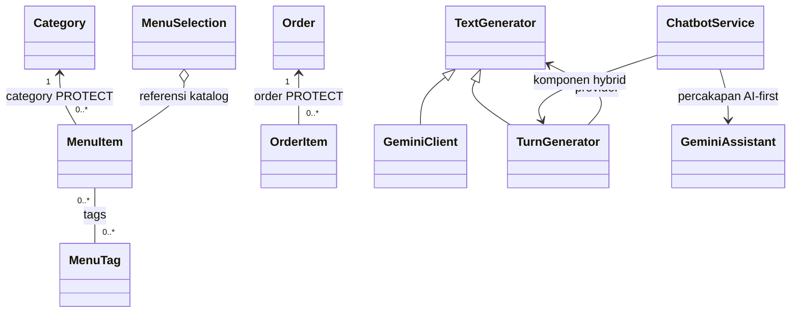

# Modul 4. Relasi Kelas dan UML

[Kembali ke indeks OOP](README.md). Diselaraskan dengan source project utama, 23 Oktober 2026.

Menu memiliki kategori, pesanan memiliki baris, dan generator merupakan turunan kontrak teks. Kata "memiliki" belum cukup menentukan bentuk hubungan UML. Kita harus memeriksa field, referensi, dependency, serta kepemilikan siklus hidup sebelum memilih panah dan multiplisitas.

## Tujuan pembelajaran

- Membedakan is-a, has-a, dan uses-a dari bukti kode.
- Menggambar multiplisitas berdasarkan field model, lalu menambahkan aturan layanan bila berbeda.
- Membedakan asosiasi/agregasi/komposisi tanpa menyamakan ForeignKey dengan cascade delete.

## Bekal istilah

| Istilah | Makna saat membaca kode |
|---|---|
| Asosiasi | Hubungan antarinstans yang saling merujuk. |
| Agregasi | Pengelompokan bagian yang dapat tetap ada secara mandiri. |
| Komposisi | Kepemilikan bagian kuat; membutuhkan alasan siklus hidup, bukan sekadar atribut. |
| Dependency/inheritance | Dependency memakai kemampuan lain; inheritance menyatakan turunan suatu tipe. |

## Peta lima kasus dari lima berkas berbeda

| Kasus | Berkas utama | Fokus simbol |
|---|---|---|
| 1. Kategori dan tag membentuk dua asosiasi berbeda | [menu/models.py](../../menu/models.py#L48) | `MenuItem` |
| 2. Pesanan, baris, dan snapshot harga perlu dibaca bersama | [orders/models.py](../../orders/models.py#L135) | `OrderItem` |
| 3. Pilihan menu mengelompokkan referensi katalog | [menu/selection.py](../../menu/selection.py#L34) | `MenuSelection.__init__` |
| 4. Chatbot merangkai object bantuan dengan cakupan berbeda | [recommendation/services/chatbot.py](../../recommendation/services/chatbot.py#L114) | `ChatbotService.__init__` |
| 5. Kontrak teks memberi garis inheritance yang berbeda dari provider | [recommendation/services/text_generator.py](../../recommendation/services/text_generator.py#L6) | `TextGenerator` |

## Kasus 1. Kategori dan tag membentuk dua asosiasi berbeda

**Berkas utama:** [menu/models.py](../../menu/models.py#L68). **Simbol yang dibedah:** `MenuItem`.

### Masalah yang dihadapi

Satu menu berada dalam satu kategori, tetapi dapat memiliki beberapa tag. Menulis semua garis sebagai "satu ke banyak" akan menghilangkan perbedaan bentuk data yang penting bagi pencarian dan pengelolaan katalog.

### Cuplikan kode nyata

Cuplikan `MenuItem.__str__` dari source saat penyelarasan. Import dan bagian lain tidak ditampilkan.

```python
def __str__(self) -> str:
    return self.name
```

### Bedah alur dan tanggung jawab

1. Baca ForeignKey Category pada field category dan related_name items.
2. Periksa on_delete=PROTECT sebelum memberi arti siklus hidup pada relasi.
3. Baca ManyToManyField MenuTag pada tags dan related_name menu_items.
4. Bandingkan arah akses item.category, category.items, item.tags, dan tag.menu_items.

### Contoh input dan hasil yang perlu dijelaskan

Satu MenuItem tersimpan wajib menunjuk satu Category, sedangkan Category dapat mempunyai nol atau banyak menu. Satu MenuItem dapat memiliki nol atau banyak MenuTag; satu tag juga dapat dipakai nol atau banyak menu. Tag pedas bukan class induk dari MenuItem dan tidak mengganti category.

### Hubungan dengan konsep OOP

Multiplisitas menyatakan berapa instans yang dapat terhubung. ForeignKey dan ManyToMany memberikan bukti relasi data. Hubungan ini adalah asosiasi; diagram sebaiknya menuliskan nama field agar pembaca dapat kembali ke source untuk memeriksanya.

### Batas penerapan dan kekeliruan yang perlu dihindari

PROTECT mencegah penghapusan induk yang masih dirujuk pada jalur ORM terkait. Itu bukan bukti bahwa semua object harus mati bersama atau bahwa menghapus kategori menghapus menu otomatis. Tag juga bukan bukti komposisi bahan lengkap.

### Latihan penelusuran

Gambar kedua hubungan dengan angka 1 dan 0..*. Jelaskan mengapa satu garis ManyToMany tidak diganti dengan panah inheritance.

## Kasus 2. Pesanan, baris, dan snapshot harga perlu dibaca bersama

**Berkas utama:** [orders/models.py](../../orders/models.py#L135). **Simbol yang dibedah:** `OrderItem`.

### Masalah yang dihadapi

Satu pesanan berisi beberapa baris. Ketika katalog berubah kemudian, transaksi lama masih membutuhkan nama dan harga saat pemesanan. Karena itu OrderItem menyimpan referensi sekaligus field snapshot, bukan hanya mengandalkan menu_item.price setiap kali struk dibaca.

### Cuplikan kode nyata

Cuplikan `OrderItem` dari source saat penyelarasan; bagian berikutnya dilanjutkan di berkas sumber. Import dan bagian lain tidak ditampilkan.

```python
class OrderItem(models.Model):
    order = models.ForeignKey(Order, on_delete=models.PROTECT, related_name="items")
    menu_item = models.ForeignKey(
        MenuItem, null=True, blank=True, on_delete=models.PROTECT, related_name="order_items"
    )
    item_name = models.CharField(max_length=150)
    base_price = models.DecimalField(
        max_digits=12, decimal_places=2, validators=[MinValueValidator(0)]
    )
    unit_price = models.DecimalField(
        max_digits=12, decimal_places=2, validators=[MinValueValidator(0)]
    )
    quantity = models.PositiveIntegerField(validators=[MinValueValidator(1)])
    line_total = models.DecimalField(
        max_digits=12, decimal_places=2, validators=[MinValueValidator(0)]
    )
    created_at = models.DateTimeField(auto_now_add=True)

```

### Bedah alur dan tanggung jawab

1. Baca order=ForeignKey(Order, PROTECT, related_name="items").
2. Baca menu_item yang dapat null dan field item_name/base_price/unit_price.
3. Telusuri quantity dan line_total untuk mengenali data historis pada baris.
4. Buka create_order di layanan untuk membedakan struktur tabel dengan aturan order tidak kosong.

### Contoh input dan hasil yang perlu dijelaskan

Diagram data memperbolehkan satu Order dihubungkan dengan nol atau banyak OrderItem; tiap baris wajib memiliki satu order. Namun layanan create_order menolak items kosong dan memakai transaksi atomic. Menu dapat berubah harga tanpa mengganti unit_price snapshot pada baris yang sudah tercatat.

### Hubungan dengan konsep OOP

Relasi domain bagian–keseluruhan perlu dikaitkan dengan implementasi siklus hidup. Pada kode ini PROTECT tidak otomatis menghapus baris saat order dihapus. Menggambar asosiasi dengan catatan PROTECT lebih jujur daripada mengklaim cascade composition hanya berdasarkan cerita restoran.

### Batas penerapan dan kekeliruan yang perlu dihindari

Snapshot tidak membuat seluruh object OrderItem immutable; operasi sah masih dapat mengubah pesanan sesuai status dan izin. Aturan layanan/transaksi tidak seluruhnya terlihat pada diagram kelas atau field. Jangan menyimpulkan order kosong berhasil dibuat hanya karena struktur sementara dapat memilikinya.

### Latihan penelusuran

Apa yang harus dicantumkan pada diagram dan apa yang perlu dijelaskan sebagai aturan layanan? Mengapa struk memakai snapshot?

## Kasus 3. Pilihan menu mengelompokkan referensi katalog

**Berkas utama:** [menu/selection.py](../../menu/selection.py#L34). **Simbol yang dibedah:** `MenuSelection.__init__`.

### Masalah yang dihadapi

Satu pilihan pelanggan menggabungkan item, opsi, dan addon yang sudah ada. Tidak ada kebutuhan agar katalog dihapus ketika object pilihan selesai dipakai. Ini membantu membedakan penampungan referensi dari kepemilikan hidup yang eksklusif.

### Cuplikan kode nyata

Cuplikan `MenuSelection.__init__` dari source saat penyelarasan. Import dan bagian lain tidak ditampilkan.

```python
def __init__(
    self,
    item: MenuItem,
    options: Iterable[VariantOption] = (),
    addons: Iterable[AddOn] = (),
) -> None:
    self.item: MenuItem = item
    self.__options: tuple[VariantOption, ...] = tuple(options)
    self.__addons: tuple[AddOn, ...] = tuple(addons)
```

### Bedah alur dan tanggung jawab

1. Periksa parameter constructor: object diterima, bukan semuanya dibuat secara internal.
2. Lihat self.item dan tuple pilihan.
3. Buka from_ids untuk mengikuti pengambilan model yang sudah ada di database.
4. Periksa tidak ada delete pada siklus hidup MenuSelection.

### Contoh input dan hasil yang perlu dijelaskan

Dua MenuSelection dapat menunjuk MenuItem yang sama dengan tuple opsi berbeda. Saat salah satu selection tidak lagi direferensikan Python, baris MenuItem dan AddOn di database tetap ada. Karena koleksi dan referensinya lokal, ini bukan hubungan ManyToMany ORM baru.

### Hubungan dengan konsep OOP

Sebagai model pembelajaran, wajik kosong dapat dipakai untuk agregasi referensi. Beri label bahwa ini pengelompokan pilihan sementara. Dependency dari CartService ke MenuSelection berbeda lagi: layanan memakainya untuk validasi/perhitungan dan tidak harus mewarisinya.

### Batas penerapan dan kekeliruan yang perlu dihindari

Agregasi pada UML merupakan keputusan pemodelan yang harus dijelaskan. Python tidak mengeksekusi simbol wajik. Tuple tidak membuktikan komposisi, dan constructor menerima object dari luar sehingga kepemilikan eksklusif tidak dapat disimpulkan.

### Latihan penelusuran

Apakah menghapus variabel selection menghapus katalog? Gambarkan dua selection yang berbagi satu item tanpa memberi panah inheritance.

## Kasus 4. Chatbot merangkai object bantuan dengan cakupan berbeda

**Berkas utama:** [recommendation/services/chatbot.py](../../recommendation/services/chatbot.py#L114). **Simbol yang dibedah:** `ChatbotService.__init__`.

### Masalah yang dihadapi

Satu pesan perlu penafsir, pencarian katalog, penyimpanan konteks, serta provider. Constructor ChatbotService memperlihatkan perangkaian dependency yang sering disebut object composition dalam desain sehari-hari. Istilah itu harus dibedakan dari komposisi UML yang mempunyai makna kepemilikan lebih ketat.

### Cuplikan kode nyata

Cuplikan `ChatbotService.__init__` dari source saat penyelarasan; bagian berikutnya dilanjutkan di berkas sumber. Import dan bagian lain tidak ditampilkan.

```python
def __init__(
    self,
    session: SessionBase,
    *,
    gemini_client: TextGenerator | None = None,
) -> None:
    self.session: SessionBase = session
    self._session_state: ConversationSession = ConversationSession(session)
    self._responses: LocalResponseComposer = LocalResponseComposer(session)
    self.tag_extractor: TagExtractor = TagExtractor()
    catalog_tags = (
        MenuTag.objects.filter(
            menu_items__is_active=True,
            menu_items__category__is_active=True,
        )
        .values_list("name", "display_name")
        .distinct()
    )
```

### Bedah alur dan tanggung jawab

1. Temukan ConversationSession(session), TagExtractor(), dan RecommendationService().
2. Cari parameter gemini_client dan pemilihan instance yang diberikan atau GeminiClient bawaan.
3. Periksa GeminiAssistant yang menerima provider langsung.
4. Bandingkan TurnGenerator yang membungkus provider untuk komponen hybrid.

### Contoh input dan hasil yang perlu dijelaskan

Satu provider dapat direferensikan assistant dan wrapper hybrid sekaligus. Menghapus referensi pada satu komponen tidak otomatis menutup atau menghapus object di semua pemakai. Sesi juga berasal dari request, sehingga hidupnya tidak dimiliki eksklusif oleh ChatbotService.

### Hubungan dengan konsep OOP

Diagram dapat memakai dependency/asosiasi berlabel, misalnya ChatbotService --> GeminiAssistant dan ChatbotService --> ConversationSession. Perangkaian object memisahkan pekerjaan tanpa membutuhkan inheritance antarsemua komponen. Tanggung jawab hubungan perlu disebut, bukan hanya daftar class.

### Batas penerapan dan kekeliruan yang perlu dihindari

Jangan memberi wajik terisi pada semua atribut constructor. AI-first memakai provider langsung dan converse, sedangkan komponen hybrid memakai TurnGenerator. Diagram yang mengarahkan semua dispatch lewat wrapper akan mengajarkan alur yang tidak sesuai source.

### Latihan penelusuran

Gambar cabang provider langsung dan provider melalui wrapper. Relasi mana yang dependency dan mana yang menyimpan referensi?

## Kasus 5. Kontrak teks memberi garis inheritance yang berbeda dari provider

**Berkas utama:** [recommendation/services/text_generator.py](../../recommendation/services/text_generator.py#L6). **Simbol yang dibedah:** `TextGenerator`.

### Masalah yang dihadapi

GeminiClient dan TurnGenerator sama-sama dapat digunakan sebagai pembuat teks pada batas generate. Di saat yang sama, TurnGenerator memiliki provider lain di dalamnya. Satu class dapat mempunyai hubungan inheritance dan asosiasi sekaligus.

### Cuplikan kode nyata

Cuplikan `TextGenerator` dari source saat penyelarasan. Import dan bagian lain tidak ditampilkan.

```python
class TextGenerator(ABC):
    @abstractmethod
    def generate(self, prompt: str) -> str | None:
        """Return response text, or None when generation is unavailable/failed.

        Provider adapters handle their own provider/network failures. Consumers
        remain responsible for parsing and validating the returned text.
        """

        raise NotImplementedError

    def generate_ranking(self, prompt: str) -> str | None:
        """Optional ranking format support; text-only providers keep their behavior."""

        return self.generate(prompt)
```

### Bedah alur dan tanggung jawab

1. Baca TextGenerator(ABC) dan abstractmethod generate.
2. Temukan deklarasi GeminiClient(TextGenerator).
3. Temukan deklarasi TurnGenerator(TextGenerator) dan atribut self.provider.
4. Bedakan panah turunan menuju TextGenerator dengan garis penggunaan menuju provider.

### Contoh input dan hasil yang perlu dijelaskan

TurnGenerator adalah suatu TextGenerator dan mempunyai referensi provider. Dua pernyataan tersebut berbeda. Memanggil generate pada wrapper dapat meneruskan pekerjaan ke provider setelah reservasi, sehingga hubungan menggunakan object tidak membuat provider menjadi superclass kedua.

### Hubungan dengan konsep OOP

Segitiga kosong UML menunjuk induk. Garis asosiasi/dependency menuju provider menjelaskan cara implementasi bekerja. Menulis is-a dan has-a di samping diagram dapat membantu pembaca menguji apakah panah telah dipilih berdasarkan bukti.

### Batas penerapan dan kekeliruan yang perlu dihindari

Kontrak TextGenerator belum menyatakan converse atau available. Karena itu turunan generate saja tidak otomatis memenuhi kebutuhan GeminiAssistant AI-first. Diagram inheritance membuktikan hubungan tipe, bukan semua janji perilaku atau kualitas jawaban.

### Latihan penelusuran

Mengapa TurnGenerator mempunyai dua garis berbeda pada diagram? Apakah TextGenerator juga harus mengetahui SDK Google?

## Menjelaskan modul saat presentasi

Pilih satu kasus, buka berkas utamanya, dan tunjukkan simbol yang dibahas. Jelaskan input, state, pemanggilan method, hasil, lalu konsep OOP yang membuat alurnya dapat dipahami. Setelah itu sebutkan satu batas desain. Membaca source membuktikan bentuk implementasi; hasil runtime harus didukung pengujian yang benar-benar dijalankan.

Kelima kasus memakai lima berkas utama berbeda; berkas pendamping boleh muncul lagi untuk menjelaskan hubungan. Nilai harga, nama menu, dan akun pada cerita adalah ilustrasi. Jangan menjalankan operasi database, unggahan, atau provider asli hanya untuk menghafal konsep. Latihan aman dan rubrik presentasi tersedia di [Modul 10](10.%20Latihan%20dan%20Presentasi.md).

## Diagram gabungan sebagai bahan verifikasi



Wajik kosong adalah pemodelan pengelompokan referensi, bukan perintah penghapusan. Garis diagram ini tidak menampilkan semua field atau semua dependency. Tidak ada klaim komposisi UML kuat hanya dari keberadaan ForeignKey.
