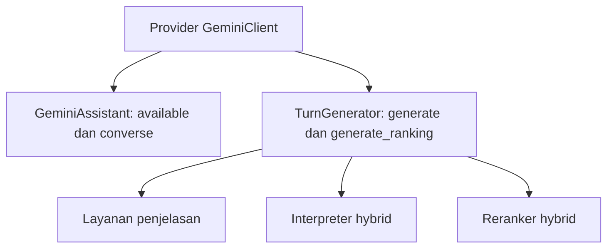

# 8. Pendalaman Abstraksi

[Indeks OOP](README.md) · Pendamping [Modul 6](6.%20Polimorfisme%20dan%20Abstraksi.md).
Diselaraskan pada 23 Oktober 2026.

## Mulai dari kebutuhan pemakai

Layanan penjelasan ingin meminta teks dan memeriksa hasilnya. Ia tidak perlu
mengetahui object respons SDK Google, header jaringan, atau algoritma counter.
Abstraksi memilih kemampuan yang cukup untuk kebutuhan itu. Dalam proyek,
[TextGenerator](../../recommendation/services/text_generator.py) menyatakan
`generate(prompt: str) -> str | None`.

Kata "cukup" penting. Menyembunyikan semua detail tidak berarti menghilangkan
semua aturan. Caller tetap harus memahami jenis input, bentuk hasil, kondisi
gagal, dan apakah operasi mempunyai efek seperti penggunaan kuota.

## Kontrak formal yang benar-benar ada

```python
class TextGenerator(ABC):
    @abstractmethod
    def generate(self, prompt: str) -> str | None:
```

Ini cuplikan deklarasi; docstring dan isi method dilihat di source. Method
abstrak induk melempar NotImplementedError. Subclass perlu mengimplementasikan
generate sebelum dapat dipakai sebagai instans konkret. Induk juga menyediakan
generate_ranking yang secara default meneruskan ke self.generate.

Ada dua tingkat validasi yang berbeda. ABC memeriksa kelengkapan implementasi
method abstrak saat instansiasi. Validasi domain memeriksa apakah teks hasil
memenuhi format, ID, panjang, dan fakta yang diizinkan. ABC tidak menjalankan
penilaian kualitas seluruh jawaban provider dan annotation tidak memaksa semua
nilai runtime sesuai tipe.

## Tiga kontrak yang jangan dicampur

| Kemampuan | Source pemilik | Hasil/kebutuhan |
|---|---|---|
| Teks umum | TextGenerator.generate | str atau None; caller memvalidasi isi |
| Ranking khusus | TextGenerator.generate_ranking | Default memakai generate; adapter dapat mengkhususkan format |
| Percakapan tool | GeminiClient.converse | Pesan, instruksi, deklarasi tool, handler, callback budget; tuple respons/hasil tool |

[GeminiAssistant.respond](../../recommendation/services/ai/assistant.py)
memerlukan available dan converse. Keduanya bukan bagian kontrak TextGenerator.
Karena itu fake yang hanya mempunyai generate belum tentu dapat menggantikan
provider pada seluruh ChatbotService. Type hint sempit pada constructor tidak
menghapus kebutuhan runtime tersebut.

## Bedah perjalanan dependency

Pada [ChatbotService.`__init__`](../../recommendation/services/chatbot.py), provider
diberikan dari parameter atau dibentuk sebagai GeminiClient. Provider itu dipakai
langsung oleh assistant dan juga dibungkus TurnGenerator. Layanan penjelasan,
interpreter, dan reranker hybrid menerima wrapper tersebut.



Garis menunjukkan penggunaan object, bukan semua urutan panggilan. Pada reply,
AI-first dicoba lebih dahulu ketika tersedia; jika tidak menghasilkan respons,
jalur lokal/hybrid dapat dipakai. Aturan satu upaya TurnGenerator berlaku pada
komponen yang melalui wrapper, bukan batas satu SDK dispatch untuk seluruh AI-first.

## Abstraksi tidak harus memakai ABC

[CartService](../../cart/services.py) menyajikan add_item, update_quantity, dan
get_items tanpa meminta view mengubah _lines sendiri. Itu abstraksi layanan
melalui antarmuka operasinya, meskipun CartService bukan abstract class.
[MenuSelection](../../menu/selection.py) menyajikan from_ids dan unit_price;
caller tidak harus menulis ulang query opsi wajib setiap kali.

Fungsi create_order juga menjadi batas operasi yang berguna. Satu pemanggilan
mengoordinasikan validasi, penyimpanan, audit, dan total dalam transaksi atomic.
Menyebutnya abstraksi layanan tidak mengharuskan kita mengarang class OrderService
yang tidak ada pada source.

## Contoh substitusi yang perlu dijelaskan

Untuk layanan penjelasan, object uji yang memenuhi kontrak generate dapat
menyediakan teks yang diketahui agar parser diuji tanpa API. Untuk assistant,
object uji harus mendukung kontrak percakapan tambahan. Tes kuota adapter pada
[test_audit_regressions.py](../../recommendation/tests/test_audit_regressions.py)
memakai transport palsu dan melewati constructor agar tidak membentuk SDK client.
Itu strategi pengujian adapter, bukan mode provider palsu yang otomatis tersedia
di halaman web.

## Latihan pendalaman

1. Buka tiga caller: penjelasan, wrapper, dan assistant. Tuliskan method provider
   yang benar-benar dipanggil masing-masing, bukan yang diasumsikan dari annotation.
2. Jika fake hanya mendukung generate, caller mana yang dapat memakainya? Jelaskan
   kegagalan yang mungkin muncul pada caller lain sebelum menjalankan tes.
3. Apa bedanya membuat kontrak conversation baru sebagai usulan desain dan
   menyatakan kontrak itu sudah tersedia? Tunjukkan bukti source untuk jawabanmu.
4. Jelaskan bagaimana None yang sah membantu fallback tanpa menjamin semua error
   aplikasi akan tertangkap oleh adapter.

Pembahasan ini membaca batas desain yang ada. Tidak ditambahkan provider,
abstract class baru, atau panggilan API untuk pekerjaan dokumentasi.
