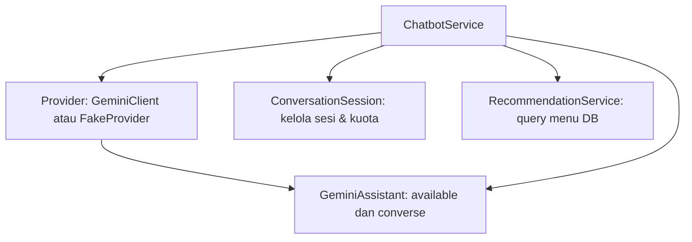

# 8. Pendalaman Abstraksi

[Indeks OOP](README.md) · Pendamping [Modul 6](6.%20Polimorfisme%20dan%20Abstraksi.md).

## Meminta pekerjaan tanpa mengatur semua caranya

Bayangkan kamu meminta seseorang mencetak struk. Kamu perlu tahu data yang diberikan dan hasil
yang akan diterima. Kamu tidak harus mengatur setiap gerakan mesin cetak. Abstraksi punya
tujuan serupa: menunjukkan kemampuan yang dibutuhkan, sambil menyerahkan cara mengerjakannya
kepada bagian yang sesuai.

Dalam proyek ini, layanan chatbot meminta teks kepada pembuat teks.
[TextGenerator](../../recommendation/services/text_generator.py) menyatakan kemampuan
`generate`. Pemakainya memberi pesan dan menerima teks atau `None`. `None` berarti teks tidak
tersedia, sehingga pemakai dapat memilih jawaban lain.

## Kemampuan yang wajib diisi turunan

```python
class TextGenerator(ABC):
    @abstractmethod
    def generate(self, prompt: str) -> str | None:
```

Potongan ini menunjukkan awal penulisan class. `ABC` dan `abstractmethod` adalah cara Python
menandai bahwa method tertentu harus diisi oleh class turunan. TextGenerator sendiri belum
mengerjakan pembuatan teks. GeminiClient dan FakeProvider mengisi kemampuan tersebut dengan
pekerjaan masing-masing.

Pemeriksaan ini hanya menyangkut kelengkapan method. Python tidak membaca seluruh jawaban
Gemini lalu memastikan semua faktanya benar. Bagian yang memakai jawaban tetap perlu memeriksa
isi, bentuk data, dan nomor menu.

## Membuat teks biasa berbeda dari percakapan dengan tool

| Kebutuhan | Method | Penjelasan |
|---|---|---|
| Meminta teks | TextGenerator.generate | Memberi satu pesan, menerima teks atau None. |
| Percakapan dengan tool katalog | GeminiClient.converse / GeminiAssistant.respond | AI dapat meminta fungsi bantuan (misalnya pencarian menu katalog) dijalankan sebelum memberi jawaban akhir. |

Tool di sini berarti fungsi bantuan di server, misalnya mencari menu. Tool bukan program yang
bebas dibuat dan dijalankan AI. Program menentukan fungsi yang tersedia serta memeriksa masukan
dan hasilnya.

[GeminiAssistant.respond](../../recommendation/services/ai/assistant.py) memakai `available`
dan `converse`. Keduanya tidak tercantum sebagai kemampuan wajib TextGenerator. Jadi object
yang hanya mempunyai generate belum tentu bisa dipakai menggantikan Gemini pada seluruh
chatbot.

Contohnya, pembuat teks tiruan pada tes bisa cocok untuk layanan chatbot, tetapi belum cocok
untuk assistant yang membutuhkan percakapan dengan tool. Periksa method yang benar-benar
dipanggil sebelum mengganti suatu object.

## Bagaimana object bantuan disusun pada chatbot?

[ChatbotService](../../recommendation/services/chatbot.py) menerima pembuat teks dari luar atau
membuat GeminiClient sebagai pilihan bawaan. Object itu dipakai assistant secara langsung
untuk memproses pesan pelanggan dan memanggil tool pencarian katalog.



Arsitektur chatbot berjalan secara AI-first. Asisten AI langsung berinteraksi dengan pengguna dan dapat
meminta eksekusi tool pencarian katalog Django. Jika Gemini tidak aktif, kuota habis, atau respons gagal
diverifikasi, sistem secara tegas mengembalikan status bahwa Chatbot belum tersedia (HTTP 503) tanpa
melakukan tebakan lokal yang rapuh.

## Abstraksi juga terlihat pada layanan biasa

[CartService](../../cart/services.py) menyediakan add_item dan update_quantity. Bagian halaman
tidak perlu mengubah daftar keranjang sendiri. Pemakai cukup memberi pilihan dan jumlah, lalu
layanan memeriksa dan menyimpannya.

[MenuSelection](../../menu/selection.py) menyediakan from_ids dan unit_price. Pemakainya tidak
perlu mengulang seluruh pencarian varian wajib setiap kali menghitung pilihan. Ini juga
membantu menyembunyikan pekerjaan yang tidak perlu diatur pemakai, walaupun class tersebut
tidak ditulis sebagai ABC.

Fungsi create_order pun menyediakan satu langkah untuk membuat pesanan. Ia memeriksa data dan
mengatur penyimpanan sebagai satu kesatuan. Kita tidak perlu mengarang class OrderService;
dalam proyek sekarang pekerjaan itu berupa fungsi.

## Coba jelaskan kembali

1. Apa yang perlu diketahui layanan chatbot agar dapat meminta teks?
2. Mengapa object yang hanya punya generate belum cukup untuk assistant?
3. Apa yang disembunyikan CartService dari bagian halaman yang memakainya?
4. Mengapa adanya ABC belum menjamin semua jawaban AI benar?

Untuk melihat contoh tes tanpa memanggil Google, baca [tes pembatas dan pencatatan
Gemini](../../recommendation/tests/test_audit_regressions.py). Tes memakai pengganti panggilan
jaringan. Itu berbeda dari mode tiruan yang langsung dapat dipilih pada halaman web; mode web
tersebut belum dibuat.
