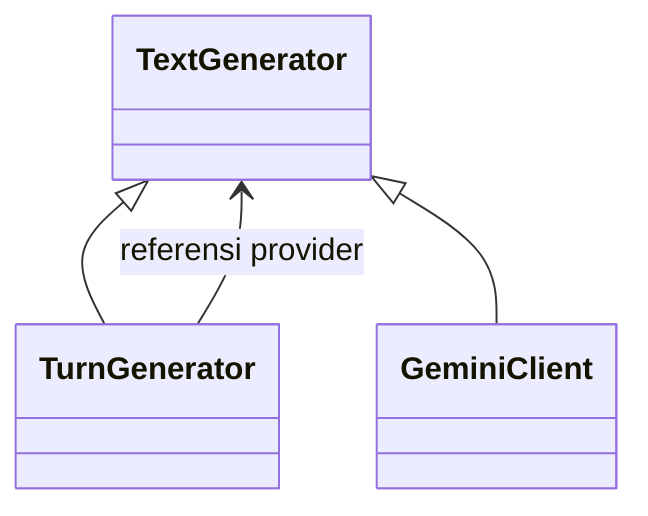

# 9. Pendalaman Komposisi

[Indeks OOP](README.md) · Pendamping [Modul 4](4.%20Relasi%20Kelas%20dan%20UML.md).
Diselaraskan pada 23 Oktober 2026.

## Mulai dari "merupakan", "mempunyai", dan "memakai"

TurnGenerator merupakan TextGenerator, mempunyai referensi provider, dan memakai
provider untuk membuat teks. Tiga kalimat ini menerangkan aspek berbeda. Pada
desain sehari-hari, merangkai object bantuan sering disebut object composition.
Dalam UML, komposisi dengan wajik terisi menyatakan kepemilikan bagian yang lebih
kuat. Kedua pemakaian istilah tidak boleh disamakan tanpa penjelasan.

## Kasus perangkaian nyata: TurnGenerator

Cuplikan constructor dari
[turn_generator.py](../../recommendation/services/ai/turn_generator.py):

```python
class TurnGenerator(TextGenerator):
    def __init__(self, provider: TextGenerator) -> None:
        self.provider = provider
        self.reset()
```

Provider diterima dari luar. Wrapper tidak menyatakan bahwa object tersebut
hanya boleh dipakai olehnya. self.provider menyimpan referensi, lalu _generate
meneruskan panggilan setelah gate privasi, reservasi, dan percobaan diperiksa.
Memanggil reset hanya mereset flag giliran wrapper; itu bukan reset counter
provider bersama atau penghapusan client SDK.



Panah inheritance menjelaskan tipe. Garis provider menjelaskan kerja sama object.
Wajik terisi tidak diperlukan untuk menjelaskan delegation yang terlihat ini.

## Kasus katalog: MenuSelection

[MenuSelection](../../menu/selection.py) menerima satu MenuItem dan iterable
opsi/addon. Koleksi diubah menjadi tuple agar keanggotaan pilihan tidak ikut
berubah hanya karena list sumber di-append. Object katalog di dalamnya tetap
referensi ke model yang mempunyai identitas sendiri.

Menghapus variabel selection di Python tidak menjalankan delete pada database.
Menu yang sama dapat dipakai dua selection. Hubungan ini dapat dimodelkan sebagai
agregasi referensi dengan label yang jelas. Menulis "selection memiliki addon"
belum membuktikan addon wajib musnah ketika selection tidak digunakan.

## Kasus sesi: ChatbotService dan ConversationSession

[ChatbotService](../../recommendation/services/chatbot.py) membentuk wrapper sesi,
penafsir, pencarian, assistant, dan beberapa helper. SessionBase datang dari
request Django. [ConversationSession](../../recommendation/services/conversation_session.py)
memegang referensinya dan mengelola kunci dialog tertentu, bukan memiliki seluruh
data sesi aplikasi secara eksklusif.

Reset menghapus daftar state dialog, termasuk teks pesan/jawaban lama. Ia tidak
menghapus cart, autentikasi, atau gemini_calls. Pada level alur, reset dapat
diikuti panggilan sapaan baru bila Gemini tersedia. Membedakan kepemilikan state
membantu kita memahami kenapa session.flush bukan pengganti reset yang sesuai.

## Kasus database: Order dan OrderItem

Pada [orders/models.py](../../orders/models.py), OrderItem.order memakai
ForeignKey dengan PROTECT. Secara domain baris merupakan bagian dari pesanan,
tetapi implementasinya tidak menyatakan bahwa penghapusan order otomatis
menghapus semua baris. Riwayat harga disimpan sebagai snapshot dan layanan
transaksi mempunyai aturan status/izin sendiri.

Diagram yang paling mudah diaudit adalah asosiasi dengan multiplisitas dan
catatan PROTECT. Komposisi domain boleh dibahas sebagai interpretasi bila dosen
meminta, tetapi jelaskan perbedaannya dengan perilaku penghapusan ORM. Jangan
mengganti PROTECT menjadi CASCADE hanya agar cocok dengan gambar.

## Lima pertanyaan sebelum memberi wajik terisi

1. Siapa yang membentuk object bagian, dan apakah menerima bagian dari luar?
2. Dapatkah bagian dibagi ke object lain? Contoh provider digunakan assistant
   sekaligus wrapper hybrid pada perangkaian chatbot.
3. Apakah bagian mempunyai identitas dan arti mandiri, seperti menu katalog?
4. Apa yang terjadi saat referensi owner dilepas? Bedakan garbage collection
   object memori dengan penghapusan record database.
5. Apakah source mempunyai aturan siklus hidup eksklusif yang dapat ditunjukkan,
   atau kita hanya menafsirkan kata "memiliki" pada cerita domain?

## Mengapa komposisi object berguna tanpa memaksakan inheritance

CartService memakai MenuSelection untuk validasi, tetapi CartService bukan jenis
MenuSelection. ChatbotService memakai StaffAccess hanya jika suatu alur memang
membutuhkannya; kebutuhan menggunakan kemampuan tidak otomatis berarti mewarisi
class tersebut. Ketika tujuan hubungan adalah membagi pekerjaan, menerima object
atau memanggil fungsi sering lebih tepat daripada membuat pohon turunan baru.

Pada proyek ini, fungsi transaksi orders/services.py juga dapat memakai object
model dan selection tanpa menjadi class besar. Pilihan OOP dinilai dari batas
tanggung jawab serta kebutuhan perubahan, bukan jumlah inheritance pada diagram.

## Latihan

Buat tabel untuk TurnGenerator–provider, MenuSelection–MenuItem,
ConversationSession–session, dan Order–OrderItem. Isi kolom sumber pembentukan,
peluang berbagi, aturan penghapusan, serta simbol diagram yang dipilih. Sertakan
satu kalimat alasan per hubungan. Jika tidak ada bukti siklus hidup, nyatakan
belum ada bukti; itu lebih tepat daripada menggambar komposisi kuat secara otomatis.
