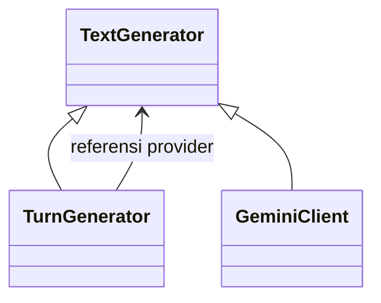

# 9. Pendalaman Komposisi

[Indeks OOP](README.md) · Pendamping [Modul 4](4.%20Relasi%20Kelas%20dan%20UML.md).

## Memakai bantuan berbeda dengan menjadi turunan

Di restoran, kasir memakai alat cetak struk. Kasir bukan turunan dari alat cetak. Dalam program
juga begitu: sebuah class bisa memakai object lain untuk membantu pekerjaannya tanpa harus
mewarisi class object tersebut.

Pada TurnGenerator, ada dua hubungan yang perlu dibedakan. Ia **merupakan TextGenerator**,
sehingga mengikuti kemampuan dasar pembuat teks. Ia juga **mempunyai provider**, yaitu object
yang diminta membuat teks setelah pemeriksaan selesai.

## Contoh pada TurnGenerator

Cuplikan dari [turn_generator.py](../../recommendation/services/ai/turn_generator.py):

```python
class TurnGenerator(TextGenerator):
    def __init__(self, provider: TextGenerator) -> None:
        self.provider = provider
        self.reset()
```

Provider diberikan dari luar, lalu disimpan pada self.provider. TurnGenerator tidak menulis
ulang seluruh cara menghasilkan teks. Ia memeriksa jatah percobaan, kemudian meneruskan
pekerjaan kepada object bantuan tersebut.



Panah ke TextGenerator menjelaskan hubungan induk dan turunan. Garis provider menjelaskan
object bantuan yang dipakai. Dua garis itu bukan dua cara berbeda untuk menyatakan hal yang
sama.

## Dua arti komposisi yang sering tertukar

Dalam pembicaraan desain, “merangkai object” sering disebut komposisi object. Artinya beberapa
object bekerja sama. Namun pada UML, tanda wajik terisi mempunyai arti lebih khusus: bagian
sangat terkait dengan pemiliknya, termasuk masa penggunaannya.

Karena itu, jangan langsung memberi wajik terisi pada semua atribut. Tanyakan dahulu: apakah
object bantuan hanya dipakai satu pemilik? Apakah ia masih berguna sendiri? Apa yang terjadi
jika object pengaturnya tidak dipakai lagi?

## Contoh pilihan makanan

[MenuSelection](../../menu/selection.py) mengumpulkan menu, varian, dan addon yang dipilih
pelanggan. Menu katalog sudah ada sebelumnya dan dapat dipakai pelanggan lain. Jika satu
pilihan tidak lagi dipakai, menunya tetap ada.

Daftar pilihan disimpan dalam tuple. Tuple membantu menjaga agar daftar anggota tidak ditambah
lewat append, tetapi tidak menghapus atau membekukan object katalog di dalamnya. Pengelompokan
ini dapat digambarkan sebagai penghitungan, yaitu beberapa object dikumpulkan tetapi masih
dapat digunakan sendiri.

## Contoh data percakapan

[ConversationSession](../../recommendation/services/conversation_session.py) menerima sesi dari
Django. Ia mengatur data percakapan tertentu, bukan seluruh isi sesi. Keranjang dan login
mempunyai kegunaan sendiri di aplikasi.

Saat Mulai Lagi ditekan, data dialog lama dihapus. Cart, login, dan penghitung pemakaian tetap
ada. Contoh ini membantu kita melihat mengapa pembagian pekerjaan penting: object percakapan
tidak seharusnya menghapus data lain.

## Contoh pesanan dan baris makanan

Pada [orders/models.py](../../orders/models.py), setiap OrderItem terhubung dengan satu Order.
Aturan penghapusannya memakai PROTECT. Jadi menghapus order tidak otomatis menghapus semua
barisnya melalui hubungan tersebut.

Dalam cerita restoran, baris makanan memang merupakan bagian pesanan. Tetapi untuk menggambar
perilaku program, baca aturan kodenya. Jelaskan hubungan dan jumlahnya, lalu tambahkan catatan
PROTECT. Jangan mengubah kode menjadi CASCADE hanya agar cocok dengan gambar komposisi.

## Latihan membuat alasan untuk setiap garis

Buat tabel dengan empat pasangan: TurnGenerator–provider, MenuSelection–MenuItem,
ConversationSession–sesi, dan Order–OrderItem. Jawab pertanyaan berikut:

1. Siapa yang membuat atau memberikan object bantuan?
2. Apakah object yang sama dapat dipakai oleh bagian lain?
3. Apakah data di database ikut terhapus jika variabel di Python dihapus?
4. Simbol hubungan apa yang dipilih, dan baris kode mana yang menjadi alasannya?

Jawaban tidak harus selalu “komposisi”. Yang penting hubungan pada gambar dapat dijelaskan dari
kode. Memakai fungsi atau object bantuan sering sudah cukup; tidak semua kerja sama perlu
dibuat menjadi hubungan induk dan turunan.
