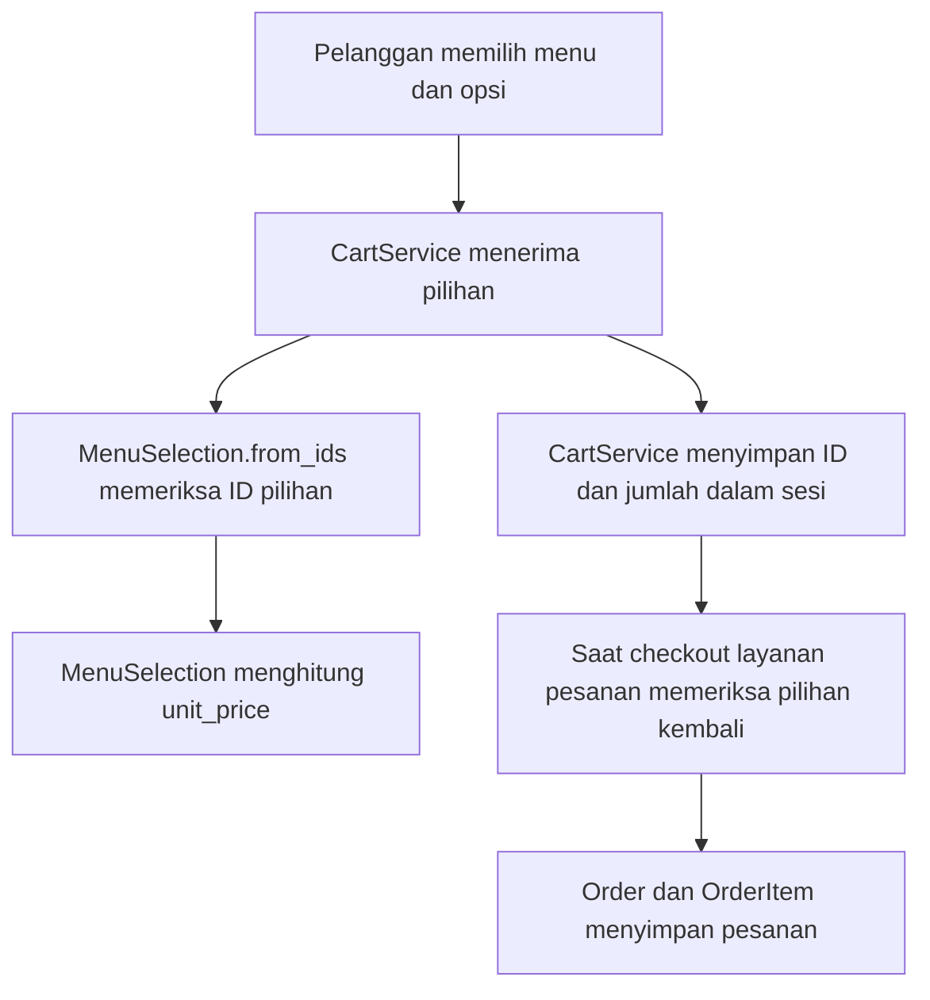

# Panduan belajar OOP dari kode RasaKita

Panduan ini untuk anggota proyek bersama Universitas Mulawarman, Samarinda.
Tujuannya supaya anggota dapat membuka file nyata, menemukan bagian kodenya,
lalu menjelaskan hubungan kode dengan materi kuliah menggunakan bahasa sendiri.

Ada **7 materi utama dan 35 kasus**, tepat lima kasus pada setiap materi.
Urutannya mengikuti tujuh PDF yang diberikan. Contoh laptop, bank, tim, dan hero
pada modul kuliah dipakai sebagai acuan konsep, lalu dipetakan ke implementasi
restoran yang benar-benar ada. Dokumen ini tidak menyalin seluruh modul kuliah.

## 1. Mulai membaca dari sini

1. Kenali struktur folder pada bagian berikut.
2. Baca Modul 1, lalu lanjut sesuai urutan tabel.
3. Buka tautan file pada kasus yang dipelajari.
4. Cari nama class/method yang disebutkan. Jangan hanya membaca nama filenya.
5. Ikuti langkah pembacaan, lalu cocokkan dengan hasil dan batas yang dijelaskan.
6. Sampaikan kembali konsep dan alurnya tanpa menghafal kalimat panduan.

## 2. Peta folder dan file yang dipakai

| Folder/file | Isinya | Mulai memperhatikan bagian ini |
|---|---|---|
| [menu/models.py](../../menu/models.py) | Kategori, menu, tag, alias, varian, tambahan | Field data, relasi model, save, __str__. |
| [menu/selection.py](../../menu/selection.py) | Pilihan menu dan perhitungan harganya | MenuSelection, MinimumQuote, from_ids, unit_price. |
| [menu/forms.py](../../menu/forms.py) | Form foto menu | MenuPhotoForm dan super().__init__. |
| [menu/widgets.py](../../menu/widgets.py) | Input foto untuk form | MenuPhotoWidget dan get_context. |
| [cart/services.py](../../cart/services.py) | Keranjang berbasis sesi | CartService, SESSION_KEY, _lines, add_item, clear. |
| [orders/models.py](../../orders/models.py) | Pesanan, baris, pembayaran, meja, audit | Order, OrderItem, ForeignKey, PROTECT, save. |
| [orders/services.py](../../orders/services.py) | Fungsi layanan transaksi pesanan | Pemakaian MenuSelection dan transaksi database. |
| [users/access.py](../../users/access.py) | Keputusan akses staf dan kasir | StaffAccess dan property hak akses. |
| [recommendation/services/budget.py](../../recommendation/services/budget.py) | Nilai batas harga | BudgetConstraint, validasi, property, __eq__. |
| [recommendation/services/text_generator.py](../../recommendation/services/text_generator.py) | Kontrak pembuat teks | ABC, abstractmethod, generate, generate_ranking. |
| [recommendation/services/gemini.py](../../recommendation/services/gemini.py) | Implementasi Gemini | GeminiClient, generate, converse. |
| [recommendation/services/ai/turn_generator.py](../../recommendation/services/ai/turn_generator.py) | Pembatas pemakaian generator dalam giliran hybrid | TurnGenerator, reserve, _generate. |
| [recommendation/services/ai/explanations.py](../../recommendation/services/ai/explanations.py) | Penyusunan penjelasan rekomendasi | Constructor yang menerima TextGenerator. |
| [recommendation/services/ai/assistant.py](../../recommendation/services/ai/assistant.py) | Percakapan AI-first dan tool katalog | GeminiAssistant, respond, pencarian menu. |
| [recommendation/services/chatbot.py](../../recommendation/services/chatbot.py) | Pengarah percakapan | ChatbotService dan pemilihan jalur AI/lokal. |

Tidak setiap file harus berisi class. Contohnya orders/services.py berisi fungsi
layanan; jangan menyebut ada class OrderService di sana. Fungsi biasa tetap tepat
bila sesuai tanggung jawabnya. Memakai OOP juga tidak mengharuskan setiap fungsi
dibungkus class.

## 3. Urutan materi sesuai PDF

| Modul | Dokumen proyek | Jumlah kasus | Acuan materi |
|---|---|---|---|
| 1 | [Pengantar OOP, class, dan object](class-dan-object.md) | 5 | Modul 1 Pengantar OOP, Class, dan Object.pdf |
| 2 | [Atribut dan method](atribut-dan-method.md) | 5 | Modul 2 Atribut dan Method.pdf |
| 3 | [Enkapsulasi](encapsulation.md) | 5 | Modul 3 Encapsulation.pdf |
| 4 | [Relasi antarkelas dan diagram UML](uml-class-relationships.md) | 5 | Modul 4 UML class relationships-1.pdf |
| 5 | [Inheritance atau pewarisan](inheritance.md) | 5 | Modul 5 Inheritance-1.pdf |
| 6 | [Polimorfisme dan abstraksi](polymorphism.md) | 5 | Modul 6 Polimorfisme & Abstraksi-1.pdf |
| 7 | [Lima prinsip SOLID](solid.md) | 5 | Modul 7 - Prinsip SOLID.pdf |

Modul 6 menggabungkan polimorfisme dan abstraksi sesuai PDF. Lima kasusnya
mencakup ABC, pertukaran implementasi generate, __str__, __eq__, dan widget Django.
Catatan [abstraksi](abstraction.md) serta [komposisi](composition.md) adalah
pendamping, bukan tambahan kasus yang dihitung sebagai modul kedelapan.

## 4. Cara membaca satu potongan kode

```python
class CartService:
    SESSION_KEY: ClassVar[str] = "cart"

    def __init__(self, session: SessionBase) -> None:
        self.session: SessionBase = session
        self._lines: list[CartLine] = deepcopy(session.get(self.SESSION_KEY, []))
```

Ini cuplikan dari cart/services.py; import dan method lain tidak ditampilkan.

1. class CartService menyatakan rancangan layanan keranjang.
2. SESSION_KEY adalah atribut kelas untuk nama penyimpanan bersama.
3. __init__ menerima sesi saat object dibuat.
4. self.session menyimpan sesi milik object itu.
5. self._lines menyimpan salinan baris yang dibaca dari sesi.
6. Awalan _ menyatakan bagian internal secara konvensi, bukan larangan akses mutlak.
7. : SessionBase dan -> None merupakan keterangan tipe, bukan nilai yang diberikan.

Setelah memahami bagian ini, lanjutkan ke method yang memakai _lines. Di situlah
terlihat hubungan data dengan perilaku object.

## 5. Daftar lengkap 35 kasus dan lokasi kode

### Modul 1: Pengantar OOP, class, dan object

1. **Dua menu, satu rancangan** — [`MenuItem`](../../menu/models.py#L48) di `menu/models.py`.
2. **Dua pelanggan mempunyai budget berbeda** — [`BudgetConstraint`](../../recommendation/services/budget.py#L14) di `recommendation/services/budget.py`.
3. **Keranjang mengikuti sesi pelanggan** — [`CartService`](../../cart/services.py#L17) di `cart/services.py`.
4. **Satu tambahan menu menyimpan statusnya** — [`AddOn`](../../menu/models.py#L168) di `menu/models.py`.
5. **Keputusan akses melekat pada pengguna yang diperiksa** — [`StaffAccess`](../../users/access.py#L6) di `users/access.py`.

### Modul 2: Atribut dan method

1. **Nama tempat penyimpanan bersama, isi keranjang berbeda** — [`CartService`](../../cart/services.py#L17) di `cart/services.py`.
2. **Mengosongkan satu keranjang melalui instance method** — [`CartService.clear`](../../cart/services.py#L150) di `cart/services.py`.
3. **Membuat object budget dari dictionary** — [`BudgetConstraint.from_dict`](../../recommendation/services/budget.py#L82) di `recommendation/services/budget.py`.
4. **Menormalkan alias tanpa membuat object** — [`MenuItemAlias.normalize_phrase`](../../menu/models.py#L107) di `menu/models.py`.
5. **Membaca property berbeda dari memanggil method** — [`MenuSelection`](../../menu/selection.py#L33) di `menu/selection.py`.

### Modul 3: Enkapsulasi

1. **Batas harga tidak diganti sembarangan** — [`BudgetConstraint`](../../recommendation/services/budget.py#L14) di `recommendation/services/budget.py`.
2. **Daftar pilihan dikembalikan sebagai tuple** — [`MenuSelection`](../../menu/selection.py#L33) di `menu/selection.py`.
3. **Keranjang mengembalikan salinan baris** — [`CartService.add_item`](../../cart/services.py#L35) di `cart/services.py`.
4. **Keputusan hak akses dibaca melalui property** — [`StaffAccess`](../../users/access.py#L6) di `users/access.py`.
5. **Hasil perkiraan minimum mempunyai antarmuka baca** — [`MinimumQuote`](../../menu/selection.py#L12) di `menu/selection.py`.

### Modul 4: Relasi antarkelas dan diagram UML

1. **Kategori mempunyai banyak menu** — [`MenuItem`](../../menu/models.py#L48) di `menu/models.py`.
2. **Menu dan tag berhubungan banyak-ke-banyak** — [`MenuItem`](../../menu/models.py#L48) di `menu/models.py`.
3. **Pilihan menu menampung object dari luar** — [`MenuSelection`](../../menu/selection.py#L33) di `menu/selection.py`.
4. **Pesanan dan baris pesanan harus dibaca bersama aturan hapus** — [`OrderItem`](../../orders/models.py#L135) di `orders/models.py`.
5. **Pembuat teks adalah hubungan inheritance, bukan isi keranjang** — [`TextGenerator`](../../recommendation/services/text_generator.py#L6) di `recommendation/services/text_generator.py`.

### Modul 5: Inheritance atau pewarisan

1. **GeminiClient mengkhususkan pembuat teks** — [`GeminiClient`](../../recommendation/services/gemini.py#L16) di `recommendation/services/gemini.py`.
2. **TurnGenerator juga turunan pembuat teks** — [`TurnGenerator`](../../recommendation/services/ai/turn_generator.py#L9) di `recommendation/services/ai/turn_generator.py`.
3. **MenuItem mewarisi model Django** — [`MenuItem`](../../menu/models.py#L48) di `menu/models.py`.
4. **Form foto meneruskan inisialisasi induk** — [`MenuPhotoForm`](../../menu/forms.py#L9) di `menu/forms.py`.
5. **Widget foto memperluas konteks tampilan** — [`MenuPhotoWidget`](../../menu/widgets.py#L5) di `menu/widgets.py`.

### Modul 6: Polimorfisme dan abstraksi

1. **Kontrak pembuat teks dinyatakan dengan ABC** — [`TextGenerator`](../../recommendation/services/text_generator.py#L6) di `recommendation/services/text_generator.py`.
2. **Pemanggilan generate menjalankan implementasi berbeda** — [`TurnGenerator.generate`](../../recommendation/services/ai/turn_generator.py#L63) di `recommendation/services/ai/turn_generator.py`.
3. **str memilih representasi tiap model** — [`MenuItem.__str__`](../../menu/models.py#L68) di `menu/models.py`.
4. **Kesamaan budget ditentukan dari isinya** — [`BudgetConstraint.__eq__`](../../recommendation/services/budget.py#L107) di `recommendation/services/budget.py`.
5. **Pemanggilan widget memakai implementasi khusus** — [`MenuPhotoWidget.get_context`](../../menu/widgets.py#L12) di `menu/widgets.py`.

### Modul 7: Lima prinsip SOLID

1. **SRP: aturan pilihan menu mempunyai tempat tersendiri** — [`MenuSelection`](../../menu/selection.py#L33) di `menu/selection.py`.
2. **OCP: pemakai kontrak generate dapat menerima implementasi lain** — [`TextGenerator`](../../recommendation/services/text_generator.py#L6) di `recommendation/services/text_generator.py`.
3. **LSP: None adalah hasil yang sah, bukan pelanggaran kontrak** — [`GeminiClient.generate`](../../recommendation/services/gemini.py#L63) di `recommendation/services/gemini.py`.
4. **ISP: kontrak dasar kecil, kemampuan AI-first terpisah** — [`TextGenerator`](../../recommendation/services/text_generator.py#L6) di `recommendation/services/text_generator.py`.
5. **DIP: alat pembuat penjelasan dapat diberikan dari luar** — [`RecommendationExplanationService.__init__`](../../recommendation/services/ai/explanations.py#L74) di `recommendation/services/ai/explanations.py`.


## 6. Contoh alur yang menghubungkan beberapa konsep



Class/object terlihat pada layanan dan model. Atribut/method terlihat pada data
serta pekerjaan masing-masing. Enkapsulasi terlihat pada jalur perubahan dan
salinan data. Relasi terlihat ketika keranjang memakai pilihan menu. SRP terlihat
pada pemisahan pemilihan, sesi, dan transaksi. Tidak semua langkah pada alur ini
memerlukan inheritance; jangan memaksakan satu konsep pada setiap baris kode.

## 7. Batas yang harus dipahami saat belajar

- Field model Django adalah mekanisme framework; bedakan dari atribut kelas biasa.
- PROTECT menjaga referensi database dan bukan cascade delete.
- _ dan __ bukan tempat menyembunyikan API key dari orang yang dapat membaca program.
- Property tanpa setter tidak membuat seluruh object di dalamnya immutable.
- Type hint dan ABC tidak otomatis membuktikan logika bisnis benar.
- TextGenerator.generate tidak menjanjikan converse. AI-first memakai kemampuan
  percakapan tool yang lebih luas daripada kontrak generator dasar.
- TurnGenerator dipakai pada komponen hybrid. Jangan menyimpulkan semua percakapan
  AI-first melewati pembatas tersebut.
- SOLID adalah alat menilai desain. Ada bagian yang mendukung suatu prinsip dan
  ada keterbatasan yang tetap perlu dijelaskan.
- Harga dan nama pada cerita pembelajaran merupakan ilustrasi; bukan jaminan isi
  katalog restoran saat ini.

## 8. Latihan dan cara presentasi

Lanjutkan ke [latihan.md](latihan.md). Pilih satu kasus dan jelaskan dalam urutan:
**masalah → lokasi file → class/method → alur → konsep → batas penerapan**.

Untuk alur aplikasi yang lebih lengkap, baca [Chatbot.md](../Chatbot.md),
[panduan pengembangan](../PANDUAN_PENGEMBANGAN.md), dan
[indeks dokumentasi](../README.md). Panduan ini membaca kode yang ada; tidak
mengubah backend, database, atau mengaktifkan panggilan Gemini untuk pembelajaran.
