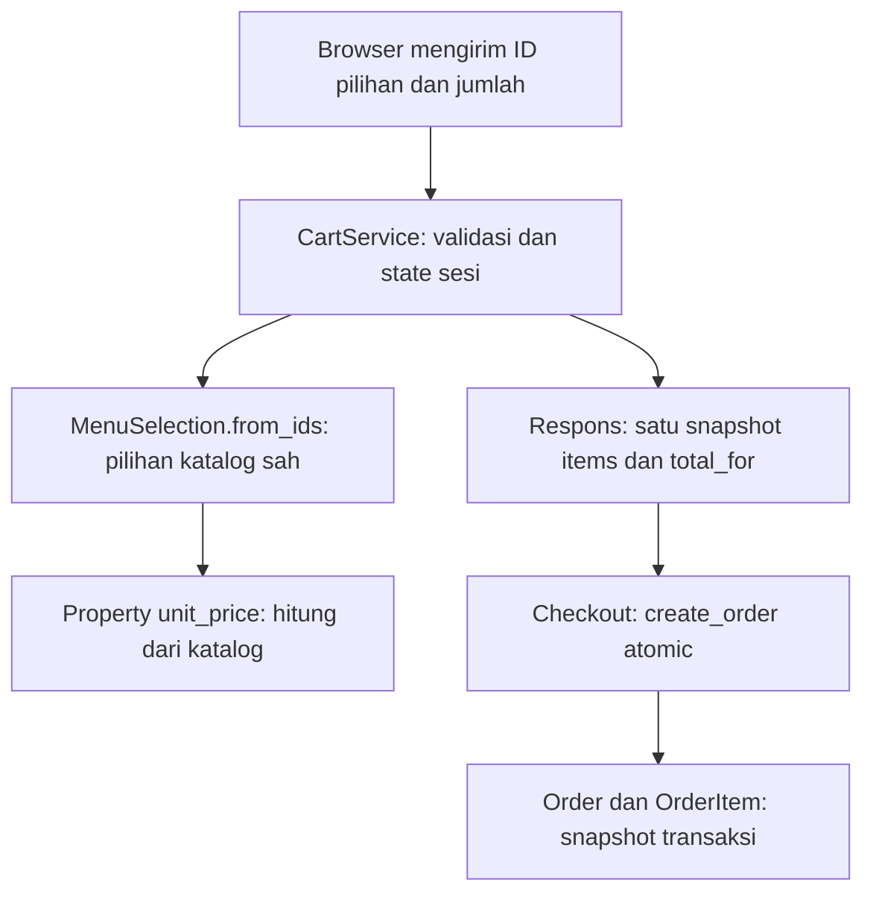

# Panduan Belajar OOP dari Kode RasaKita

Dokumen ini mengikuti source project utama pada branch `ahmad`, diselaraskan
pada **23 Oktober 2026**. Tujuannya membantu anggota tim memahami, menelusuri,
dan mempresentasikan implementasi yang benar-benar ada, bukan menghafal definisi.

Ada **tujuh modul utama, 35 kasus, dan tepat lima berkas utama berbeda pada
setiap modul**. Berkas yang sama dapat dipakai lagi di modul lain untuk membahas
konsep berbeda. Modul 8–9 merupakan pendalaman dan modul 10 berisi latihan.
Angka 35 tidak menghitung latihan sebagai kasus tambahan.

## Urutan membaca

Nama berkas diberi nomor agar mudah ditemukan. Gunakan urutan tabel ini;
beberapa file explorer menyortir teks sehingga nomor 10 bisa tampil setelah 1.
Nama bernomor adalah dokumen Markdown, bukan nama modul Python yang diimpor.

| Urutan dan berkas | Fokus | Peta kasus |
|---|---|---|
| [1. Class dan Object.md](1.%20Class%20dan%20Object.md) | Class, instans, constructor, dan self | MenuItem, BudgetConstraint, CartService, StaffAccess, MenuSelection |
| [2. Atribut dan Method.md](2.%20Atribut%20dan%20Method.md) | Atribut kelas/instans, method, factory, property | CartService, BudgetConstraint, MenuItemAlias, MenuSelection, GeminiClient |
| [3. Enkapsulasi.md](3.%20Enkapsulasi.md) | Invariant, salinan, tuple, dan kepemilikan state | BudgetConstraint, MenuSelection, CartService, StaffAccess, ConversationSession |
| [4. Relasi Kelas dan UML.md](4.%20Relasi%20Kelas%20dan%20UML.md) | Asosiasi, agregasi, dependency, dan inheritance | menu/models, orders/models, MenuSelection, ChatbotService, TextGenerator |
| [5. Inheritance.md](5.%20Inheritance.md) | Superclass, override, super, dan batas framework | GeminiClient, TurnGenerator, MenuItem, MenuPhotoForm, MenuPhotoWidget |
| [6. Polimorfisme dan Abstraksi.md](6.%20Polimorfisme%20dan%20Abstraksi.md) | ABC, dispatch, protokol string, dan kesamaan nilai | TextGenerator, TurnGenerator, model katalog, BudgetConstraint, MenuPhotoWidget |
| [7. Prinsip SOLID.md](7.%20Prinsip%20SOLID.md) | Satu kasus per prinsip dengan batas desain | MenuSelection, TextGenerator, GeminiClient, StaffAccess, RecommendationExplanationService |
| [8. Pendalaman Abstraksi.md](8.%20Pendalaman%20Abstraksi.md) | Kontrak teks dan kontrak percakapan AI-first | Materi pendamping; tidak menambah hitungan 35 kasus |
| [9. Pendalaman Komposisi.md](9.%20Pendalaman%20Komposisi.md) | Perangkaian object dan siklus hidup UML | Materi pendamping; tidak menambah hitungan 35 kasus |
| [10. Latihan dan Presentasi.md](10.%20Latihan%20dan%20Presentasi.md) | Latihan, contoh tanpa API, dan rubrik penjelasan | Latihan lintas modul; bukan implementasi fitur baru |

## Cara membedah satu kasus

1. Mulai dari masalah pelanggan atau operator yang dijelaskan, bukan dari istilah OOP.
2. Buka berkas utama dan cari simbol class/method. Tautan baris membantu pada revisi ini;
   nomor baris dapat berubah ketika source berikutnya diedit.
3. Baca cuplikan bersama konteks berkas. Cuplikan panjang hanya mengambil bagian awal
   dan diberi keterangan; itu bukan implementasi lengkap yang siap disalin sendiri.
4. Tandai input, atribut/state, method yang dipanggil, nilai hasil, dan efek penyimpanan.
5. Hubungkan mekanismenya dengan konsep: misalnya validasi sebelum mutasi menjelaskan
   enkapsulasi lebih baik daripada hanya menunjuk underscore.
6. Uji pemahaman dengan kondisi gagal. Jelaskan apa yang ditolak dan state mana yang tetap.
7. Sebutkan batasnya: yang merupakan konvensi, yang dibantu framework, dan yang perlu
   dibuktikan saat runtime.

Setiap kasus mempunyai masalah, cuplikan source, langkah penelusuran, contoh
input/hasil, pembahasan OOP, batas penerapan, dan latihan khusus. Contoh harga,
nama, dan akun adalah data ilustrasi; bukan klaim isi katalog yang sedang berjalan.

## Peta kode yang dipakai

| Berkas | Tanggung jawab | Konsep utama |
|---|---|---|
| [menu/models.py](../../menu/models.py) | Katalog, tag, alias, opsi, tambahan | Model, instans, override, relasi |
| [menu/selection.py](../../menu/selection.py) | Pilihan tervalidasi dan perhitungan harga | Class biasa, factory, property, tuple |
| [cart/services.py](../../cart/services.py) | Keranjang sesi dan mutasi terkontrol | State instans, defensive copy, staticmethod |
| [orders/models.py](../../orders/models.py) | Data pesanan dan snapshot transaksi | Relasi, field, perilaku model |
| [orders/services.py](../../orders/services.py) | Fungsi transaksi atomic dan audit | Pemisahan tanggung jawab; bukan class OrderService |
| [users/access.py](../../users/access.py) | Keputusan staf/kasir | Object kebijakan dan property |
| [budget.py](../../recommendation/services/budget.py) | Batas uang dan serialisasi | Object nilai, enkapsulasi, `__eq__` |
| [text_generator.py](../../recommendation/services/text_generator.py) | Kontrak pembuat teks | ABC dan abstractmethod |
| [gemini.py](../../recommendation/services/gemini.py) | Adapter SDK, kuota, telemetry | Implementasi kontrak dan helper kebijakan |
| [turn_generator.py](../../recommendation/services/ai/turn_generator.py) | Satu percobaan pada komponen hybrid | Inheritance, delegation, state giliran |
| [explanations.py](../../recommendation/services/ai/explanations.py) | Penjelasan dari fakta yang diperiksa | Injection dependency dan validasi |
| [assistant.py](../../recommendation/services/ai/assistant.py) | Percakapan AI-first serta tool katalog | Kontrak kemampuan di luar generate |
| [chatbot.py](../../recommendation/services/chatbot.py) | Pengarah AI-first/lokal/hybrid | Perangkaian layanan dan batas dependency |
| [conversation_session.py](../../recommendation/services/conversation_session.py) | Konteks percakapan pada sesi eksternal | Kepemilikan state dan reset terarah |
| [menu/forms.py](../../menu/forms.py) | Validasi dan konfigurasi form foto | ModelForm, super, override |
| [menu/widgets.py](../../menu/widgets.py) | Konteks input/preview foto | Inheritance dan dispatch widget |

## Daftar 35 kasus beserta simbol sumber

### Modul 1: Class dan Object

1. [`MenuItem`](../../menu/models.py#L68) — `menu/models.py`.
2. [`BudgetConstraint`](../../recommendation/services/budget.py#L53) — `recommendation/services/budget.py`.
3. [`CartService`](../../cart/services.py#L25) — `cart/services.py`.
4. [`StaffAccess`](../../users/access.py#L18) — `users/access.py`.
5. [`MenuSelection`](../../menu/selection.py#L34) — `menu/selection.py`.

### Modul 2: Atribut dan Method

1. [`CartService`](../../cart/services.py#L20) — `cart/services.py`.
2. [`BudgetConstraint.from_dict`](../../recommendation/services/budget.py#L81) — `recommendation/services/budget.py`.
3. [`MenuItemAlias.normalize_phrase`](../../menu/models.py#L106) — `menu/models.py`.
4. [`MenuSelection.unit_price`](../../menu/selection.py#L101) — `menu/selection.py`.
5. [`GeminiClient.available`](../../recommendation/services/gemini.py#L29) — `recommendation/services/gemini.py`.

### Modul 3: Enkapsulasi

1. [`BudgetConstraint`](../../recommendation/services/budget.py#L17) — `recommendation/services/budget.py`.
2. [`MenuSelection`](../../menu/selection.py#L97) — `menu/selection.py`.
3. [`CartService.add_item`](../../cart/services.py#L36) — `cart/services.py`.
4. [`StaffAccess`](../../users/access.py#L10) — `users/access.py`.
5. [`ConversationSession.reset`](../../recommendation/services/conversation_session.py#L977) — `recommendation/services/conversation_session.py`.

### Modul 4: Relasi Kelas dan UML

1. [`MenuItem`](../../menu/models.py#L68) — `menu/models.py`.
2. [`OrderItem`](../../orders/models.py#L135) — `orders/models.py`.
3. [`MenuSelection.__init__`](../../menu/selection.py#L34) — `menu/selection.py`.
4. [`ChatbotService.__init__`](../../recommendation/services/chatbot.py#L114) — `recommendation/services/chatbot.py`.
5. [`TextGenerator`](../../recommendation/services/text_generator.py#L6) — `recommendation/services/text_generator.py`.

### Modul 5: Inheritance

1. [`GeminiClient.generate`](../../recommendation/services/gemini.py#L61) — `recommendation/services/gemini.py`.
2. [`TurnGenerator`](../../recommendation/services/ai/turn_generator.py#L69) — `recommendation/services/ai/turn_generator.py`.
3. [`MenuItem.save`](../../menu/models.py#L71) — `menu/models.py`.
4. [`MenuPhotoForm.__init__`](../../menu/forms.py#L34) — `menu/forms.py`.
5. [`MenuPhotoWidget.get_context`](../../menu/widgets.py#L12) — `menu/widgets.py`.

### Modul 6: Polimorfisme dan Abstraksi

1. [`TextGenerator`](../../recommendation/services/text_generator.py#L6) — `recommendation/services/text_generator.py`.
2. [`TurnGenerator._generate`](../../recommendation/services/ai/turn_generator.py#L69) — `recommendation/services/ai/turn_generator.py`.
3. [`VariantGroup.__str__`](../../menu/models.py#L142) — `menu/models.py`.
4. [`BudgetConstraint.__eq__`](../../recommendation/services/budget.py#L107) — `recommendation/services/budget.py`.
5. [`MenuPhotoWidget.get_context`](../../menu/widgets.py#L12) — `menu/widgets.py`.

### Modul 7: Prinsip SOLID

1. [`MenuSelection.from_ids`](../../menu/selection.py#L44) — `menu/selection.py`.
2. [`TextGenerator`](../../recommendation/services/text_generator.py#L17) — `recommendation/services/text_generator.py`.
3. [`GeminiClient._generate`](../../recommendation/services/gemini.py#L61) — `recommendation/services/gemini.py`.
4. [`StaffAccess`](../../users/access.py#L18) — `users/access.py`.
5. [`RecommendationExplanationService.__init__`](../../recommendation/services/ai/explanations.py#L74) — `recommendation/services/ai/explanations.py`.

## Hubungan konsep pada satu alur

Class dan object tampak pada layanan, pilihan, serta model. Method menyatakan
pekerjaannya; enkapsulasi menjaga jalur perubahan; dependency menjelaskan siapa
memakai siapa. Inheritance tidak perlu dipaksakan pada seluruh alur. Fungsi
create_order tetap merupakan fungsi biasa yang mengoordinasikan beberapa object.

## Penyelarasan dengan perubahan aplikasi terakhir

- Validasi cart memakai integer 1–99, termasuk hasil penggabungan baris. Boolean
  ditolak. Update jumlah integer <= 0 tetap menghapus baris melalui jalurnya.
- Respons cart memakai items yang sama untuk total_for; checkout baru menunda
  agregasi total sampai akhir dengan audit running total tiap item tetap tersedia.
- Logout staf/kasir memakai POST + CSRF. Kontrol HTTP ini berbeda dari konsep private Python.
- Pemilihan parser foto dibatasi sejak Image.open; widget preview bukan validator keamanan.
- Reset dialog menghapus teks lama tetapi mempertahankan counter, cart, dan login.
  Chatbot bisa meminta sapaan AI baru setelah reset.
- Pembukaan halaman mengirim pesan kosong. Jika Gemini tersedia, sapaan awal
  juga dapat memanggil provider sebelum pengguna mengetik.
- AI-first memakai converse langsung, mempunyai batas putaran tool, serta kuota
  bersama per dispatch. TurnGenerator hanya membatasi komponen hybrid yang memakainya.
- Log provider berisi metadata/token per panggilan. Tidak ada jumlah biaya pasti
  dari estimated_cost=null dan tidak ada total token sesi otomatis di halaman.

## Apa yang telah diverifikasi dan apa yang belum

Penyelarasan materi dilakukan dengan membaca source, mengekstrak cuplikan asli,
memeriksa keberadaan simbol serta tautan, dan menjalankan contoh latihan murni.
Tidak diperlukan perubahan backend atau database untuk merapikan materi ini.
Hasil tes aplikasi pada perubahan sebelumnya dicatat sebagai riwayat di
[SECURITY-TRANSFER.md](../SECURITY-TRANSFER.md), bukan sebagai tes baru pekerjaan dokumentasi.

Urutan tujuh topik mempertahankan susunan materi kuliah pada dokumentasi lama.
PDF acuan tidak tersedia di repository ini, sehingga kesesuaian halaman PDF tidak
diverifikasi ulang dan tidak dijadikan bukti isi source. Jika rubrik dosen berbeda,
bandingkan kembali dengan modul asli; jangan mengarang kelas proyek agar cocok contoh.

Gunakan [latihan dan presentasi](10.%20Latihan%20dan%20Presentasi.md) untuk menguji
pemahaman. Panduan sistem ada pada [Chatbot.md](../Chatbot.md) dan
[panduan pengembangan](../PANDUAN_PENGEMBANGAN.md).
