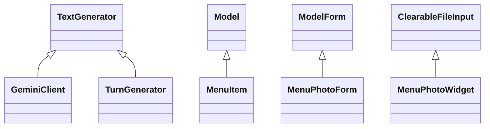

# Modul 5. Inheritance atau pewarisan

[Kembali ke indeks OOP](README.md) · Acuan: **Modul 5 Inheritance-1.pdf**, halaman PDF 2–15.

## Gambaran awal

Gunakan inheritance ketika kalimat “A adalah jenis B” masuk akal. Anak dapat memakai kemampuan induk dan mengganti bagian tertentu melalui override. super() meneruskan pekerjaan ke implementasi berikutnya menurut MRO, yaitu urutan pencarian method Python.

## Istilah yang perlu dipahami

| Istilah | Arti dalam pembelajaran ini |
|---|---|
| Parent dan subclass | Class induk menyediakan dasar; class anak menambah atau mengkhususkan perilaku. |
| Override | Anak mendefinisikan method dengan nama yang sama untuk perilaku khusus. |
| super() | Memanggil implementasi berikutnya sesuai urutan pewarisan; penting agar inisialisasi atau proses induk tetap berjalan. |
| Hierarchical inheritance | Satu induk mempunyai beberapa turunan, seperti TextGenerator. |
| Batas contoh proyek | Tidak semua bentuk pewarisan pada PDF harus dibuat secara manual di aplikasi. Beberapa rantai berasal dari Django. |

## Lima kasus dari file proyek

### Kasus 1. GeminiClient mengkhususkan pembuat teks

**File:** [`recommendation/services/gemini.py`](../../recommendation/services/gemini.py#L16)

**Class/method:** `GeminiClient`.

**Situasi:** Aplikasi memerlukan teks dari Gemini, sementara pemanggil umum cukup mengenal kemampuan generate.

**Urutan membaca kode:**

1. Baca class GeminiClient(TextGenerator).
2. Bandingkan generate pada induk dan anak.
3. Ikuti generate ke _generate.
4. Perhatikan anak juga memiliki kemampuan tambahan converse.

**Hasil dan batasnya:** GeminiClient memenuhi generate dan menambahkan komunikasi Gemini. converse adalah tambahan khusus, bukan method yang otomatis dimiliki semua TextGenerator.

**Hubungan dengan materi:** Ini inheritance dengan override. Dekorator override membantu pengecekan kode, tetapi bukan sakelar aktivasi AI.

### Kasus 2. TurnGenerator juga turunan pembuat teks

**File:** [`recommendation/services/ai/turn_generator.py`](../../recommendation/services/ai/turn_generator.py#L9)

**Class/method:** `TurnGenerator`.

**Situasi:** Komponen hybrid lokal perlu membatasi penggunaan provider pada satu giliran.

**Urutan membaca kode:**

1. Baca class TurnGenerator(TextGenerator).
2. Lihat generate dan generate_ranking.
3. Ikuti keduanya ke _generate.
4. Perhatikan reserve dan tanda _attempted.

**Hasil dan batasnya:** Object menyediakan kontrak TextGenerator sambil menambahkan pembatasan giliran. Aturan ini berlaku pada pemakai TurnGenerator, bukan bukti seluruh jalur AI-first melewatinya.

**Hubungan dengan materi:** GeminiClient dan TurnGenerator membentuk pewarisan bercabang dari induk yang sama. TurnGenerator juga memakai komposisi object bantuan melalui provider.

### Kasus 3. MenuItem mewarisi model Django

**File:** [`menu/models.py`](../../menu/models.py#L48)

**Class/method:** `MenuItem`.

**Situasi:** Menu membutuhkan kemampuan penyimpanan database tanpa menulis sendiri seluruh mesin penyimpanannya.

**Urutan membaca kode:**

1. Lihat class MenuItem(models.Model).
2. Cari override save.
3. Baca pemrosesan image dan detail_image sebelum penyimpanan.
4. Temukan return super().save(*args, **kwargs).

**Hasil dan batasnya:** Penyesuaian foto dijalankan oleh kode proyek, lalu pekerjaan penyimpanan diteruskan ke Django. save tidak berarti full_clean selalu dijalankan otomatis.

**Hubungan dengan materi:** Ini contoh reuse framework disertai override. Kemampuan dasar database berasal dari models.Model, bukan implementasi ORM buatan tim.

### Kasus 4. Form foto meneruskan inisialisasi induk

**File:** [`menu/forms.py`](../../menu/forms.py#L9)

**Class/method:** `MenuPhotoForm`.

**Situasi:** Form perlu memakai field model Django dan menambahkan informasi menu pada widget foto.

**Urutan membaca kode:**

1. Baca class MenuPhotoForm(forms.ModelForm).
2. Perhatikan Meta.model = MenuItem.
3. Ikuti super().__init__(*args, **kwargs).
4. Lihat pengisian atribut data_menu_id setelahnya.

**Hasil dan batasnya:** Field form disiapkan Django terlebih dahulu, lalu proyek memberi penyesuaian. Menimpa __init__ tanpa inisialisasi induk dapat membuat self.fields belum tersedia.

**Hubungan dengan materi:** Anak memperluas perilaku induk. Hubungan MenuPhotoForm dengan MenuItem melalui Meta.model adalah pemakaian model, bukan MenuPhotoForm mewarisi MenuItem.

### Kasus 5. Widget foto memperluas konteks tampilan

**File:** [`menu/widgets.py`](../../menu/widgets.py#L5)

**Class/method:** `MenuPhotoWidget`.

**Situasi:** Input foto memerlukan perilaku input file Django ditambah URL foto untuk ditampilkan.

**Urutan membaca kode:**

1. Baca class MenuPhotoWidget(forms.ClearableFileInput).
2. Cari template_name.
3. Baca get_context dan pemanggilan super().get_context(...).
4. Temukan tambahan context["widget"]["photo_url"].

**Hasil dan batasnya:** Hasil konteks bawaan dipertahankan dan ditambah informasi foto. Hubungan berjenjang menuju widget dasar ada melalui class Django.

**Hubungan dengan materi:** Ini override yang memperluas hasil, bukan mengganti seluruh pekerjaan induk. MRO dapat ditelusuri melalui MenuPhotoWidget.mro().

## Diagram induk dan turunan

Model, ModelForm, dan ClearableFileInput berasal dari Django. Diagram hanya
menampilkan hubungan langsung yang penting untuk lima kasus ini.

## Pertanyaan untuk diskusi

Apa yang hilang jika super().__init__ pada MenuPhotoForm dihapus? Mengapa menyimpan provider tidak membuat TurnGenerator menjadi turunan provider tersebut?

## Cara memakai contoh ini

Tautan menunjuk kode proyek, bukan class latihan yang dibuat seolah-olah sudah ada. Nomor baris membantu pencarian pada versi yang diperiksa dan dapat bergeser setelah perubahan. Untuk kasus yang melibatkan database, sesi, penyimpanan, atau Gemini, telusuri kode terlebih dahulu. Gunakan database latihan terpisah bila ingin menjalankan operasi yang mengubah data.
