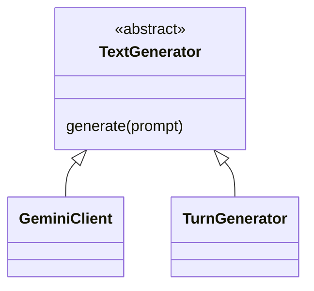

# 4. Inheritance — pewarisan

Tujuan: mengenali hubungan “merupakan jenis dari”, bukan sekadar “memakai”.

## Contoh sederhana

`TextGenerator` memberikan aturan umum pembuat teks. `GeminiClient` merupakan
salah satu pembuat teks yang melaksanakan aturan itu menggunakan provider.
Hubungannya ditulis dalam kode sebagai `class GeminiClient(TextGenerator)`.



[Buka diagram SVG](../diagrams/oop-inheritance.svg).

Panah segitiga mengarah ke class induk. Diagram hanya menunjukkan hubungan
pewarisan, bukan seluruh method atau urutan panggilan.

## Buat turunan untuk belajar

Contoh latihan berikut memakai induk proyek, tetapi **tidak menghubungi Gemini**:

```python
from recommendation.services.text_generator import TextGenerator


class GeneratorLatihan(TextGenerator):
    def generate(self, prompt: str) -> str | None:
        return 'Ini jawaban latihan tanpa layanan luar.'


generator = GeneratorLatihan()
print(isinstance(generator, TextGenerator))
print(generator.generate('Bantu pilih menu'))
```

Hasil pertama `True`. Turunan melaksanakan `generate`, sehingga bisa dibuat
menjadi object. Method turunan yang mengganti pelaksanaan method induk disebut
**override**.

Menuliskan nama induk saja belum cukup untuk melengkapi abstract method.
Jika `GeneratorLatihan` tidak menyediakan `generate`, object-nya belum bisa
dibuat karena aturan induk belum terpenuhi.

## Hubungkan ke kode proyek

- [`TextGenerator`](../../recommendation/services/text_generator.py): induk abstrak.
- [`GeminiClient`](../../recommendation/services/gemini.py): turunan yang menangani provider.
- [`TurnGenerator`](../../recommendation/services/ai/turn_generator.py): turunan
  yang membungkus generator lain dan membatasi upaya dalam satu balasan.
- [`MenuItem`](../../menu/models.py) mewarisi `models.Model` milik Django.
  Ini contoh pewarisan framework, berbeda dengan induk domain buatan tim.

Inheritance tidak berarti kode induk disalin menjadi file baru. Python mencari
atribut/method melalui hubungan class yang ada. Detail seperti izin mengakses
database tetap mengikuti kode dan aturan framework masing-masing.

## Kapan jangan memakai inheritance?

`ChatbotService` **memakai** pembuat teks, tetapi bukan jenis pembuat teks itu
sendiri. Karena itu hubungan tersebut lebih cocok dibahas sebagai composition.
Jangan membuat `ChatbotService` mewarisi `GeminiClient` hanya agar terlihat OOP.

## Cek pemahaman

1. Apa beda class induk dan object yang dibuat dari turunannya?
2. Mengapa `generate` pada turunan diperlukan?
3. Mengapa hubungan chatbot dengan pembuat teks tidak otomatis berarti pewarisan?

Lanjut: [polymorphism](polymorphism.md).
