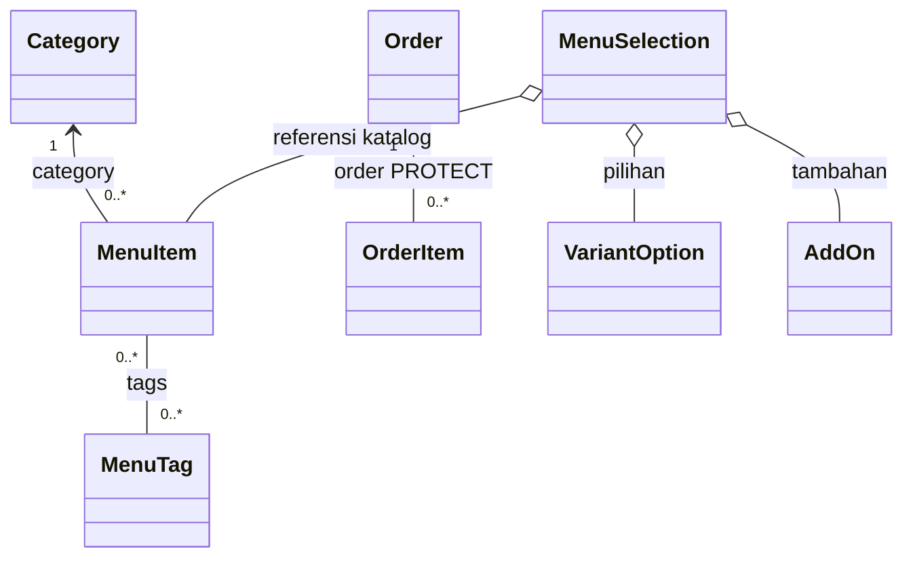

# Modul 4. Relasi antarkelas dan diagram UML

[Kembali ke indeks OOP](README.md) · Acuan: **Modul 4 UML class relationships-1.pdf**, halaman PDF 2–13.

## Gambaran awal

Pertanyaan pertama saat membaca relasi adalah: apakah A merupakan jenis B, menyimpan referensi B, atau sekadar memakai B untuk satu pekerjaan? Setelah itu periksa kepemilikan dan siklus hidupnya. Jangan menentukan komposisi hanya karena ada ForeignKey atau object dibuat di constructor.

## Istilah yang perlu dipahami

| Istilah | Arti dalam pembelajaran ini |
|---|---|
| Asosiasi | Object saling terhubung; contoh menu mengacu kategori. |
| Dependency | Class memakai bantuan class lain; pada UML biasa ditunjukkan panah putus-putus. |
| Agregasi | Hubungan bagian yang tetap dapat hidup mandiri; wajik kosong di sisi penampung. |
| Komposisi | Kepemilikan bagian yang kuat; wajik terisi di sisi pemilik. Periksa perilaku nyata sebelum memberi simbol ini. |
| Inheritance dan multiplisitas | Segitiga kosong menunjuk induk. Angka 1, 0..1, dan * menunjukkan jumlah hubungan. |

## Lima kasus dari file proyek

### Kasus 1. Kategori mempunyai banyak menu

**File:** [`menu/models.py`](../../menu/models.py#L48)

**Class/method:** `MenuItem`.

**Situasi:** Ayam Geprek termasuk kategori Makanan. Kategori yang sama dapat dipakai banyak menu.

**Urutan membaca kode:**

1. Temukan category = models.ForeignKey(Category, ...).
2. Lihat related_name="items".
3. Baca on_delete=models.PROTECT.
4. Bandingkan satu item.category dengan category.items.

**Hasil dan batasnya:** Satu MenuItem mempunyai satu kategori. Satu Category dapat berhubungan dengan nol atau banyak menu. Kategori yang masih dirujuk terlindungi dari penghapusan.

**Hubungan dengan materi:** Ini asosiasi banyak-ke-satu. PROTECT tidak berarti kategori dan menu adalah komposisi dengan penghapusan otomatis.

### Kasus 2. Menu dan tag berhubungan banyak-ke-banyak

**File:** [`menu/models.py`](../../menu/models.py#L48)

**Class/method:** `MenuItem`.

**Situasi:** Satu menu dapat memiliki beberapa tag, dan satu tag dapat digunakan beberapa menu.

**Urutan membaca kode:**

1. Cari tags = models.ManyToManyField(MenuTag, ...).
2. Baca class MenuTag dan atribut name.
3. Temukan related_name="menu_items".
4. Bedakan tag dari class turunan menu.

**Hasil dan batasnya:** Menu dan tag bukan induk/turunan. Hubungan menyatakan pengelompokan data, sementara object tag tetap memiliki identitas sendiri.

**Hubungan dengan materi:** Gunakan asosiasi * ke *. Keberadaan banyak hubungan tidak membuktikan pewarisan atau kepemilikan eksklusif.

### Kasus 3. Pilihan menu menampung object dari luar

**File:** [`menu/selection.py`](../../menu/selection.py#L33)

**Class/method:** `MenuSelection`.

**Situasi:** Pilihan pelanggan terdiri atas sebuah menu dan referensi opsi serta tambahan yang sudah ada di katalog.

**Urutan membaca kode:**

1. Baca parameter item, options, dan addons pada __init__.
2. Perhatikan object diberikan dari luar, bukan semua dibuat oleh MenuSelection.
3. Lihat penyimpanan tuple.
4. Hubungkan dengan from_ids yang mengambil object katalog.

**Hasil dan batasnya:** Object katalog tidak bergantung hidupnya pada satu MenuSelection. Melepas pilihan pelanggan tidak berarti menghapus menu, opsi, atau tambahan dari database.

**Hubungan dengan materi:** Sebagai model pembelajaran, ini dapat digambarkan sebagai agregasi referensi. Wajik kosong menggambarkan pengelompokan, bukan instruksi penghapusan Python.

### Kasus 4. Pesanan dan baris pesanan harus dibaca bersama aturan hapus

**File:** [`orders/models.py`](../../orders/models.py#L135)

**Class/method:** `OrderItem`.

**Situasi:** Satu pesanan mempunyai beberapa baris, tetapi riwayat transaksi tidak boleh dianggap hilang otomatis saat induknya dihapus.

**Urutan membaca kode:**

1. Temukan order = models.ForeignKey(Order, ...).
2. Baca related_name="items".
3. Periksa on_delete=models.PROTECT.
4. Baca item_name dan unit_price sebagai data yang disimpan pada baris pesanan.

**Hasil dan batasnya:** Setiap OrderItem mengacu satu Order. Database dapat memiliki Order tanpa baris saat belum lengkap, sedangkan proses pemesanan mempunyai aturan tersendiri.

**Hubungan dengan materi:** Gambarkan asosiasi Order 1 ke OrderItem *. Walaupun secara domain baris merupakan bagian pesanan, kode PROTECT tidak membuktikan komposisi dengan cascade delete.

### Kasus 5. Pembuat teks adalah hubungan inheritance, bukan isi keranjang

**File:** [`recommendation/services/text_generator.py`](../../recommendation/services/text_generator.py#L6)

**Class/method:** `TextGenerator`.

**Situasi:** GeminiClient dan TurnGenerator sama-sama menyediakan kemampuan membuat teks.

**Urutan membaca kode:**

1. Baca class TextGenerator(ABC).
2. Buka GeminiClient(TextGenerator) di gemini.py.
3. Buka TurnGenerator(TextGenerator) di ai/turn_generator.py.
4. Bandingkan pewarisan itu dengan TurnGenerator yang juga menyimpan self.provider.

**Hasil dan batasnya:** Satu object TurnGenerator sekaligus merupakan TextGenerator, serta mempunyai referensi provider. Dua relasi berbeda dapat hadir pada class yang sama.

**Hubungan dengan materi:** Segitiga inheritance mengarah ke TextGenerator. Relasi provider adalah hubungan penggunaan object, bukan pewarisan kedua.

## Diagram relasi yang dapat ditelusuri

Wajik kosong menggambarkan agregasi referensi pada pilihan. Diagram tidak menyatakan
bahwa menghapus object pilihan akan menghapus data katalog. Multiplisitas pada garis
database menggambarkan struktur relasi; layanan dapat mempunyai syarat tambahan.

## Pertanyaan untuk diskusi

Mengapa ForeignKey dengan PROTECT tidak boleh langsung digambar sebagai komposisi? Apa perbedaan garis inheritance dan garis asosiasi?

## Cara memakai contoh ini

Tautan menunjuk kode proyek, bukan class latihan yang dibuat seolah-olah sudah ada. Nomor baris membantu pencarian pada versi yang diperiksa dan dapat bergeser setelah perubahan. Untuk kasus yang melibatkan database, sesi, penyimpanan, atau Gemini, telusuri kode terlebih dahulu. Gunakan database latihan terpisah bila ingin menjalankan operasi yang mengubah data.
